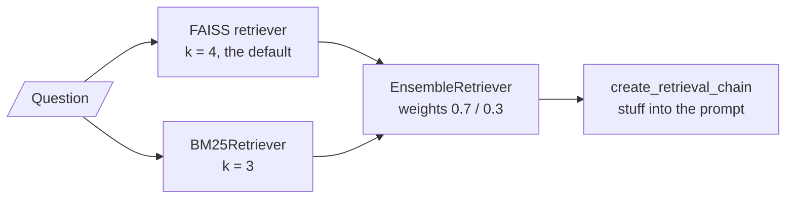
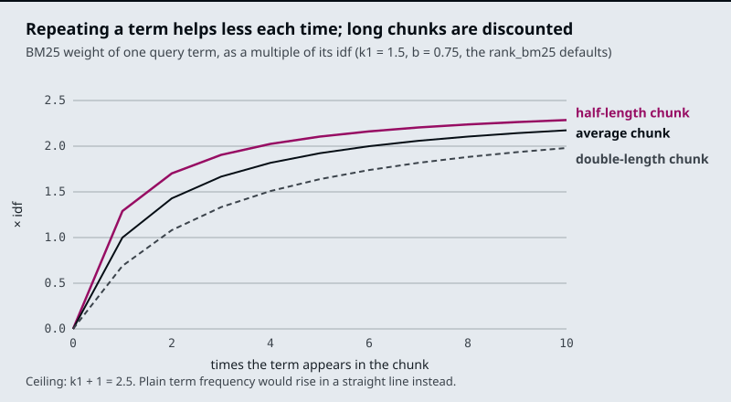

# M17.2 Theory: Dense + sparse hybrid retrieval with BM25 and EnsembleRetriever

*[M17 theory](../README.md) · Lesson 17.2 · Notebooks: [`02a_dense_sparse_hybrid_retrieval.ipynb`](../../../../course/p06_retrieval_quality/m17_retrievers_hybrid_search/notebooks/02a_dense_sparse_hybrid_retrieval.ipynb), [`02b_hybrid_search_rag.ipynb`](../../../../course/p06_retrieval_quality/m17_retrievers_hybrid_search/optional/02b_hybrid_search_rag.ipynb) (optional) · [All theory pages](../../../README.md)*

## Dense vs sparse

A dense retriever turns every chunk and the question into an embedding, a vector in which every position holds a number, and ranks chunks by vector similarity. A sparse retriever describes a chunk by the words in it: one weight per vocabulary word, zero for almost all of them. The two fail on opposite questions.

| | Dense (embeddings) | Sparse (BM25) |
|---|---|---|
| A chunk is | A vector; 1,536 numbers for `text-embedding-3-small` in `02a` | Token counts over the vocabulary, mostly zero |
| Matches | Meaning: paraphrase, synonyms | Exact tokens |
| Misses | Rare exact strings: order IDs, plan names, error codes | Different words for the same thing |
| Larkspur question it gets right | *What happens if my server goes down?* (the evidence says "outage") | One that quotes `ORD-88213` |
| Needs | An embedding model at index and query time | A tokeniser; no model |
| In the notebooks | FAISS (`02a`), Chroma (`02b`) | `BM25Retriever`, `k = 3` (`02a`) or `k = 5` (`02b`) |

An order ID has no learned meaning for an embedding model, so its few characters move the chunk's vector very little. BM25 treats the ID as one more token, and a rare one, which is the case it weights most. The [M11 TF-IDF lab](../../../p04_rag_foundations/m11_rag_lifecycle/02_indexing_from_scratch_with_tf_idf_and_nearest_neighbours/README.md#top-k) showed the sparse failure: *What happens if my server goes down?* shares no word with the outage chunks, so a token matcher ranks the `reboot` and `sizing` chunks first because they contain "server".

`02a` combines the two with `EnsembleRetriever`:



The weights follow the order of the `retrievers` list: `02a` gives 0.7 to dense and 0.3 to BM25, and `02b` lists BM25 first with `[0.5, 0.5]`. The ensemble hands its merged list to `create_retrieval_chain`, which stuffs every returned chunk into the prompt. Lesson 17.3 shows how the merge works.

## BM25

BM25 scores a chunk by summing one term for each query word it contains:

```
score(q, d) = sum over query tokens t of
              idf(t) * tf * (k1 + 1) / (tf + k1 * (1 - b + b * len(d) / avg_len))

tf  = how often t occurs in chunk d          idf(t) = how rare t is across all chunks
k1  = saturation, 1.5 in rank_bm25           b      = length normalisation, 0.75 in rank_bm25
```

It is TF-IDF with two corrections. In plain TF-IDF a word that appears ten times counts ten times as much as one that appears once. In BM25 each extra occurrence adds less, up to a ceiling of `k1 + 1` times the idf. And because a long chunk contains more words by chance, `b` scales the term-frequency part down for chunks longer than average and up for shorter ones.



With the `rank_bm25` defaults, the first occurrence of a word in an average-length chunk is worth 1.00 × its idf, the second brings it to 1.43, and ten reach 2.17. A chunk twice the average length gets 0.69 for one occurrence. `rank_bm25`'s idf is `log((N - n + 0.5) / (n + 0.5))` for a word in `n` of `N` chunks; a word in more than half the chunks would go negative, so it gets a small floor instead.

LangChain's `BM25Retriever` uses `BM25Okapi` from `rank_bm25` and, by default, `text.split()` as its tokeniser: whitespace only, no lower-casing, punctuation kept. Run on the five `02a` sentences (scores computed with `rank_bm25` on that corpus), the question *How can I build an application using LLMs?* matches only two tokens:

| Sentence | Tokens matched | BM25 score |
|---|---|---|
| LangChain helps build LLM applications. | `build` | 1.261 |
| Langchain can be used to develop agentic ai application. | `can` | 0.973 |
| The other three | none | 0 |

`application` does not match `application.`, and `LLMs?` does not match `LLM`. Case splits words too: `LangChain` (one sentence) and `Langchain` (two sentences) are separate tokens with idf 1.10 and 0.34. `BM25Retriever` still returns `k = 3` sentences, so its third result is *Langchain has many types of retrievers.*, which scored 0 and was picked by tie order. On this question the BM25 half contributes one real keyword match, "build", one match on "can", and one filler.

Pass a tokeniser that lower-cases and strips punctuation but keeps hyphenated IDs together:

```python
import re

def tokens(text):
    return re.findall(r"[a-z0-9]+(?:-[a-z0-9]+)*", text.lower())

bm25 = BM25Retriever.from_documents(chunks, preprocess_func=tokens, k=5)
```

On the same corpus this lifts the second sentence to 1.947, because `application` now matches. `ORD-88213?` becomes `ord-88213`, so an ID typed at the end of a question still matches the chunk that contains it. `LLMs` still misses `LLM`; matching word forms needs a stemmer, the same gap that kept the `refund-timing` chunk ("Refunds") away from "refund" in the M11 lab. Tune `k1` and `b` through `bm25_params` only after the tokeniser is right; the tokens decide what can match at all.

---
*Previous: [17.1 The retriever interface and its search modes](../01_the_retriever_interface_and_its_search_modes/README.md). Next: [17.3 Fusion retrieval: score normalisation vs rank fusion](../03_fusion_retrieval_score_normalisation_vs_rank_fusion/README.md).*
