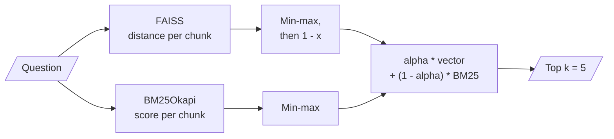
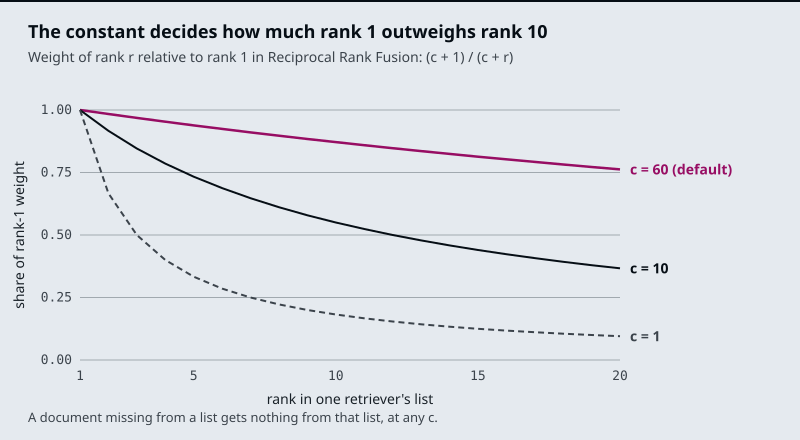

# M17.3 Theory: Fusion retrieval: score normalisation vs rank fusion

*[M17 theory](../README.md) · Lesson 17.3 · Notebooks: [`03a_fusion_retrieval.ipynb`](../../../../course/p06_retrieval_quality/m17_retrievers_hybrid_search/notebooks/03a_fusion_retrieval.ipynb) · [All theory pages](../../../README.md)*

## Weighted score fusion

Two retrievers give two sets of scores on different scales. BM25 scores are unbounded sums of idf weights; FAISS returns L2 distances, where lower is better. `03a` puts them on one scale and adds them:



`03a` splits a climate-change PDF into 1,000-character chunks with 200 of overlap, scores every chunk both ways, min-max normalises each list to the range 0 to 1, flips the distances so that higher means closer, and ranks by `alpha * vector + (1 - alpha) * bm25` with `alpha = 0.5` and `k = 5`. `alpha = 1` is pure dense retrieval and `alpha = 0` is pure BM25.

Min-max is relative to the current query's results. The best chunk always gets 1.0 and the worst 0.0, even when no chunk is relevant, so a question the corpus cannot answer produces confident-looking scores. One outlier squashes everything else: if one chunk contains a rare ID and scores far above the rest in BM25, every other chunk's BM25 contribution shrinks toward 0, and the dense half decides their order. The same `alpha` therefore weighs the two retrievers differently from one question to the next. In return, score fusion keeps information that ranks throw away: how far ahead the top hit is.

Pair scores by chunk, never by position. As written, `03a` takes the document list from `similarity_search("")` (ordered by distance to an empty query), the vector scores from `similarity_search_with_score(query)` (ordered by distance to the question) and the BM25 scores from `get_scores` (in corpus order), then adds them index by index. Those are three different orders, so each combined score mixes different chunks. Key the dense scores by chunk and read them out in the order BM25 used:

```python
def minmax(x):
    return (x - x.min()) / (x.max() - x.min() + 1e-8)

docs = cleaned_texts                                     # the order BM25 scored
bm25_scores = minmax(bm25.get_scores(query.split()))
dist = {d.page_content: s for d, s in vectorstore.similarity_search_with_score(query, k=len(docs))}
vector_scores = 1 - minmax(np.array([dist[d.page_content] for d in docs]))
combined = alpha * vector_scores + (1 - alpha) * bm25_scores
top_k = [docs[i] for i in np.argsort(combined)[::-1][:k]]
```

Keying on `page_content` assumes no two chunks have identical text, which is also what `EnsembleRetriever` assumes unless you give it an `id_key`.

## Reciprocal Rank Fusion

Reciprocal Rank Fusion ignores scores and uses only each chunk's position in each list:

```
rrf(d) = sum over retrievers i of  w_i / (c + rank_i(d))

rank_i(d) = d's position in retriever i's list, starting at 1; a chunk not in the list gets nothing from it
c         = 60 in EnsembleRetriever, the value from Cormack, Clarke and Buettcher (SIGIR 2009), the paper 01a links
w_i       = the weights list; equal weights if you pass none
```

`EnsembleRetriever` runs each retriever, adds up these terms per chunk (chunks are matched by `page_content`, or by `metadata[id_key]`), and returns every unique chunk sorted by the sum. It does not cut the list to a final `k`.

Three consequences follow from the formula, all plain arithmetic:

- **Agreement beats a single strong vote.** With weights of 1, a chunk ranked 3rd by both retrievers scores 2/63 = 0.0317; a chunk ranked 1st by one retriever and missing from the other scores 1/61 = 0.0164.
- **Weights decide whether a BM25-only hit can surface.** `02a` weights dense 0.7 and BM25 0.3. A chunk that BM25 ranks 1st and the dense retriever does not return scores 0.3/61 = 0.0049. Every chunk the dense retriever returns at rank 82 or better scores more than that (rank 82 gives 0.7/142 = 0.00493 against 0.00492). For an exact-ID question that the dense retriever misses, the ID chunk lands below every dense result. With equal weights it ties a chunk that only the dense retriever ranks 1st.
- **`c` sets how steeply rank matters.** The chart below plots each rank's weight as a share of rank 1's.



With `c = 60`, rank 10 keeps 0.87 of rank 1's weight and rank 20 keeps 0.76, so being in both lists matters more than being near the top of one. With `c = 1`, rank 10 keeps 0.18 and the top of each list dominates.

The [interactive lab](interactive/hybrid-fusion-lab.html) runs real BM25 in JavaScript over 19 Larkspur chunks, ranks the same chunks by `all-MiniLM-L6-v2` cosine similarity, and fuses the two lists both ways: weighted min-max scores with an `alpha` slider, and RRF with its constant `c`. With equal weights, `c = 60` and 4 chunks per retriever, RRF answers 5 of 7 golden questions fully (mean recall@3 0.86), against 6 of 7 for weighted fusion at `alpha = 0.5`. The two questions it loses each have evidence at rank 5 in one retriever, below the 4 that retriever hands over. Raise the hand-over to 10 and RRF reaches 0.93 at any `c` from 2 to 100. Rank fusion cannot rescue a chunk that never made either list, so the depth each retriever returns matters more than `c`.

<!-- lab: interactive/hybrid-fusion-lab.html -->

| | Weighted score fusion (`03a`) | Reciprocal Rank Fusion (`EnsembleRetriever`) |
|---|---|---|
| Combines | Normalised scores | Ranks |
| Calibration | Needs `alpha` tuned on the golden set, and the meaning of `alpha` shifts with each query's score spread | None needed; optional weights per retriever |
| Keeps | How far ahead the top hit is | Only the order |
| Chunks one retriever did not return | None in `03a`, which scores every chunk both ways | Get nothing from that retriever |
| Cost | Scores the whole corpus twice per query in `03a` | One top-`k` search per retriever |

RAG-Fusion in [M18](../../m18_query_transformation/README.md) uses the same formula to merge the result lists of several rewritten queries instead of several retrievers.

## Check yourself

<details>
<summary>1. Why can min-max weighted fusion produce confident-looking scores for a question the corpus cannot answer?</summary>

Min-max is relative to the current query's results: the best chunk always gets 1.0 and the worst 0.0, even when no chunk is relevant. One outlier also squashes the rest toward 0, so the same `alpha` weighs the two retrievers differently from one question to the next.

</details>

<details>
<summary>2. With weights of 0.7 dense and 0.3 BM25, as in notebook 02a, where does a chunk that only BM25 ranks first end up after RRF?</summary>

Below every chunk the dense retriever returns at rank 82 or better. It scores 0.3/61 = 0.0049, while dense rank 82 scores 0.7/142 = 0.00493. For an exact-ID question the dense retriever misses, the ID chunk sinks; with equal weights it would tie a chunk that only the dense retriever ranks first.

</details>

<details>
<summary>3. In the lab, RRF with 4 chunks per retriever answers 5 of 7 golden questions fully, and both misses have evidence at rank 5. Do you tune c or something else?</summary>

Raise the hand-over depth, not `c`. With 10 chunks per retriever RRF reaches a mean recall@3 of 0.93 at any `c` from 2 to 100. Rank fusion cannot rescue a chunk that never made either list, so the depth each retriever returns matters more than `c`.

</details>

---
*Previous: [17.2 Dense + sparse hybrid retrieval with BM25 and EnsembleRetriever](../02_dense_sparse_hybrid_retrieval_with_bm25_and_ensembleretriever/README.md). Next: [17.4 Maximal Marginal Relevance for diversity](../04_maximal_marginal_relevance_for_diversity/README.md).*
