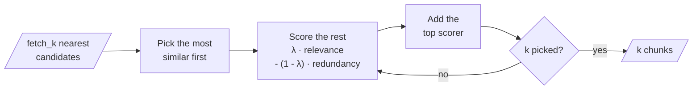

# M17.4 Theory: Maximal Marginal Relevance for diversity

*[M17 theory](../README.md) · Lesson 17.4 · Notebooks: [`04a_maximal_marginal_relevance.ipynb`](../../../../course/p06_retrieval_quality/m17_retrievers_hybrid_search/notebooks/04a_maximal_marginal_relevance.ipynb) · [All theory pages](../../../README.md)*

## MMR λ

Top-k similarity search returns the `k` chunks nearest the question, and the nearest chunks are often near each other too. Overlapping chunks from M13's splitter, or one handbook rule repeated in two documents, fill the top of the list with one fact said three times. The model gets fewer distinct facts for the same tokens.

Maximal Marginal Relevance picks chunks one at a time and charges each candidate for what is already picked:

```
first pick: the candidate most similar to the query
next pick:  the candidate with the highest
            λ * sim(candidate, query) - (1 - λ) * max sim(candidate, each chunk already picked)
repeat until k are picked
```


<!-- animated: diagrams/mmr-loop.anim.html -->

λ is `lambda_mult` in LangChain. `04a` writes the trade-off as 0.0 for maximum diversity and 1.0 for maximum relevance, and leaves it at the default of 0.5. Reading the formula at its ends:

| `lambda_mult` | What MMR does after the first pick |
|---|---|
| 1.0 | The penalty term is 0, so it returns the `k` most similar candidates: plain similarity search |
| 0.5 (default) | Relevance and redundancy count equally |
| 0.0 | Relevance drops out; each pick is the candidate whose most similar picked chunk is least similar to it |

The first pick is the same at every λ, because nothing is picked yet to be redundant with. At λ = 0 the only thing keeping later picks on topic is the candidate pool: MMR chooses among the `fetch_k` nearest chunks, never the whole index. That makes `fetch_k` the second knob. LangChain's default is 20; `01a` uses `k = 3` from `fetch_k = 10`, and `04a` uses `k = 3` with the default pool. A pool much larger than `k` gives MMR room to find other topics, and also room to reach chunks that are barely relevant.

```python
retriever = vectorstore.as_retriever(
    search_type="mmr",
    search_kwargs={"k": 3, "fetch_k": 20, "lambda_mult": 0.5},
)
```

`04a` splits `langchain_rag_dataset.txt` into 300-character chunks with 50 of overlap, embeds them with `all-MiniLM-L6-v2` (384 dimensions) in FAISS, and asks *How does LangChain support agents and memory?*, a question with two parts, agents and memory, that may sit in different chunks. Small overlapping chunks suit MMR: neighbouring chunks share up to 50 characters, so plain top-k can return two windows onto the same passage.

MMR measures similarity, not correctness or freshness. If the index holds this year's and last year's refund policy, MMR treats them as near-copies and keeps whichever it picks first. Filter on `version` or `date` metadata before MMR ([17.5](../05_multi_faceted_filtering/README.md)). Tune λ and `fetch_k` on golden questions that need two or more distinct chunks, and check that single-fact questions do not lose their second-best supporting chunk.

## Check yourself

<details>
<summary>1. What does MMR return at lambda_mult 1.0, and why is its first pick the same at every value of lambda?</summary>

At 1.0 the redundancy penalty is 0, so MMR returns the `k` most similar candidates, plain similarity search. The first pick is always the candidate most similar to the query, because nothing is picked yet for it to be redundant with. At 0.0 only the `fetch_k` pool keeps later picks on topic.

</details>

<details>
<summary>2. Notebook 04a asks how LangChain supports agents and memory over 300-character chunks with 50 of overlap. Why does MMR suit this question and this index?</summary>

The question has two parts that may sit in different chunks, and plain top-k can fill all its slots with one of them. Neighbouring chunks share up to 50 characters, so top-k can also return two windows onto the same passage. MMR charges each candidate for what is already picked, which leaves room for the second part.

</details>

<details>
<summary>3. The Larkspur index holds this year's and last year's refund policy, and MMR keeps last year's. Why, and what should run first?</summary>

MMR measures similarity, not correctness or freshness. It treats the two policies as near-copies and keeps whichever it picks first. Filter on `version` or `date` metadata before MMR runs (17.5).

</details>

---
*Previous: [17.3 Fusion retrieval: score normalisation vs rank fusion](../03_fusion_retrieval_score_normalisation_vs_rank_fusion/README.md). Next: [17.5 Multi-faceted filtering](../05_multi_faceted_filtering/README.md).*
