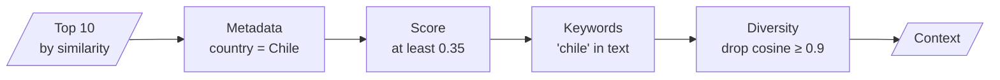

# M17.5 Theory: Multi-faceted filtering

*[M17 theory](../README.md) · Lesson 17.5 · Notebooks: [`05a_multi_faceted_filtering.ipynb`](../../../../course/p06_retrieval_quality/m17_retrievers_hybrid_search/notebooks/05a_multi_faceted_filtering.ipynb) · [All theory pages](../../../README.md)*

## Four filters in sequence

Ranking decides the order of chunks; filtering decides which chunks are allowed at all. `05a` turns each row of `customers-100.csv` into a `Document` whose metadata holds country, company, city, subscription date and website, embeds them with `all-MiniLM-L6-v2` in Chroma, retrieves the top 10 for *Which customers work for companies in Chile?* with `similarity_search_with_relevance_scores`, and then passes them through four filters:

| Filter | `05a` setting | What it removes | Cost |
|---|---|---|---|
| Metadata | `{"country": "Chile"}`, exact match on every key | Chunks whose fields contradict the question | A dictionary lookup |
| Similarity threshold | relevance ≥ 0.35 | Chunks that rank in the top 10 only because something has to | A comparison |
| Content | `["chile"]`, lower-cased substring, all keywords required | Chunks without a term the evidence must contain | A string search |
| Diversity | cosine ≥ 0.9 with a chunk already kept | Near-duplicates, kept greedily in rank order | One embedding call per chunk |

`multi_faceted_filter` applies them in that order, and the order is a cost decision: exact checks first, then the one filter that calls the embedding model, on whatever survives. Each filter is optional, so the same function serves a question with a known country and one without.

The four filters only remove. They run on the 10 chunks the similarity search returned, so if a Chilean customer ranked 11th, no filter brings it back, and a strict combination can leave nothing. When a filter is known before the search, push it into the store: Chroma's `similarity_search(query, k=10, filter={"country": "Chile"})` ranks only the matching chunks, and every one of the 10 slots goes to a chunk that matches the filter. Keep post-filters for conditions the store cannot express, such as the diversity check.

The settings are specific to this setup. A relevance threshold of 0.35 belongs to `all-MiniLM-L6-v2` on this corpus. The substring test for `chile` would also accept a longer word that contains it. The diversity filter is a hard cut at one similarity, where MMR ([17.4](../04_maximal_marginal_relevance_for_diversity/README.md)) trades redundancy against relevance with λ.

For the Larkspur handbook, the useful facets come from metadata written at ingestion: the handbook section, which M13's header splitter writes, and the `version` and `date` fields of the [M12 metadata schema](../../../p05_ingestion_and_indexing/m12_document_ingestion/01_the_document_abstraction_and_metadata_design/README.md#metadata-schema). A question about refunds on annual plans can filter to the Refunds section and the current version before ranking, which removes last year's policy without asking MMR or the reranker to notice it.

## Check yourself

1. Why does the multi-faceted filter run the metadata, score and keyword checks before the diversity check?

Order is a cost decision. The first three are a dictionary lookup, a comparison and a string search; the diversity check needs one embedding call per chunk. Running the cheap exact checks first means the embedding model sees only the chunks that survive them.

2. A Chilean customer ranks 11th by similarity for the Chile question. Will the post-filters find it, and what should you do instead?

No. The four filters only remove from the 10 chunks the search returned, so a chunk ranked 11th never comes back. When the filter is known before the search, push it into the store with `similarity_search(query, k=10, filter={"country": "Chile"})`, so all 10 slots go to matching chunks. Keep post-filters for what the store cannot express, such as diversity.

3. You copy the 0.35 relevance threshold and the substring test for chile into a different project. What should you check first?

That they still mean anything there. The 0.35 threshold belongs to `all-MiniLM-L6-v2` on this corpus, and a lower-cased substring test for `chile` also accepts a longer word that contains it. Re-measure the threshold for your embedding model and corpus, and check the keyword test against the words your documents use.

---
*Previous: [17.4 Maximal Marginal Relevance for diversity](../04_maximal_marginal_relevance_for_diversity/README.md). Next: [17.6 Retriever patterns compared; hybrid + rerank on Databricks Vector Search](../06_retriever_patterns_compared_hybrid_rerank_on_databricks_vector_search/README.md).*
