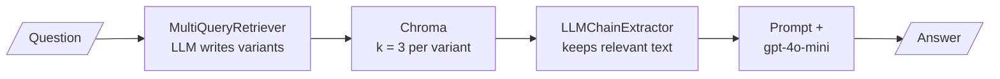

# M17.6 Theory: Retriever patterns compared; hybrid + rerank on Databricks Vector Search

*[M17 theory](../README.md) · Lesson 17.6 · Notebooks: [`06a_advanced_retriever_patterns.ipynb`](../../../../course/p06_retrieval_quality/m17_retrievers_hybrid_search/notebooks/06a_advanced_retriever_patterns.ipynb), [`06b_hybrid_search_and_reranking_databricks.ipynb`](../../../../course/p06_retrieval_quality/m17_retrievers_hybrid_search/optional/06b_hybrid_search_and_reranking_databricks.ipynb) (optional) · [All theory pages](../../../README.md)*

## Choosing a retriever pattern

`06a` runs four retriever patterns over the same eight topic-tagged documents in Chroma with `text-embedding-3-small`. Each fixes a different failure and costs something different:

| Pattern | Fixes | Extra cost per question | How `06a` sets it up |
|---|---|---|---|
| `MultiQueryRetriever` | Wording that misses the documents | 1 LLM call, then one search per generated variant | Base retriever `k = 2`, `gpt-4o-mini` at temperature 0.3 |
| `ContextualCompressionRetriever` + `LLMChainExtractor` | Chunks full of text the question does not need | 1 LLM call per retrieved chunk | Base retriever `k = 4` |
| `EnsembleRetriever` (BM25 + dense) | Exact terms the dense retriever misses | One more search; no LLM call | `k = 3` each, weights 0.4 BM25 and 0.6 dense |
| `ParentDocumentRetriever` | Small chunks that match well but lack context | A docstore lookup | Children of 200 characters (20 overlap) inside parents of 800 (100 overlap), `InMemoryStore` |

The ensemble demo uses three questions chosen to separate the halves: *ACID transactions* (keyword-heavy, BM25 should help), *How do I store AI model outputs for later retrieval?* (worded unlike any document, dense should help), and *fast similarity lookup for embeddings* (mixed). It prints the top result from BM25, dense and the ensemble for each question, side by side. Build your own comparison the same way, with golden questions of each kind.

Because every pattern is a retriever, they nest. `06a`'s last demo wraps multi-query inside compression and feeds the result to a prompt:

Multi-query widens the pool for recall and compression narrows each chunk for precision, so the two pull in opposite directions on purpose. The LLM calls add up: one for the variants, one per chunk in the union for extraction, one for the answer.

`06b` moves hybrid search and reranking into the vector store. On a Databricks Vector Search index it embeds the question with `BAAI/bge-large-en-v1.5` (1,024 dimensions, normalised) and makes one call per mode, with `num_results=5`:

| Mode | Arguments added to `index.similarity_search` |
|---|---|
| Vector only | `query_vector` |
| Hybrid | `query_text=query`, `query_type="hybrid"` |
| Hybrid + rerank | and `reranker=DatabricksReranker(columns_to_rerank=["text"])` |

Hybrid in the store and `EnsembleRetriever` in the application do the same job in different places. The store keeps the keyword side next to the vectors and fuses on the server in one round trip. `BM25Retriever` holds its index in application memory and is built from the full document list with `from_documents`, so a changed corpus means rebuilding it. The ensemble is easier to inspect and tune; the store version is easier to run at scale.

`06b` describes the reranker as about 15% better in quality for 1 to 1.5 seconds of extra latency. The notebook states these figures without measuring them; measure your own on the golden set before you pay that latency. [M19](../../m19_reranking_post_retrieval/README.md) covers rerankers and the retrieve-wide, rerank-narrow design.

---
*Previous: [17.5 Multi-faceted filtering](../05_multi_faceted_filtering/README.md). Next: [M17 interview questions](../README.md#interview-spotlight-5-questions-you-might-get-asked).*
