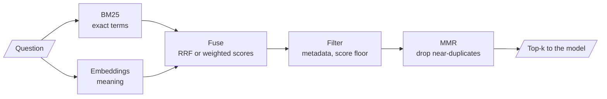

# M17 Theory: Retrievers and hybrid search

*Part VI · Retrieval Quality Engineering · [Module README](../../../course/p06_retrieval_quality/m17_retrievers_hybrid_search/README.md) · [All theory pages](../../README.md)*

An embedding retriever finds chunks that mean what the question means, and misses chunks that only share a rare exact token: an order ID, a plan name, an error code. A keyword retriever has the opposite failure. M17 runs both and merges their rankings. The M17 notebooks build on four ideas: dense and sparse retrieval, the BM25 ranking function, Reciprocal Rank Fusion, and the λ that trades relevance against diversity in Maximal Marginal Relevance. Each idea has a page in the folder of the lesson that teaches it, listed under [Lessons](#lessons). This page has the overview, the interview questions and the takeaways.

The running example is the Larkspur Cloud handbook from M11 to M13, now searched with two kinds of question. Some are worded unlike the handbook, such as *What happens if my server goes down?*, whose evidence talks about "outage" and "availability"; the dense retriever is built for these. Others hang on an exact string, such as an order ID like `ORD-88213`, which the M11 symptom table already sends to this module; BM25 is built for these. The lab's golden set mixes both kinds: paraphrase questions, and questions that name an error code such as `E-4021`.

## TL;DR

- **Dense** retrieval compares embedding vectors and matches paraphrase; **sparse** retrieval (BM25) scores shared tokens and matches exact terms. Each misses what the other finds, so production retrieval usually runs both.
- **BM25** is TF-IDF with two corrections: repeated terms saturate (`k1`, 1.5 by default in `rank_bm25`) and long chunks are discounted (`b`, 0.75). LangChain's `BM25Retriever` splits on whitespace only, so `application.` and `application` are different tokens.
- Fusing two rankings by **weighted min-max scores** (`03a`, `alpha = 0.5`) depends on each retriever's score scale. **Reciprocal Rank Fusion** uses ranks only: `EnsembleRetriever` adds `weight / (60 + rank)` per list. With equal weights of 1, a chunk ranked 3rd by both retrievers (2/63 = 0.0317) beats one ranked 1st by only one (1/61 = 0.0164).
- **MMR** picks the most similar chunk first, then trades relevance against redundancy with `lambda_mult` (0.5 by default) over `fetch_k` candidates (20 by default).
- Filters on metadata, score, keywords and diversity shrink the context after retrieval. Score thresholds belong to one embedding model; re-tune them when the model changes.

## Mental model

<!-- animated: diagrams/hybrid-pipeline.anim.html -->

Two retrievers rank the same chunks by different evidence, and fusion turns two ranked lists into one. Fusion only reorders what the two retrievers returned: a chunk that neither puts in its top `k` is gone before the merge, so give each retriever a wider `k` than the final one.

## Lessons

| Lesson | Topic | Theory |
|---|---|---|
| 17.1 | The retriever interface and its search modes | [Search modes](01_the_retriever_interface_and_its_search_modes/README.md#search-modes) |
| 17.2 | Dense + sparse hybrid retrieval with BM25 and EnsembleRetriever | [Dense vs sparse](02_dense_sparse_hybrid_retrieval_with_bm25_and_ensembleretriever/README.md#dense-vs-sparse) [BM25](02_dense_sparse_hybrid_retrieval_with_bm25_and_ensembleretriever/README.md#bm25) |
| 17.3 | Fusion retrieval: score normalisation vs rank fusion | [Weighted score fusion](03_fusion_retrieval_score_normalisation_vs_rank_fusion/README.md#weighted-score-fusion) [Reciprocal Rank Fusion](03_fusion_retrieval_score_normalisation_vs_rank_fusion/README.md#reciprocal-rank-fusion) |
| 17.4 | Maximal Marginal Relevance for diversity | [MMR λ](04_maximal_marginal_relevance_for_diversity/README.md#mmr-λ) |
| 17.5 | Multi-faceted filtering | [Four filters in sequence](05_multi_faceted_filtering/README.md#four-filters-in-sequence) |
| 17.6 | Retriever patterns compared; hybrid + rerank on Databricks Vector Search | [Choosing a retriever pattern](06_retriever_patterns_compared_hybrid_rerank_on_databricks_vector_search/README.md#choosing-a-retriever-pattern) |

## Interactive lab

[**Hybrid fusion lab**](03_fusion_retrieval_score_normalisation_vs_rank_fusion/interactive/hybrid-fusion-lab.html): open the file in a browser. It ranks 19 handbook chunks with real BM25 and with `all-MiniLM-L6-v2` cosine similarity, then fuses them. On seven golden questions, mean recall@3 is 0.57 for BM25 alone, 0.64 for dense alone and 0.93 fused at `alpha = 0.5`.

- Pick *E-4102 for the third time. Can I take my files with me another way?* and slide `alpha` from 0 to 1. BM25 alone and dense alone each miss one of the two evidence chunks; the blend in between sends both.
- On *What does E-4021 mean?*, push `alpha` toward 1. Dense retrieval ranks the code chunk 5th, behind look-alike codes, so the exact code drops out of the top 3.
- Switch to RRF with *E-5013 for the third time. Will my machines get shut off?*. With 4 chunks per retriever the suspension chunk is never handed over; with 10 it returns. Changing `c` barely moves recall here.

## How it connects

- **Before:** [M11](../../p04_rag_foundations/m11_rag_lifecycle/README.md) gives the baseline and the symptom table that sends exact-code misses here; its TF-IDF lab is the sparse half in miniature. [M13](../../p05_ingestion_and_indexing/m13_chunking/README.md) sets chunk length, which BM25's `b` parameter normalises. [M14](../../p05_ingestion_and_indexing/m14_embeddings/README.md) and [M15](../../p05_ingestion_and_indexing/m15_vector_stores/README.md) supply the embeddings and the vector store behind the dense half.
- **Next:** [M18](../m18_query_transformation/README.md) rewrites the question before these retrievers see it, and RAG-Fusion applies this module's RRF to several query variants. [M19](../m19_reranking_post_retrieval/README.md) reranks the fused list with a cross-encoder.

## Interview Spotlight: 5 Questions You Might Get Asked

*Production questions in the style of OpenAI, Anthropic and Google interviews for applied AI roles.*

### 1. Larkspur moved support search from keyword search to embeddings. Agents now report that pasting an order ID such as `ORD-88213` returns general refund-policy chunks instead of the one note that mentions that order. What happened, and what do you change?

**What a strong answer covers:**
- Rare identifiers carry little meaning for an embedding model, so the ID's chunk is not near the query vector; confirms it by printing the dense ranking and the chunk's rank
- Adds BM25 next to the dense retriever and fuses with RRF or weighted scores, keeping the dense half for paraphrased questions
- Checks the tokeniser: whitespace splitting keeps `ORD-88213` whole, but `ORD-88213?` or a lower-cased copy would not match without a normalising `preprocess_func`
- Adds exact-ID questions to the golden set so a later change cannot drop them silently

### 2. Your team must choose between weighted min-max fusion with an `alpha` and Reciprocal Rank Fusion for the handbook search. Which do you ship, and how do you tune it?

**What a strong answer covers:**
- Min-max is relative to each query's result list: the top chunk always scores 1.0, even when nothing matches, and one outlier compresses the rest
- RRF ignores score scales, needs no per-retriever calibration, and rewards chunks both retrievers agree on; its constant (60 in `EnsembleRetriever`) and the list weights are the knobs
- Tunes `alpha` or the RRF weights on the golden set, split by question type (exact-ID, paraphrase, mixed), not on the mean alone
- Joins scores by chunk id, never by list position, and widens each retriever's `k` beyond the final `k`

### 3. Hybrid search is live. How do you know, week to week, that both halves are still pulling their weight?

**What a strong answer covers:**
- Logs both rankings and the fused one for each query, with chunk ids
- Tracks how often the final top-k comes only from BM25, only from dense, or from both; a half that never contributes is either broken or unneeded
- Re-runs the golden set on every index, embedding-model or tokeniser change and compares recall per question type with the baseline
- Alerts on the share of queries where BM25 returns nothing, which flags tokenisation drift such as new ID formats

### 4. The handbook index holds the current refund policy and last year's version. With MMR turned on, answers start quoting the old policy. Why, and what is the fix?

**What a strong answer covers:**
- MMR knows similarity, not dates. The two versions score almost the same against the question, so the old one can be the first pick, and MMR then penalises the current one as redundant
- Diversity is the wrong tool for versioning; filter on `version` or `date` metadata before MMR, or remove superseded chunks at index time
- Prints the `fetch_k` candidates and the picks at the current `lambda_mult` to confirm which version wins the first pick
- Adds a golden question whose correct answer depends on the current version

### 5. A teammate copied `score_threshold=0.3` from a tutorial into the handbook retriever, then switched embedding models. Now out-of-scope questions return five chunks, and some in-scope ones return none. What is going on?

**What a strong answer covers:**
- Similarity scores are not comparable across embedding models or distance functions; a threshold is a property of one model on one corpus
- Checks whether the store returns a distance (lower is better, `similarity_search_with_score`) or a relevance score (higher is better, `similarity_search_with_relevance_scores`), and how the store converts one into the other
- Re-tunes the threshold from the score distributions of in-scope and out-of-scope golden questions
- Treats an empty result as a valid outcome with a fallback answer, rather than lowering the threshold until something comes back

## Key Takeaways

- Run sparse and dense retrieval together when questions mix exact strings with free wording. Check the BM25 tokeniser before you trust its misses.
- Prefer RRF when the two retrievers' scores live on different scales; it needs no calibration and rewards agreement. Use weighted scores only if you join them by id and tune the weight on the golden set.
- Fusion and MMR reorder a candidate pool and cannot add to it. Retrieve wider than you return.
- Set λ, score thresholds and fusion weights by measuring them on your golden set, and measure again when the embedding model changes.

---
*Previous: [M16 Advanced indexing strategies](../../p05_ingestion_and_indexing/m16_advanced_indexing/README.md). Next: [M18 Query transformation and routing](../m18_query_transformation/README.md).*
