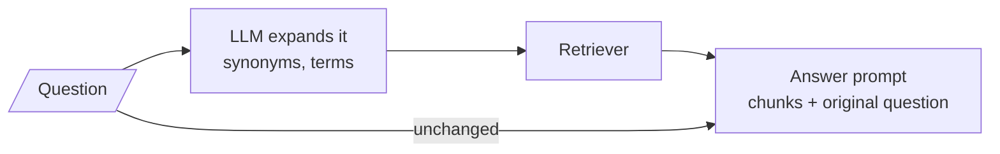
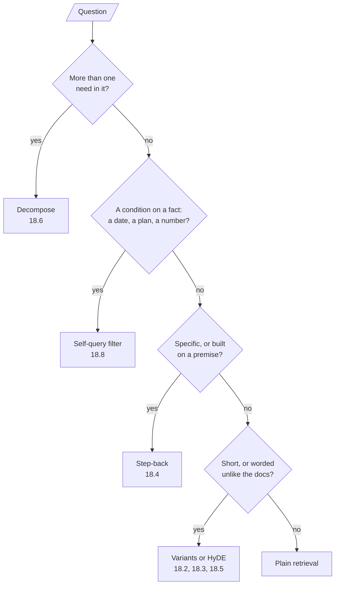

# M18.1 Theory: Query rewriting and expansion

*[M18 theory](../README.md) · Lesson 18.1 · Notebooks: [`01a_query_expansion.ipynb`](../../../../course/p06_retrieval_quality/m18_query_transformation/notebooks/01a_query_expansion.ipynb), [`01b_query_transformations_rag_techniques.ipynb`](../../../../course/p06_retrieval_quality/m18_query_transformation/optional/01b_query_transformations_rag_techniques.ipynb) (optional) · [All theory pages](../../../README.md)*

## Query–document asymmetry

A retriever compares the question with each chunk and returns the closest. That works when the two look alike, and a question rarely looks like its answer. They differ in two ways.

**Vocabulary.** The user's words are not the handbook's words. In the M11 index, *What happens if my server goes down?* scores 0.000 against both chunks that answer it, because they say "outage", "availability" and "incident" and never "down". Its top three are `reboot` (0.416), `sizing` (0.389) and `export` (0.217), all matched on "server". Embeddings (M14) close part of this gap, since they place paraphrases near each other.

**Shape.** A question is short and interrogative; a chunk is long, declarative and dense with terms. The 05a notebook's example is a nine-word question, *What is LangSmith, and why do we need it?*, against a 400-token passage that answers it. Even with a good embedding model, the question's vector sits closer to other questions than to the passage. The notebook calls this the query-document asymmetry.

| Query (what the user typed) | Chunk that answers it |
|---|---|
| What happens if my server goes down? | Larkspur guarantees 99.95% monthly availability. If an outage pushes availability below that, you receive service credits on the next invoice. |
| How long does a refund take? | Refunds go back to the original payment method and take 5 to 10 business days to appear on your statement. |

The second pair shows the vocabulary gap at its smallest. TF-IDF does not stem, so "refund" in the question never meets "Refunds" in the chunk, and the timing chunk scores 0.000 too.

### Rewriting and expansion

Lesson 18.1's notebook closes the vocabulary gap with one LLM call. A prompt asks the model to *"expand the following query to improve document retrieval by adding relevant synonyms, technical terms, and useful context"*, and the expanded text goes to the retriever. The original question still goes to the answer prompt, so the model answers what the user asked, not the expansion.

The optional notebook (01b) shows the neighbouring moves on one example: rewriting a query to be more specific, a step-back query that is broader, and decomposition into two to four sub-queries. The 01a notebook lists the costs: one LLM call before every retrieval, and a dilution risk, because too many added terms pull the query toward everything.

### Which transformation closes which gap

| Technique | Lesson | What it changes | Gap it closes | LLM calls, retrievals |
|---|---|---|---|---|
| Plain RAG | M11 | nothing | none | 1, 1 |
| Rewrite or expand | 18.1 | one query, more terms | vocabulary | 2, 1 |
| Multi-query | 18.2 | 3 phrasings, flat union | vocabulary | 2, 3 |
| RAG-Fusion | 18.3 | 5 phrasings, ranks fused | vocabulary, plus ranking | 2, 5 |
| Step-back | 18.4 | a broader question, searched with the original | a narrow or false premise | 2, 2 |
| HyDE | 18.5 | a hypothetical answer is the search key | shape | 2, 1 |
| Decomposition | 18.6 | 3 independent sub-questions | several needs in one question | 5, 3 |
| Self-query | 18.8 | a semantic query plus a metadata filter | facts an embedding cannot compare | 2, 1 |

The counts are per question, answer call included, from each notebook's own code. HyDE's retrieval also embeds the hypothetical answer instead of the question, at the same cost.

When a question arrives, a short chain of checks picks the transformation:

Plain retrieval is a valid exit. The M11 lab's export question already retrieves both its evidence chunks at `k = 2`, and every transformation on it adds cost with nothing to gain. A router (lesson 18.7) can make this choice per question instead of applying one technique to all traffic.

## Check yourself

1. Why does "What happens if my server goes down?" score 0.000 against both Larkspur chunks that answer it?

The vocabulary differs. The answering chunks say "outage", "availability" and "incident" and never "down", so a term matcher finds no overlap; the top three, `reboot`, `sizing` and `export`, match only on "server". Embeddings (M14) close part of this gap, and query expansion adds the handbook's words to the query.

2. In the expansion chain, which text goes to the retriever and which goes to the answer prompt, and why?

The expanded text goes to the retriever; the original question goes to the answer prompt. The expansion exists only to find the chunks, and the model should answer what the user asked, not the expansion. The cost is one LLM call before every retrieval and a risk of dilution if too many terms are added.

3. Should you apply a query transformation to "Can I export my data after I cancel my plan?" on the Larkspur index?

No. The M11 lab already retrieves both its evidence chunks at `k = 2`, so every transformation adds cost with nothing to gain. Plain retrieval is a valid exit, and a router (lesson 18.7) can make that choice per question.

---
*Previous: [M18 overview](../README.md). Next: [18.3 RAG-Fusion with Reciprocal Rank Fusion](../03_rag_fusion_with_reciprocal_rank_fusion/README.md).*
