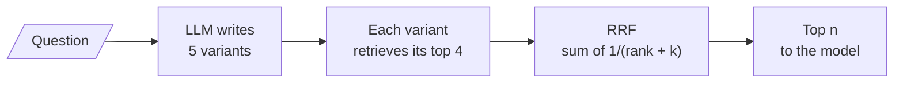

# M18.3 Theory: RAG-Fusion with Reciprocal Rank Fusion

*[M18 theory](../README.md) · Lesson 18.3 · Notebooks: [`03a_rag_fusion.ipynb`](../../../../course/p06_retrieval_quality/m18_query_transformation/notebooks/03a_rag_fusion.ipynb) · [All theory pages](../../../README.md)*

## RRF

Multi-query (lesson 18.2) asks an LLM for three phrasings of the question, retrieves for each, and merges the lists into a flat union. The union keeps every chunk once, in the order it was first seen, and throws away two signals: where each list ranked the chunk, and how many lists found it. A chunk that every variant ranked first looks the same as one that scraped in at fourth place in one list.

RAG-Fusion keeps both signals. It asks for five phrasings, because fusion needs several rankings before agreement means anything, and fuses the rankings with Reciprocal Rank Fusion. The 03a notebook scores each chunk as

`score(d) = sum over the variants that retrieved d of 1 / (rank + k)`

with `rank` counted from 0, as Python's `enumerate` does, and `k = 60`. First place in one list adds 1/60 ≈ 0.0167 and fourth place adds 1/63 ≈ 0.0159, so being found by more variants matters more than placing first in any one of them. RRF uses ranks, never similarity scores, because scores from different queries are not on the same scale. [M17's fusion page](../../m17_retrievers_hybrid_search/03_fusion_retrieval_score_normalisation_vs_rank_fusion/README.md#reciprocal-rank-fusion) covers the formula in depth, including the more common convention that counts ranks from 1; there the lists come from BM25 and dense retrieval, here from five phrasings of one question.

<!-- animated: diagrams/rrf-fusion.anim.html -->

### The outage question, fused

The [interactive lab](interactive/query-variant-fusion-lab.html) runs this on the M11 index: the same twelve Larkspur chunks, the same TF-IDF, and five hand-written variants per golden question in the style of the 03a prompt. Each variant retrieves its top 4, LangChain's default `k`, minus chunks it shares no term with. For *What happens if my server goes down?* at `k = 60`:

| # | Chunk | RRF score | Ranks in variants 1 to 5 | Golden set |
|---|---|---|---|---|
| 1 | `reboot` | 0.0656 | 1, 2, 1, 0, none | |
| 2 | `sla` | 0.0500 | 0, 0, 0, none, none | evidence |
| 3 | `incidents` | 0.0331 | none, 1, none, none, 0 | evidence |
| 4 | `sizing` | 0.0325 | 2, none, none, 1, none | |
| 5 | `export` | 0.0320 | 3, none, none, 2, none | |

The question as asked reaches neither evidence chunk. The variants reach both, because they use the handbook's words: "outage", "availability", "incident", "root-cause report". At three chunks sent, recall is 1.00 against 0.00.

`reboot` still comes first. Four of the five variants match it, on "server" or on "does" (the chunk says "does not change"), and one variant drifted to *How do I restart a server that has stopped responding?*. RRF counts agreement, and agreement on a distractor counts too. Cut at two chunks and `incidents` is gone.

<!-- lab: interactive/query-variant-fusion-lab.html -->

### What `k` controls

A small `k` makes rank position dominate: at `k = 1` first place is worth 1 and fourth place 0.25. A large `k` flattens the curve until only the number of votes counts. The 03a notebook runs `k` at 1, 5, 60 and 1000 and notes that the ordering only changes when rank and agreement disagree. In the refund question they do. `refund-window` is ranked 1 and 0 by two variants; `retention` is ranked 3, 3 and 2 by three. At `k = 60` `retention` wins, 0.0479 to 0.0331. At `k = 1` `refund-window` wins, 1.50 to 0.83.

Mean recall over the three golden questions, from the lab:

| Chunks sent | Question as asked (M11) | Flat union | RRF `k = 1` | RRF `k = 5`, `60` or `1000` |
|---|---|---|---|---|
| 2 | 0.50 | 0.83 | 0.83 | 0.67 |
| 3 | 0.50 | 0.83 | 1.00 | 1.00 |

Every merge beats the question as asked. Fusion and the union retrieve the same chunks and differ only in order, and the order decides what survives the cut. At three chunks every RRF setting beats the union, which leaves `incidents` at rank 5 because variant 1’s four chunks come first. At two chunks the conventional `k = 60` loses to both the union and `k = 1`. Tune `k` and the cut on your own golden set; 60 is a convention.

### Details that bite

- **Merge Documents, not ids.** The 02a notebook's original `get_unique_union()` returned `doc.id` values instead of documents, so the prompt's context held bare identifiers and the model answered from memory, fluently. Its output showed one "document". Key the merge by `page_content`, return the `Document` objects, and assert that the context holds real text.
- **Parse variants with a schema.** Splitting the LLM's reply on newlines turns headers, numbering and blank lines into queries. In RAG-Fusion each junk query produces a ranked list that votes in the fusion. Both notebooks bind a Pydantic model with `with_structured_output()` to get a guaranteed `list[str]`.
- **Cost.** One LLM call for the variants, then one retrieval per variant, run in parallel with `retriever.map()`. RRF itself is a dictionary and a sort.

---
*Previous: [18.1 Query rewriting and expansion](../01_query_rewriting_and_expansion/README.md). Next: [18.5 HyDE: embed a hypothetical answer](../05_hyde_embed_a_hypothetical_answer/README.md).*
