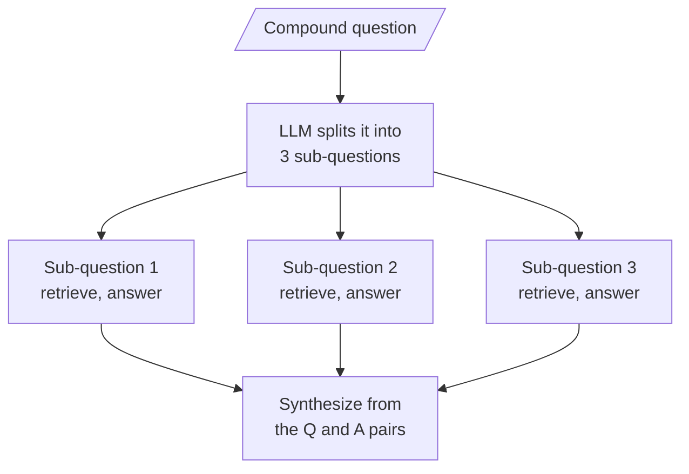

# M18.6 Theory: Query decomposition for multi-hop questions

*[M18 theory](../README.md) · Lesson 18.6 · Notebooks: [`06a_query_decomposition.ipynb`](../../../../course/p06_retrieval_quality/m18_query_transformation/notebooks/06a_query_decomposition.ipynb), [`06b_query_decomposition_walkthrough.ipynb`](../../../../course/p06_retrieval_quality/m18_query_transformation/optional/06b_query_decomposition_walkthrough.ipynb) (optional) · [All theory pages](../../../README.md)*

## Decomposing compound questions

Some questions carry two or three needs. *What is LangSmith, and why do we need it?*, the 06a notebook's example, asks for a definition and a justification, and the answers live in different chunks. Dense retrieval gives the whole question one vector, which lands between the two needs and close to neither. With a top-k cut, one need can crowd the other out entirely.

Decomposition splits the question before retrieval and answers each part on its own:

The synthesis prompt sees the three question and answer pairs, never the retrieved chunks, so its context stays small however many sub-questions there were. The 06a notebook splits its corpus into 100-token chunks so that each holds about one idea, which makes the gain visible: it counts the unique chunks the three sub-questions reach against the single query's.

### What it costs

| Step | LLM calls | Retrievals |
|---|---|---|
| Decompose | 1 | 0 |
| Answer each sub-question | 3 | 3 |
| Synthesize | 1 | 0 |
| **Total** | **5** | **3** |

Plain RAG costs one and one, so decomposition is five times the LLM calls for one user question, the most expensive technique in M18. The sub-questions are independent, so `rag_chain.batch(...)` runs them in parallel and recovers most of the wall-clock time at the same token cost. Errors propagate: a bad sub-question produces a confident wrong sub-answer, and the synthesis has no chunks to check it against.

### Get the list right

The first version of the notebook asked for prose and split it on newlines. The prompt asked for sub-questions and then for "multiple search queries", the model returned both under markdown headers, and the split produced about 18 items: headers, blank strings and bullets. Each one triggered a retrieval and an LLM call, roughly 18 of each instead of 3, and the same chain returned 3 clean lines on some runs, so the bug came and went. The fix is a prompt that asks for one thing and a Pydantic schema bound with `with_structured_output()`, which returns a `list[str]` of exactly the sub-questions.

### On the Larkspur handbook

M11's symptom table sends "half an answer; one fact found, another missed" to decomposition. *Can I export my data after I cancel my plan?* reads like two needs, how to export and what happens to data after cancelling. The M11 lab already retrieves both evidence chunks for it at `k = 2`, because one chunk says "Export your data" and the other "After a plan is cancelled". Decomposing it would cost four extra LLM calls and add nothing. Decompose the questions whose parts the single query misses, found on the golden set, and route the rest past it (lesson 18.7).

---
*Previous: [18.5 HyDE: embed a hypothetical answer](../05_hyde_embed_a_hypothetical_answer/README.md). Next: [18.7 Routing: LLM classifier and semantic routing](../07_routing_llm_classifier_and_semantic_routing/README.md).*
