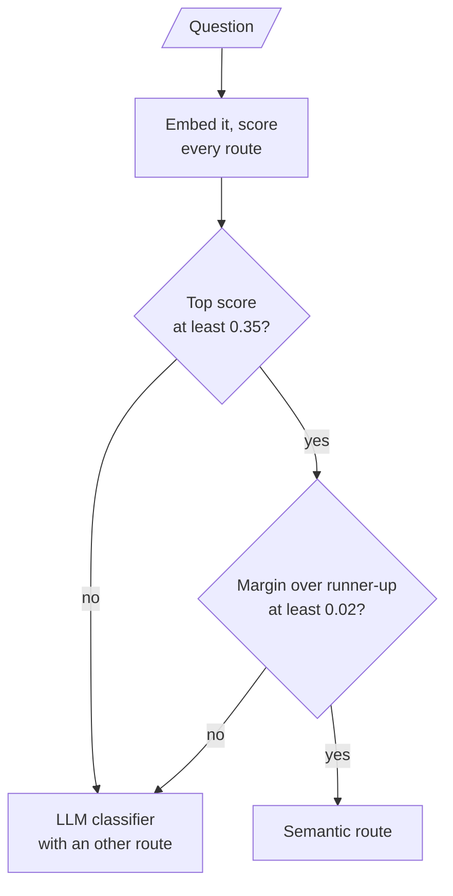

# M18.7 Theory: Routing: LLM classifier and semantic routing

*[M18 theory](../README.md) · Lesson 18.7 · Notebooks: [`07a_routing_with_llm_classifier.ipynb`](../../../../course/p06_retrieval_quality/m18_query_transformation/notebooks/07a_routing_with_llm_classifier.ipynb), [`07b_semantic_routing.ipynb`](../../../../course/p06_retrieval_quality/m18_query_transformation/notebooks/07b_semantic_routing.ipynb) · [All theory pages](../../../README.md)*

## Logical vs semantic routing

A router decides where a question goes before anything answers it: which prompt, which data source, which transformation. Lesson 18.7 builds the same four-way router twice, over the notebooks' personal finance, book review, health and fitness, and travel destinations. **Logical routing** asks an LLM to read the question and choose. **Semantic routing** embeds the question and picks the destination whose example questions it is closest to.

| | Logical (LLM classifier) | Semantic (embedding similarity) |
|---|---|---|
| Decides by | the model reasoning over the question | cosine similarity to each route's example questions |
| Cost per query | one LLM call | one embedding call, about 100 times cheaper in the 07a notebook's comparison |
| Handles | nuance, new phrasings, questions with several clauses | questions that resemble the examples |
| Fails by | picking a plausible but wrong route | routing on surface resemblance; a tie looks like a decision |
| Out-of-scope questions | still routed unless it has an "other" route | always routed: there is no "none of these" |

### The LLM classifier

The first version of the 07a notebook asked for the category as free text and compared it with exact strings. The model answered `'health & fitness'` and `'travel guides'`, which match neither `'Health & Fitness'` nor `'Travel Guide'`, so every branch fell through and the router returned `None`. The notebook still appeared to work. The fix binds a Pydantic model with `with_structured_output()` whose `destination` field is a `Literal` of the four route names, so no other value can come back, plus a one-sentence `reasoning` field that makes each decision readable in traces.

A `Literal` guarantees a valid route, not a sensible one. Asked *What is the capital of France?*, the router still picks one of the four. Production routers need an explicit `other` destination, a regression set of question to expected route (adding a route changes decisions on old questions), and usually a smaller, cheaper model for routing than for answering.

### Semantic routing

Each route is defined by a few example questions, three per route in the 07b notebook, embedded once at start-up. Per query the router embeds the question, takes each route's highest cosine similarity to its examples, and picks the highest route. The routing path never calls an LLM.

The 07b notebook shows why the winner alone is not enough (scores from `text-embedding-3-small`):

- *How can I travel on a budget?* is one of the travel examples word for word and scores 1.0000, while personal finance still scores about 0.50 on "budget".
- *Are meal-prep books worth buying?* wins by a margin of about 0.002, with every route near 0.28, and book review is not even in the top two despite the word "books". The router returns that answer with the same confidence as the exact match.

Two thresholds turn the scores into a confidence check: a minimum top score (did anything match?) and a minimum margin over the runner-up (was the choice distinguishable?). The notebook uses 0.35 and 0.02 and calls them illustrative; tune them on logged traffic. Questions that fail either go to the LLM classifier, which makes the two routers one system:

Most traffic pays for one embedding; only the unclear questions pay for a generation.

### Larkspur's routes

A Larkspur support assistant could route on the handbook's own sections. The examples below are written for illustration; the notebooks' scores do not transfer to them.

| Route | Handbook chunks behind it | Example questions |
|---|---|---|
| billing | `billing`, `cancel`, `refund-window`, `refund-timing`, `promo` | How long does a refund take? When am I charged for an annual plan? |
| data | `export`, `retention` | Can I export my data after I cancel my plan? How long is my data kept? |
| reliability | `sla`, `incidents` | What happens if my server goes down? Where do I see incident updates? |
| servers | `sizing`, `reboot` | Which server size do I need? Does a reboot change my IP address? |

*Do I get a refund if an outage lasts a day?* belongs to billing and reliability at once. Expect its two scores to sit close, the margin check to fail, and the classifier to decide, or send it to both routes. Self-querying (lesson 18.8) is the related move inside one source: instead of choosing a destination it turns part of the question into a metadata filter, such as a plan type or a date.

---
*Previous: [18.6 Query decomposition for multi-hop questions](../06_query_decomposition_for_multi_hop_questions/README.md). Next: [M18 interview questions](../README.md#interview-spotlight-5-questions-you-might-get-asked).*
