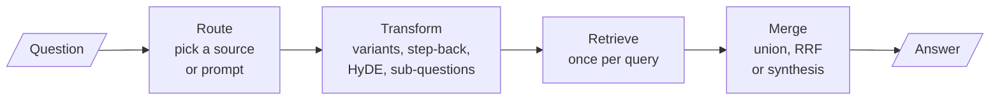

# M18 Theory: Query transformation and routing

*Part VI · Retrieval Quality Engineering · [Module README](../../../course/p06_retrieval_quality/m18_query_transformation/README.md) · [All theory pages](../../README.md)*

Users ask short, vague or compound questions, and the retriever searches with exactly what they typed. M18 changes the query before retrieval: rewrite it, ask it several ways, ask a broader question, search with an invented answer, split it, or send it to the right place first. The M18 notebooks build on four ideas: why a question and its answer sit far apart, how to fuse rankings from several phrasings, how a hypothetical answer becomes a search key, and the two ways to route a question. Each idea has a page in the folder of the lesson that teaches it, listed under [Lessons](#lessons). This page has the overview, the interview questions and the takeaways.

The running example is the Larkspur Cloud handbook from M11: twelve chunks on billing, refunds, outages, servers and data exports, and the same three golden questions. M11 left one of them unsolved. *What happens if my server goes down?* shares no word with the two chunks that answer it, so no value of `k` could retrieve them. M18 starts there.

## TL;DR

- Questions and documents differ in vocabulary ("server goes down" against "outage" and "availability") and in shape (a nine-word question against a 400-token passage). Every technique here closes one of those gaps, or splits a question that has more than one need.
- Multi-query and RAG-Fusion search with several LLM-written phrasings. In the lab, five variants per question lift mean recall@3 over the three golden questions from 0.50 to 0.83 with a flat union and to 1.00 with RRF.
- RRF's constant `k` is a real setting. At two chunks sent, `k = 60` scores 0.67 and `k = 1` scores 0.83, because a large `k` lets chunks that several variants rank low outvote a chunk two variants rank high.
- HyDE embeds an LLM-written answer instead of the question. It costs one LLM call per query and can mislead on a private corpus the model knows nothing about. Decomposition costs five LLM calls and three retrievals where plain RAG costs one and one.
- An LLM classifier routes by reasoning and pays a generation call per query; semantic routing compares embeddings with example questions and cannot say "none of these". Guard it with a minimum score and a minimum margin, and hand unclear cases to the classifier.

## Mental model

<!-- animated: diagrams/query-path.anim.html -->

Everything in M18 happens before the first vector search or after the last one. The index from M12 to M17 stays as it is. A transformation multiplies the queries, so the stage after retrieval has to merge their results, and the merge decides which chunks survive the cut to the model.

## Lessons

| Lesson | Topic | Theory |
|---|---|---|
| 18.1 | Query rewriting and expansion | [Query-document asymmetry](01_query_rewriting_and_expansion/README.md#querydocument-asymmetry) |
| 18.2 | Multi-query retrieval | *planned* |
| 18.3 | RAG-Fusion with Reciprocal Rank Fusion | [RRF](03_rag_fusion_with_reciprocal_rank_fusion/README.md#rrf) |
| 18.4 | Step-back prompting | *planned* |
| 18.5 | HyDE: embed a hypothetical answer | [HyDE](05_hyde_embed_a_hypothetical_answer/README.md#hyde) |
| 18.6 | Query decomposition for multi-hop questions | [Decomposing compound questions](06_query_decomposition_for_multi_hop_questions/README.md#decomposing-compound-questions) |
| 18.7 | Routing: LLM classifier and semantic routing | [Logical vs semantic routing](07_routing_llm_classifier_and_semantic_routing/README.md#logical-vs-semantic-routing) |
| 18.8 | Self-querying: natural language to metadata filter | *planned* |

## Interactive lab

[**Query variants and rank fusion**](03_rag_fusion_with_reciprocal_rank_fusion/interactive/query-variant-fusion-lab.html): open the file in a browser. It opens on the outage question at three chunks: both evidence chunks are in, against none for the question as asked. Switch to **Flat union** and `incidents` drops to rank 5. Then pick *How long does a refund take?*, set the cut to 2, and move `k` from 60 to 1 to watch `refund-window` climb back above `retention`.

## How it connects

- **Before:** [M11](../../p04_rag_foundations/m11_rag_lifecycle/README.md) supplies the index, the golden questions and the baseline row (recall@2 0.50) that the lab compares against. M14 narrows the vocabulary gap with embeddings; [M17](../m17_retrievers_hybrid_search/README.md) adds keyword search and teaches RRF for fusing BM25 with dense retrieval.
- **Next:** [M19](../m19_reranking_post_retrieval/README.md) reranks what the merged lists retrieve, which matters more once several queries widen the pool. M25 rebuilds decomposition as an orchestrator and workers; M28 has an agent rewrite failed queries; M30 turns routing into adaptive RAG.

## Interview Spotlight: 5 Questions You Might Get Asked

*Production questions in the style of OpenAI, Anthropic and Google interviews for applied AI roles.*

### 1. You ship RAG-Fusion for Larkspur's support assistant. A customer asks "What happens if my server goes down?" and gets reboot instructions instead of the SLA credit policy. Recall on the golden set went up. What happened?

**What a strong answer covers:**
- Prints the fused list with each chunk's votes and ranks: the reboot chunk can win because four of five variants matched "server" or "does", which is agreement on a distractor
- Checks the variants themselves; a variant that drifts ("How do I restart a server…") adds a vote for the wrong chunk
- Looks at the cut: at three chunks both evidence chunks are in, at two only `sla` is, so the number of chunks sent matters as much as the fusion
- Fixes with a reranker over the fused pool (M19), a lower `k` or fewer drifting variants, and adds the question to the golden set at the production cut

### 2. Your latency budget is 1.5 s and a plain retrieval takes 300 ms. Product wants multi-query, HyDE and decomposition "on every question". What do you propose?

**What a strong answer covers:**
- Counts the calls: multi-query adds one LLM call and N retrievals, HyDE one LLM call, decomposition five LLM calls and three retrievals where plain RAG has one and one
- Routes first: send compound questions to decomposition, short or vague ones to variants or HyDE, and direct lookups straight to retrieval
- Runs the per-variant retrievals and sub-questions in parallel (`retriever.map()`, `.batch()`), and uses a small model for rewriting
- Measures each technique per question type against the M11 baseline and keeps only the ones that win where they are applied

### 3. How do you show that RAG-Fusion helped, rather than only cost more?

**What a strong answer covers:**
- Compares against the plain pipeline on the same frozen golden set, at the cut the product really uses
- Reports recall at that cut, answer quality, latency and LLM cost per question, and breaks results down by question type
- Watches regressions on direct lookups: in the lab, RRF at `k = 60` and two chunks drops the refund question from 1.00 (union) to 0.50
- Logs the variants and fused lists in production so a bad variant or a distractor that keeps winning shows up in traces

### 4. Larkspur routes questions semantically to billing, data, reliability and servers. "Do I get a refund if an outage lasts a day?" goes to servers. How do you make the router safer?

**What a strong answer covers:**
- Reads all route scores and the margin, not only the winner; a question that straddles billing and reliability will have close scores
- Adds a minimum top score and a minimum margin, tuned on logged traffic, and sends anything below either to an LLM classifier or a default prompt
- Gives the classifier an explicit "other" destination, because a `Literal` guarantees a valid route, not a sensible one
- Adds exemplars for the cross-topic phrasings that fail, and keeps a regression set of query to expected route

### 5. A self-querying retriever turns "annual-plan refund rules updated after 2025" into a metadata filter. Some days it returns nothing, and the logs show no error. What do you check?

**What a strong answer covers:**
- Logs the structured query each call produced, because the query constructor is an LLM and its output varies between runs
- Looks for a filter value of the wrong type ("2025" as a string), which a store such as Chroma rejects for `$gt`, and coerces numeric values before they reach the store
- Checks the metadata itself: an attribute that is not declared cannot be filtered, and "annual" against "Annual" breaks equality
- Treats an empty result after a filter as a signal to retry without the filter or to ask the user, not as "nothing matched"

## Key Takeaways

- Print what the retriever saw before you change the prompt: the original query, every variant and every list. Fluent answers can come from an empty context, as the 02a notebook's merge bug showed.
- Match the transformation to the gap. Vocabulary gaps want variants or expansion, shape gaps want HyDE, compound questions want decomposition, facts the embedding cannot compare want a metadata filter.
- RRF rewards agreement, and agreement on a distractor still counts. Tune `k` and the cut on your golden set instead of taking 60 on trust.
- Route cheaply by similarity, check the margin, and pay for an LLM classifier only when the margin is small.

---
*Previous: [M17 Retrievers and hybrid search](../m17_retrievers_hybrid_search/README.md). Next: [M19 Post-retrieval optimisation and reranking](../m19_reranking_post_retrieval/README.md).*
