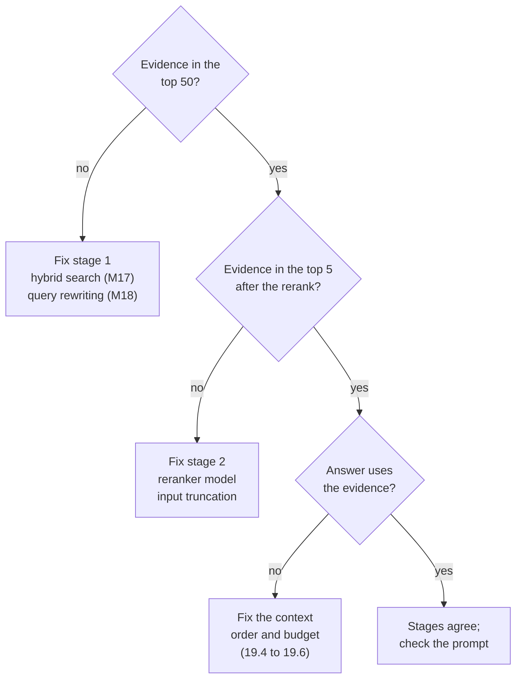

# M19.1 Theory: Two-stage retrieval: retrieve wide, rerank narrow

*[M19 theory](../README.md) · Lesson 19.1 · Notebooks: [`01a_two_stage_reranking.ipynb`](../../../../course/p06_retrieval_quality/m19_reranking_post_retrieval/notebooks/01a_two_stage_reranking.ipynb) · [All theory pages](../../../README.md)*

## Recall@50 → precision@5

Two-stage retrieval gives each stage one job and one metric. The notebook's version: FAISS with `all-MiniLM-L6-v2` embeddings returns `k=8` chunks, then `llama-3.1-8b-instant` reads all eight in one prompt and returns their indices in order of relevance. The notebook calls this "retrieve many, keep few". The lab brief for this module scales it to the production shape: 50 candidates from a hybrid first stage, 5 chunks to the model. The lab below keeps the first stage dense only, so its numbers isolate the reranker.

| Stage | Job | Metric | Cost per question |
|---|---|---|---|
| 1. Retrieve wide | Get the evidence somewhere into the candidate list | Recall@50 | One query embedding and an index lookup, nearly the same at any depth |
| 2. Rerank narrow | Put the evidence at the top and cut the rest | Precision@5 | One reranker pass per candidate: 50 pairs at depth 50 |

The arrow in the heading is a ceiling. The top 5 after reranking is a subset of the top 50 before it, so recall@5 after the rerank can never exceed recall@50 before it. A reranker reorders; it cannot fetch. When the `retention` chunk is not among the 50 candidates for *Can I export my data after I cancel my plan?*, the answer misses the 30-day deletion rule however good the reranker is.

Depth pulls in two directions. Recall@k never falls as k grows, because a deeper list contains the shallower one. The rerank cost rises with every candidate. The notebooks in this module sit at the shallow end:

| Notebook | First stage returns | Reranker | Keeps |
|---|---|---|---|
| `01a_two_stage_reranking` | 8 (FAISS) | LLM, one listwise call | all 8, reordered |
| `02a_cross_encoder_reranking` | LangChain's default `k` (Chroma) | `BAAI/bge-reranker-base` | 3 |
| `02b_reranking_cross_encoder_walkthrough` (optional) | 10 (Chroma) | `cross-encoder/ms-marco-MiniLM-L-6-v2` | all 10, reordered |
| `03a_reranking_methods`, LLM | 15, or 30 in the custom retriever | `gpt-4o`, one call per chunk | 3, or 2 |
| `03a_reranking_methods`, cross-encoder | 10 | `cross-encoder/ms-marco-MiniLM-L-6-v2` | 5 |

To pick the depth for your own corpus, plot stage-1 recall@k on the golden set and find where it flattens. Past that point a deeper list only adds rerank latency. The [interactive lab](interactive/rerank-precision-lab.html) puts the three numbers side by side on a 100-chunk Larkspur handbook. Stage 1 is dense only (`all-MiniLM-L6-v2`); the rerankers are `cross-encoder/ms-marco-MiniLM-L-6-v2` and `BAAI/bge-reranker-v2-m3`, all real scores. On the outage question with no reranker, the two SLA chunks sit at ranks 9 and 11, so precision@5 is 0.20. At `k = 20` the bge reranker lifts them to ranks 3 and 2 and precision@5 rises to 0.60, for about 623 ms of CPU time. At `k = 10` one SLA chunk is outside the candidates and precision@5 stops at 0.40. The PostgreSQL question shows the same ceiling at every depth: one evidence chunk sits at stage-1 rank 52, past any `k` the lab offers, so the fix belongs in stage 1.

<!-- lab: interactive/rerank-precision-lab.html -->

When an answer is wrong, the two metrics tell you which stage to fix. Ask the questions in order:

## Lost in the middle

Liu et al. (*Lost in the Middle: How Language Models Use Long Contexts*, 2023) gave models a question with many retrieved passages and moved the one that held the answer through the list. Accuracy was highest with the answer near the start or the end of the context and lowest with it in the middle. M11 met the same effect when it raised `k`.

For a RAG pipeline the finding has three consequences:

- **Send fewer chunks.** With five chunks there is little middle to get lost in. If stage 1 returns 20 chunks for the export question and `retention` sits at position 11, it is in the part of the prompt the model reads least reliably.
- **Send them in rank order, best first.** The notebook's last step does this: it rebuilds the list from the LLM's ranking so the chunk it judged most relevant leads the prompt.
- **If you must send many, put the strongest at the edges.** LangChain's `LongContextReorder` document transformer places the highest-ranked documents at the start and the end and the weakest in the middle. The M19 notebooks do not use it; reranking and a small cut usually make it unnecessary.

The notebook's own list of when to rerank makes the same point from the other side: when only the top 3 chunks are used, or when the context window is limited and needs the best documents.

---
*Previous: [M19 overview](../README.md). Next: [19.2 Cross-encoder reranking in a RAG chain](../02_cross_encoder_reranking_in_a_rag_chain/README.md).*
