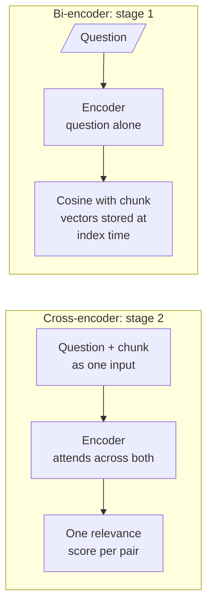

# M19.2 Theory: Cross-encoder reranking in a RAG chain

*[M19 theory](../README.md) · Lesson 19.2 · Notebooks: [`02a_cross_encoder_reranking.ipynb`](../../../../course/p06_retrieval_quality/m19_reranking_post_retrieval/notebooks/02a_cross_encoder_reranking.ipynb), [`02b_reranking_cross_encoder_walkthrough.ipynb`](../../../../course/p06_retrieval_quality/m19_reranking_post_retrieval/optional/02b_reranking_cross_encoder_walkthrough.ipynb) (optional) · [All theory pages](../../../README.md)*

## Bi-encoder vs cross-encoder

Both models read text with a transformer encoder. They differ in what goes into the encoder together.

A **bi-encoder** turns the question and each chunk into vectors separately and compares them with cosine similarity. The chunk vectors are computed once, when the index is built, so answering a question costs one embedding and a nearest-neighbour search however large the index is. Lesson 19.1's first stage uses `all-MiniLM-L6-v2`, which the notebook describes as about 22M parameters with 384-dimensional vectors. The price is that each chunk is summarised into one vector before any question exists. The `cancel` chunk ("You can cancel any plan from the Billing page…") and the `retention` chunk ("After a plan is cancelled, its data is kept for 30 days…") both share words with *Can I export my data after I cancel my plan?*. One vector per chunk has to serve every question, so the bi-encoder can place `cancel` as close to the question as `retention`, though only `retention` answers it.

A **cross-encoder** reads the question and one chunk as a single input, so every question token can attend to every chunk token, and it outputs one relevance score. It can tell that only `retention` says what happens to the data. Nothing can be computed ahead of time, because the input depends on the question: scoring 50 candidates means 50 forward passes. That is why it runs only on the short list.

| | Bi-encoder | Cross-encoder |
|---|---|---|
| Input | Question or chunk, alone | Question and chunk together |
| Output | A vector | A relevance score |
| Work at index time | Embed every chunk once | None |
| Work per question | One embedding, one index search | One forward pass per candidate |
| Used for | Stage 1 over the whole index | Stage 2 over the candidates |
| In these notebooks | `all-MiniLM-L6-v2`, `OpenAIEmbeddings` | `BAAI/bge-reranker-base`, `cross-encoder/ms-marco-MiniLM-L-6-v2`; Cohere's hosted `rerank-english-v3.0` in 19.6 |

The two notebooks wire the cross-encoder into a chain in different ways:

- **`02a` uses LangChain's wrapper.** `HuggingFaceCrossEncoder` loads `BAAI/bge-reranker-base`, `CrossEncoderReranker(top_n=3)` scores and cuts, and `ContextualCompressionRetriever` runs it after the base retriever. In LangChain a reranker is a *document compressor*: it takes the retrieved documents and the question and returns fewer documents. Lesson 19.4 plugs an extractor into the same slot.
- **`02b` writes the step by hand.** It builds `(question, chunk)` pairs, calls `CrossEncoder.predict` on the list, sorts by score and puts the result into the chain with `RunnableLambda`.

Three details in that code matter in production:

- `02a`'s base retriever keeps LangChain's default `k`, so the reranker chooses 3 from a list barely longer than 3. Raise `k` through `search_kwargs` until stage 1 recall flattens (19.1).
- `02b`'s `rerank_documents` creates the `CrossEncoder` inside the function, so the model loads again on every question. Load it once at start-up.
- `02b`'s chain version returns all 10 reranked chunks, so it reorders without narrowing. Slice the sorted list to the top few, as its earlier cell does with `[0:2]`.

Cross-encoder scores rank the candidates for one question. Nothing guarantees that a score means the same thing across questions or across models. The 19.6 notebook notes that Cohere's reranker returns values "very close to 0 or 1" and spreads them with a beta transform before using them. Before you set a fixed score threshold, check its distribution on your golden set.

---
*Previous: [19.1 Two-stage retrieval: retrieve wide, rerank narrow](../01_two_stage_retrieval_retrieve_wide_rerank_narrow/README.md). Next: [19.3 LLM reranking vs cross-encoder reranking](../03_llm_reranking_vs_cross_encoder_reranking/README.md).*
