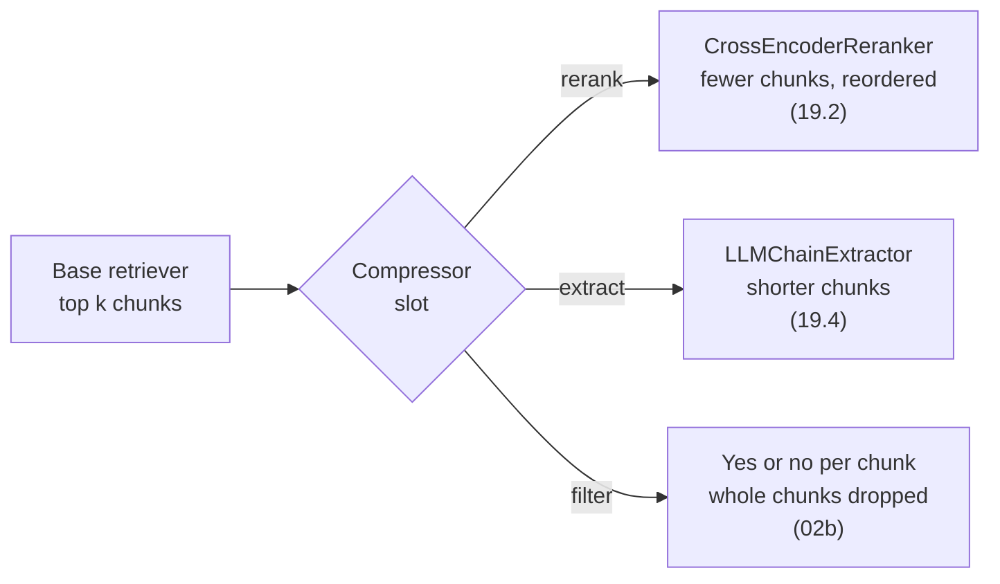

# M19.4 Theory: Contextual compression

*[M19 theory](../README.md) · Lesson 19.4 · Notebooks: [`04a_contextual_compression.ipynb`](../../../../course/p06_retrieval_quality/m19_reranking_post_retrieval/notebooks/04a_contextual_compression.ipynb) · [All theory pages](../../../README.md)*

## Context budget

The context budget is the share of each prompt that retrieved text may take. Four things set it: the model's context window, the cost of input tokens, the latency of reading them, and the position effect from 19.1, which makes a long context less reliable than a short one. Every step after retrieval either saves from that budget or spends it:

| Step | Lesson | Effect on the budget | What it costs |
|---|---|---|---|
| Cut to the top few after reranking | 19.1 to 19.3 | Saves: fewer chunks | Rerank latency |
| Drop chunks that do not answer | 02b (optional) | Saves: whole chunks | One LLM call per chunk |
| Extract the relevant sentences | 19.4 | Saves: shorter chunks | One LLM call per chunk |
| Add the neighbouring chunks | 19.5 | Spends: 800 characters per hit at the 05a settings, twice the chunk | A lookup per neighbour |
| Rebuild contiguous segments | 19.6 | Spends: up to 30 chunks of 800 characters, 24,000 characters, at the 06a settings | A reranker pass over the document's chunks |

Saving and spending go together. A pipeline that expands each hit to its neighbours can afford it by keeping three chunks instead of five; one that compresses each chunk can keep more of them.

`04a` saves with `LLMChainExtractor`. It wraps `gpt-4o-mini` (temperature 0, `max_tokens=4000`) and plugs into `ContextualCompressionRetriever`, the same wrapper 19.2 used for the cross-encoder. For each retrieved chunk the extractor asks the LLM to copy out only the parts that bear on the question; a chunk with nothing relevant comes back empty and is dropped. A `RetrievalQA` chain then answers from what is left.

Whichever compressor fills the slot, its output is what the prompt receives. The retriever and the chain stay the same.

Compression has the same risk as M13's propositions: an LLM sits between the source and the prompt. On the Larkspur `refund-window` chunk, an extractor that keeps "An annual plan can get a full refund within 30 days of purchase" and drops "if the account used less than 100 GB of outbound traffic" produces a confident wrong answer. Check compressed context for faithfulness on the golden set, and keep each chunk's id so the citation points at the full source text.

Filtering has a simpler failure. The optional `02b` notebook's `evaluate_documents` asks `gpt-4o-mini` whether each chunk suits the question and keeps it only if the reply equals the string `"True"` exactly. A reply of `"True."` drops the chunk. Ask for structured output, as 19.3's pointwise reranker does, instead of matching text.

## Key Takeaways

- Every step after retrieval saves or spends one context budget. Plan them together: widening each hit means keeping fewer hits, and compressing each chunk lets you keep more.
- `LLMChainExtractor` copies out only the relevant parts of each chunk at one LLM call per chunk, and drops chunks with nothing relevant.
- An extractor can drop the condition that limits a rule and produce a confident wrong answer. Check compressed context for faithfulness and keep each chunk's id for citations.

## Check yourself

1. Why do the saving and spending steps after retrieval have to be planned together?

They draw on one context budget, set by the context window, input-token cost, reading latency and the position effect. A pipeline that adds each hit's neighbours can afford it by keeping three chunks instead of five; one that compresses each chunk can keep more of them.

2. The extractor keeps "full refund within 30 days of purchase" from Larkspur's refund-window chunk and drops the 100 GB condition. What goes wrong, and what guards against it?

The model gives a confident wrong answer, because the condition that limits the refund never reaches the prompt. An LLM sits between the source and the prompt, so check compressed context for faithfulness on the golden set, and keep each chunk's id so the citation points at the full source text.

3. The optional 02b filter drops chunks that the model judged relevant. What is the likely cause?

It keeps a chunk only when the reply equals the string `"True"` exactly, so a reply of `"True."` drops it. Ask for structured output, as 19.3's pointwise reranker does, instead of matching text.

---
*Previous: [19.3 LLM reranking vs cross-encoder reranking](../03_llm_reranking_vs_cross_encoder_reranking/README.md). Next: [19.5 Context enrichment windows](../05_context_enrichment_windows/README.md).*
