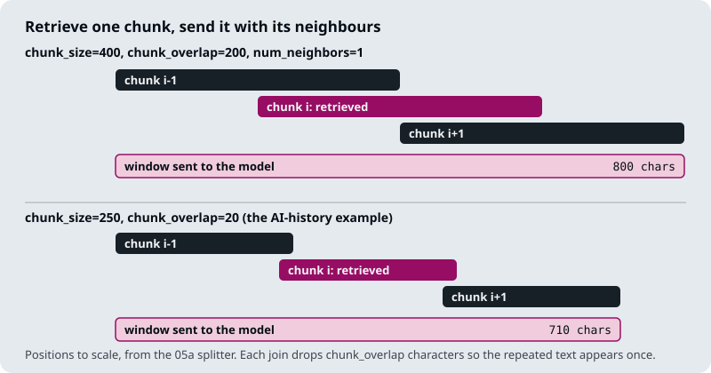

# M19.5 Theory: Context enrichment windows

*[M19 theory](../README.md) · Lesson 19.5 · Notebooks: [`05a_context_enrichment_window.ipynb`](../../../../course/p06_retrieval_quality/m19_reranking_post_retrieval/notebooks/05a_context_enrichment_window.ipynb) · [All theory pages](../../../README.md)*

## Enrichment windows

Small chunks retrieve precisely and large chunks answer completely (M13). An enrichment window keeps both: index small chunks, and when one is retrieved, send it to the model together with the chunks on either side of it.

The notebook splits the text into fixed-size character chunks with `split_text_to_chunks_with_indices` and stores each chunk's position in its metadata as `index`. The retriever returns `k=1` chunk. `retrieve_with_context_overlap` then fetches the chunks at `index - 1` to `index + 1` (`num_neighbors=1`), sorts them by position and joins them, dropping `chunk_overlap` characters at each join so the repeated text appears once.

The window length follows from the split. Neighbouring chunks start `chunk_size - chunk_overlap` characters apart, so a window of three chunks covers `2 × (chunk_size - chunk_overlap) + chunk_size` characters:

| Example in the notebook | Split | Retrieved chunk | Window | Growth |
|---|---|---|---|---|
| Climate change PDF | 400 / 200 | 400 characters | 800 characters | 2× |
| AI-history passage, *When did deep learning become prominent in AI?* | 250 / 20 | 250 characters | 710 characters | 2.84× |

The more the chunks already overlap, the less the window adds. Either way the growth comes out of the context budget (19.4), so a pipeline that widens each hit usually keeps fewer hits.

On the Larkspur handbook the window repairs M13's boundary cut. M13's 300-character split ends chunk 2 of the refund section at "used less than" and starts chunk 3 with the 100 GB condition; a window around chunk 2 sends both halves of the rule.

The notebook's helpers are written for a demo, and four of their shortcuts break in production:

- **The join needs the split's overlap.** `retrieve_with_context_overlap` takes `chunk_overlap` as its own argument. If it differs from the overlap used to split, the joins repeat or delete text. The AI-history call relies on the default of 20 matching its split.
- **Fetching a neighbour scans the whole store.** `get_chunk_by_index` runs `similarity_search("", k=vectorstore.index.ntotal)` and loops over every chunk to find one index; the notebook calls it a simplified version. Keep chunk text in a key-value store keyed by document id and chunk index, which 19.6's method requires anyway.
- **Every chunk carries the whole document.** The splitter stores the full text in each chunk's metadata under `text`, so the index holds one copy of the document per chunk.
- **Indexes restart per document.** With more than one document, the key must include the document id, or a window can join the end of one file to the start of another. Two hits next to each other also produce overlapping windows; merge them, which is the problem 19.6 solves in general.

## Check yourself

1. How long is a three-chunk window at a 250-character split with 20 of overlap, and why does a window add less when chunks overlap more?

710 characters: `2 × (250 - 20) + 250`. Neighbouring chunks start `chunk_size - chunk_overlap` characters apart, so more overlap means each neighbour adds less new text; at 400 with 200 overlap the window is 800 characters, only twice the chunk.

2. A 300-character split cuts Larkspur's refund rule across two chunks. How does an enrichment window repair the cut?

M13's 300-character split ends chunk 2 of the refund section at "used less than" and starts chunk 3 with the 100 GB condition. A window around chunk 2 sends chunks 1 to 3 together, so both halves of the rule reach the model while the index keeps its small, precise chunks.

3. Windows built with the notebook's helper repeat or lose text at the joins. What is the likely cause?

The `chunk_overlap` passed to `retrieve_with_context_overlap` differs from the overlap used to split. The helper takes it as its own argument and drops that many characters at each join, so a mismatch repeats or deletes text. The AI-history call works only because its default of 20 matches the split.

---
*Previous: [19.4 Contextual compression](../04_contextual_compression/README.md). Next: [19.6 Relevant segment extraction](../06_relevant_segment_extraction/README.md).*
