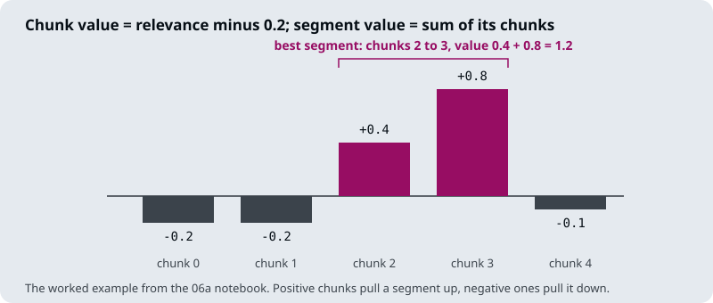

# M19.6 Theory: Relevant segment extraction

*[M19 theory](../README.md) · Lesson 19.6 · Notebooks: [`06a_relevant_segment_extraction.ipynb`](../../../../course/p06_retrieval_quality/m19_reranking_post_retrieval/optional/06a_relevant_segment_extraction.ipynb) (optional) · [All theory pages](../../../README.md)*

## Relevant segment extraction

An enrichment window (19.5) grows every hit by a fixed amount. Relevant segment extraction (RSE) lets the reranker's scores decide how much to send. It rests on one observation from the notebook: "relevant chunks tend to be clustered within their original documents". RSE finds those clusters and sends each one as a single contiguous segment, in document order, including chunks between two relevant ones that the reranker scored low.

The notebook's pipeline, on Nike's 2023 annual report:

1. **Chunk with no overlap.** `RecursiveCharacterTextSplitter(chunk_size=800, chunk_overlap=0)`. Without overlap, joining neighbouring chunks rebuilds the original text exactly.
2. **Score every chunk.** Cohere's `rerank-english-v3.0` scores each chunk against *Nike consolidated financial statements*. The scores cluster near 0 and 1, so a beta CDF (`a = b = 0.4`) spreads them out, and each is multiplied by `exp(-rank / 30)` so that rank counts as well as score.
3. **Subtract a penalty.** `irrelevant_chunk_penalty = 0.2` makes irrelevant chunks negative and relevant ones positive.
4. **Find the best segments.** A segment's value is the sum of its chunk values, so finding the best one is a constrained maximum-sum subarray problem. `get_best_segments` searches by brute force with `max_length=20` chunks per segment, `overall_max_length=30` chunks in total and `minimum_value=0.7`, and repeats until no segment clears the minimum.

The notebook's own worked example has five chunks with values `[-0.2, -0.2, 0.4, 0.8, -0.1]`. Running `get_best_segments` on them returns chunks 2 to 3 with a value of 1.2. Extending to chunk 4 would subtract 0.1, and no other run of chunks has a positive sum, so the search stops after one segment.

On the annual report the notebook reads the chunks around the cluster. Only 7 of chunks 320 to 339 were marked relevant, yet chunks 323 to 333 all hold the consolidated financial statements; the optimiser's first segment is 323 to 336. The chunks the reranker scored low would have been left out by top-k retrieval; the segment brings them back.

When only one chunk is relevant, there is no cluster to join, and RSE returns that chunk on its own. It behaves like top-k retrieval on factoid questions and like a large chunk on broad ones, without fixing the chunk size in advance.

The notebook reports its authors' evaluation on their KITE benchmark (50 questions across four datasets, graded 0 to 10 by an LLM), comparing RSE with top-k retrieval at `k=20` with the Cohere reranker and `gpt-4o` in both:

| Dataset | Top-k | RSE |
|---|---|---|
| AI Papers | 4.5 | 7.9 |
| BVP Cloud 10-Ks | 2.6 | 4.4 |
| Sourcegraph handbook | 5.7 | 6.6 |
| Supreme Court opinions | 6.1 | 8.0 |
| Average | 4.72 | 6.73 |

These are the authors' numbers, not a measurement in this course. The notebook reports the context length as roughly equal in both configurations, so the gain does not come from sending more text.

RSE spends the context budget (19.4) in a bounded way: at the notebook's settings, at most 30 chunks of 800 characters, 24,000 characters in all. For the Larkspur handbook the sections are short, so set `max_length` to a section's chunk count and the overall cap to what the generation prompt can hold.

## Check yourself

1. How does relevant segment extraction decide how much context to send, where an enrichment window adds a fixed amount?

It subtracts a penalty (0.2 in the notebook) from each chunk's reranker value, so irrelevant chunks go negative, then finds the contiguous runs with the highest sum. Each run goes as one segment in document order, including low-scored chunks between relevant ones. On the Nike report the first segment is chunks 323 to 336, though only 7 of chunks 320 to 339 were marked relevant.

2. Five chunks have values of -0.2, -0.2, 0.4, 0.8 and -0.1. Which segment does the search return, and why does it stop there?

Chunks 2 to 3, with a value of 1.2. Extending to chunk 4 would subtract 0.1, and no other run of chunks has a positive sum, so no second segment clears `minimum_value=0.7` and the search stops after one.

3. The Larkspur handbook's sections are short. How should you set the segment length limits, and what do the notebook's settings cost?

Set `max_length` to a section's chunk count and the overall cap to what the generation prompt can hold. The notebook's `overall_max_length=30` chunks of 800 characters allows up to 24,000 characters of context, far more than a short handbook section needs.

---
*Previous: [19.5 Context enrichment windows](../05_context_enrichment_windows/README.md). Next: [M19 interview questions](../README.md#interview-spotlight-5-questions-you-might-get-asked).*
