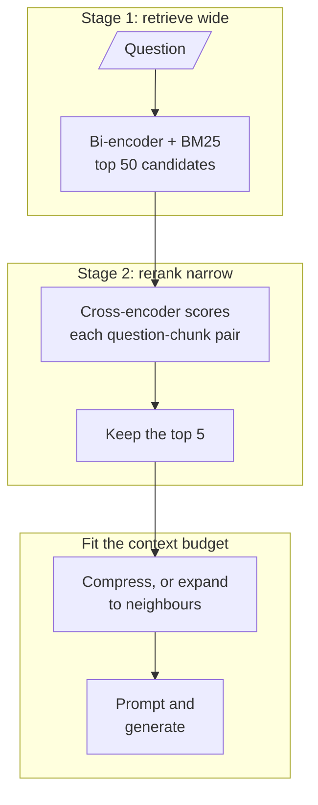

# M19 Theory: Post-retrieval optimisation and reranking

*Part VI · Retrieval Quality Engineering · [Module README](../../../course/p06_retrieval_quality/m19_reranking_post_retrieval/README.md) · [All theory pages](../../README.md)*

A retriever that scores every chunk in the index has to be cheap, so it is coarse. M19 adds a second, slower pass over a short candidate list, then decides how much of each surviving chunk the model reads. The M19 notebooks build on four ideas: why a bi-encoder and a cross-encoder do different jobs, why the first stage is judged on recall and the second on precision, why a model reads the middle of a long prompt less reliably, and how to spend a fixed context budget. Each idea has a page in the folder of the lesson that teaches it, listed under [Lessons](#lessons). This page has the overview, the interview questions and the takeaways.

The running example is the Larkspur Cloud handbook from M11 to M13, and two of its golden questions: *Can I export my data after I cancel my plan?* (evidence: the `export` and `retention` chunks) and *How long does a refund take?* (evidence: `refund-window` and `refund-timing`). The first has a distractor that shares its words, the `cancel` chunk, which is the kind of near miss a reranker is for.

## TL;DR

- Retrieval runs in two stages. A bi-encoder (with BM25 alongside it in the M17 hybrid) scores every chunk and returns a wide candidate list; a cross-encoder or an LLM reads each question and candidate together and reorders the list. Stage 1 is judged on recall at depth 50, stage 2 on precision in the top 5.
- The reranker only reorders what stage 1 returned. Evidence missing from the candidates stays missing, so recall at the first-stage depth caps everything after it.
- Reranking cost grows with the number of candidates. A cross-encoder runs one forward pass per question and chunk pair; the pointwise LLM reranker in `03a_reranking_methods.ipynb` makes one `gpt-4o` call per candidate, up to 30 per question in its custom retriever.
- Models use the start and end of a long prompt more reliably than the middle. Send a few chunks in rank order, best first, rather than a long list in retrieval order.
- After reranking, the context budget decides the shape of each chunk: compress it to the sentences that answer the question, or expand it to its neighbours when the answer runs across a boundary.

## Mental model

<!-- animated: diagrams/two-stage.anim.html -->

Each stage has its own metric and its own failure. Stage 1 fails when the evidence is not among the candidates, stage 2 fails when the evidence is a candidate but does not reach the top 5, and the last step fails when the evidence reaches the prompt cut short or buried. Debug them in that order.

## Lessons

| Lesson | Topic | Theory |
|---|---|---|
| 19.1 | Two-stage retrieval: retrieve wide, rerank narrow | [Recall@50 → precision@5](01_two_stage_retrieval_retrieve_wide_rerank_narrow/README.md#recall50--precision5) [Lost in the middle](01_two_stage_retrieval_retrieve_wide_rerank_narrow/README.md#lost-in-the-middle) |
| 19.2 | Cross-encoder reranking in a RAG chain | [Bi-encoder vs cross-encoder](02_cross_encoder_reranking_in_a_rag_chain/README.md#bi-encoder-vs-cross-encoder) |
| 19.3 | LLM reranking vs cross-encoder reranking | [LLM reranker or cross-encoder](03_llm_reranking_vs_cross_encoder_reranking/README.md#llm-reranker-or-cross-encoder) |
| 19.4 | Contextual compression | [Context budget](04_contextual_compression/README.md#context-budget) |
| 19.5 | Context enrichment windows | [Enrichment windows](05_context_enrichment_windows/README.md#enrichment-windows) |
| 19.6 | Relevant segment extraction | [Relevant segment extraction](06_relevant_segment_extraction/README.md#relevant-segment-extraction) |

## Interactive lab

[**Rerank precision lab**](01_two_stage_retrieval_retrieve_wide_rerank_narrow/interactive/rerank-precision-lab.html): open the file in a browser. It ranks a 100-chunk handbook with `all-MiniLM-L6-v2`, reranks with two real cross-encoders, and prints rerank latency measured on a laptop CPU.

- On the outage question, switch the reranker from Off to `bge-reranker-v2-m3` at `k = 20`. The two SLA chunks climb from ranks 9 and 11 into the top three, and precision@5 goes from 0.20 to 0.60 for about 623 ms.
- Drop `k` to 10 with the reranker on. One SLA chunk falls outside the candidates and precision@5 stops at 0.40, because no reranker can return a chunk the first stage never retrieved.
- Switch to MiniLM-L6. It costs 39 ms at `k = 20` instead of 623 ms and gains nothing on these questions. Measure a reranker on your golden set before you pay for it.

## How it connects

- **Before:** [M11](../../p04_rag_foundations/m11_rag_lifecycle/README.md) defines recall@k and precision@k and the baseline every change is measured against. [M13](../../p05_ingestion_and_indexing/m13_chunking/README.md) sets the chunk size that compression and enrichment windows work around. [M14](../../p05_ingestion_and_indexing/m14_embeddings/README.md) covers the embedding models that stage 1 runs as bi-encoders. [M17](../m17_retrievers_hybrid_search/README.md) builds the hybrid first stage, and [M18](../m18_query_transformation/README.md) rewrites the question before it reaches it.
- **Next:** M20 assembles the full pipeline with sources and citations on top of these stages. M28 and M29 add an LLM grader that judges each retrieved chunk, the same pointwise judgement as the LLM reranker in 19.3, with a yes or no instead of a score.

## Interview Spotlight: 5 Questions You Might Get Asked

*Production questions in the style of OpenAI, Anthropic and Google interviews for applied AI roles.*

### 1. You add a cross-encoder reranker over the top 50 for Larkspur's support assistant. Latency per question jumps, and answers to “How long does a refund take?” are no better. Where do you look?

**What a strong answer covers:**
- Checks recall@50 first: if `refund-timing` is not among the 50 candidates, no reranker can promote it, and the fix belongs in stage 1 (hybrid search in M17, query rewriting in M18)
- Profiles the rerank step: model loaded once at start-up rather than per request (the walkthrough notebook builds its `CrossEncoder` inside the rerank function), pairs scored in one batch, long chunks truncated to the model's input limit
- Compares precision@5 with and without the reranker on the golden set, per question, so one regression is not hidden in the mean
- Lowers the depth to where recall@k stops rising, which cuts the pair count and the latency with it

### 2. The team wants the best possible ranking for a high-traffic support chat and proposes an LLM reranker. What do you recommend?

**What a strong answer covers:**
- Pointwise LLM reranking costs one call per candidate (up to 30 calls per question in the 19.3 notebook); listwise costs one long call whose output must be parsed back into an order
- A cross-encoder scores every pair locally in one batch, with no parsing step that can fail
- Default to the cross-encoder and reserve the LLM for low-volume, high-stakes questions, or for re-scoring only the top few after the cross-encoder
- Decides on golden-set precision@5 and p95 latency together, not on a demo query

### 3. How do you choose the first-stage depth: 20, 50 or 100 candidates?

**What a strong answer covers:**
- Plots recall@k for stage 1 on the golden set and finds where it flattens
- Measures rerank latency at each depth, since cross-encoder cost is one pass per pair
- Picks the shallowest depth on the flat part of the recall curve that fits the latency budget
- Re-checks when the corpus grows or the embedding model changes, because the curve moves

### 4. “Can a refund be prorated after 45 days?” The reranker puts the `refund-window` chunk first, but the sentence with the proration rule sits in the next chunk and never reaches the model. What do you change?

**What a strong answer covers:**
- Recognises a boundary problem: the ranking is right and the unit of context is too small
- Expands each top chunk to its neighbours (19.5) or extracts a contiguous segment (19.6), using a key-value lookup by document and chunk index
- Accounts for the extra tokens in the context budget, for example by keeping fewer chunks
- Checks that compression (19.4) is not the step dropping the qualifier, since an extractor can cut the condition from a rule

### 5. The reranker has run in production for a month. How do you show it is still earning its latency?

**What a strong answer covers:**
- Logs, for every answer, the stage-1 rank and the reranked rank of each cited chunk
- Tracks how often a cited chunk came from below the top 5 of stage 1, which is the work only the reranker did
- Re-runs the golden set on every change to the index, the embedding model or the reranker version, and alerts on a fall in precision@5
- Watches rerank latency percentiles separately from generation latency

## Key Takeaways

- Judge stage 1 on recall at its depth and stage 2 on precision at the cut. A reranker cannot fix a candidate list that lacks the evidence.
- Reranking cost scales with the candidate count. Choose the depth from the recall curve and the latency budget, not from habit.
- Send the model a few chunks, best first. Position in a long prompt changes how reliably the model uses a fact.
- Spend the context budget where the evidence is: compress noisy chunks, expand chunks whose answer crosses a boundary, and count both against the same token limit.

---
*Previous: [M18 Query transformation and routing](../m18_query_transformation/README.md). Next: M20 End-to-end RAG systems (no theory page yet).*
