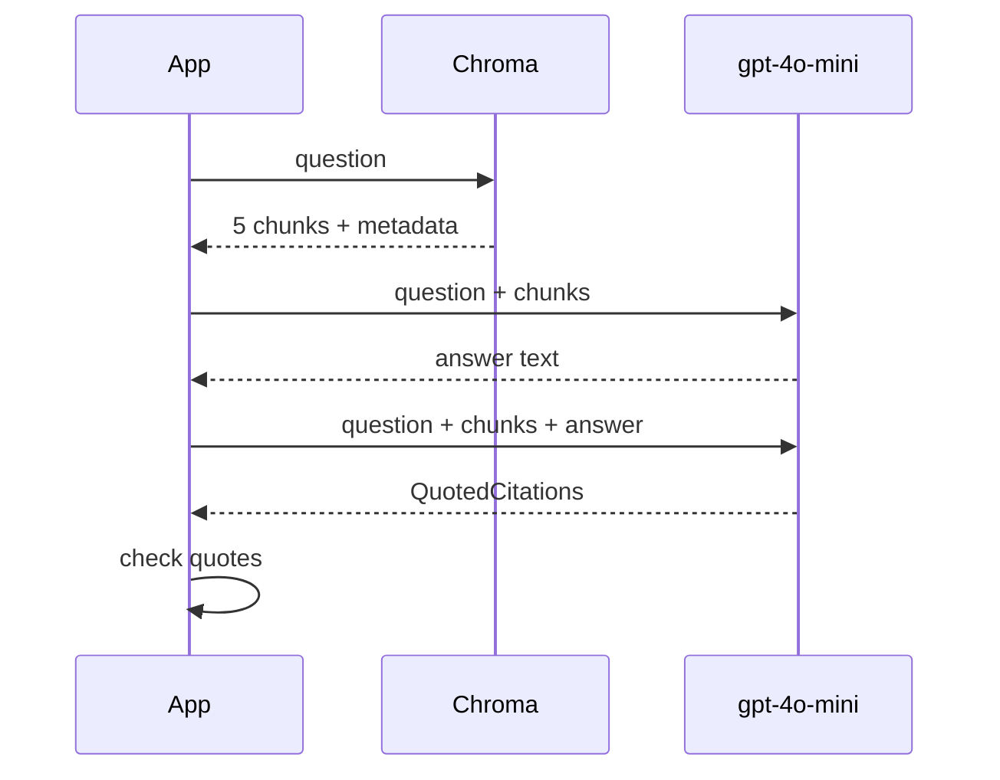

# M20.2 Theory: Answers with sources and per-claim citations

*[M20 theory](../README.md) · Lesson 20.2 · Notebooks: [`02a_rag_system_with_sources.ipynb`](../../../../course/p07_rag_applications/m20_end_to_end_rag_systems/notebooks/02a_rag_system_with_sources.ipynb), [`02b_rag_system_with_citations.ipynb`](../../../../course/p07_rag_applications/m20_end_to_end_rag_systems/notebooks/02b_rag_system_with_citations.ipynb) · [All theory pages](../../../README.md)*

## Returning the sources

Both notebooks start with `%run` on the M16 contextual retrieval notebook, [`05b_contextual_retrieval_rag_system.ipynb`](../../../../course/p05_ingestion_and_indexing/m16_advanced_indexing/notebooks/05b_contextual_retrieval_rag_system.ipynb) ([M16.5](../../../p05_ingestion_and_indexing/m16_advanced_indexing/05_context_aware_chunks_contextual_headers_and_contextual_retrieval/README.md#contextual-retrieval)). That run builds the index the citations depend on, and it writes four metadata fields on every chunk:

| Field | Wikipedia articles | PDF chunks |
|---|---|---|
| `id` | the article's id from the JSONL | a fresh `uuid4()` per chunk |
| `source` | `"Wikipedia"` | the file path |
| `title` | the article title | the file name |
| `page` | always `1` | `PyMuPDFLoader`'s page number, which counts from 0 |

Shown as stored, the 0-based page tells a reader "page 0" or sends them to the page before the right one. Add 1 when you display it.

`02a` keeps the retrieved Documents in the chain's output instead of formatting them away:

```python
rag_chain_w_sources = (
    {"context": similarity_retriever, "question": RunnablePassthrough()}
    | RunnablePassthrough.assign(response=src_rag_response_chain)
)
```

`RunnablePassthrough.assign` runs the answer chain on the dict and adds its result under `response`, so the output holds `context` (the five Documents), `question` and `response`. The retriever runs once, and the chunks the user sees are the chunks the model read. This is source attribution at the answer level: the reader gets a list of five sources and has to find the supporting sentence in each.

## Citation schema

`02b` asks for more: which chunk supports the answer, and the exact sentences. A second model call, after the answer, fills a Pydantic schema through `with_structured_output`:

```python
class Citation(BaseModel):
    id: str        # the SPECIFIC context article that justifies the answer
    source: str
    title: str
    page: int
    quotes: str    # VERBATIM sentences from that article

class QuotedCitations(BaseModel):
    citations: List[Citation]
```



The answer chain formats each chunk with `format_docs_with_metadata`, which prints `Context Article ID`, `Source`, `Title` and `Page` above its text, so the model can copy real ids into the citation. Each field earns its place:

- **`id`** joins a citation back to a retrieved chunk, which is what lets code check it.
- **`page`** sends a reader to the right place in a long PDF.
- **`quotes`** is the part a machine can check. A quote either appears in the chunk or it does not.

On the Larkspur handbook, *Can I get a refund on my annual plan?* should produce a citation like this one (a representative output, not a recorded run):

```json
{"id": "refund-window", "source": "handbook.pdf", "title": "handbook.pdf", "page": 2,
 "quotes": "An annual plan can get a full refund within 30 days of purchase if the account used less than 100 GB of outbound traffic."}
```

### What the schema does not guarantee

- **Citations come after the answer.** The second call looks for support for text that already exists. It shows the answer can be justified from the chunks, not that the model used them. A claim with no support may get a loose citation or none, and nothing marks which.
- **It is per answer, not per claim.** `QuotedCitations` is a flat list. Nothing ties a citation to the sentence of the answer it supports. For true per-claim citations, add a `claim: str` field (the answer sentence) or have the answer call emit numbered markers that the citations reference.
- **The quote may not be verbatim.** The schema asks for exact sentences; the model can still paraphrase or merge two. The notebook's display code highlights each quoted sentence in its chunk with a regex. A paraphrase highlights nothing and raises nothing, and a citation whose `id` matches no retrieved chunk comes back with its context set to `None`. Both fail silently.

So check every citation in code before showing it:

```python
import re

def norm(text):
    return re.sub(r"\s+", " ", text).strip()

def quote_found(citation, chunks_by_id):
    chunk = chunks_by_id.get(citation.id)
    return chunk is not None and norm(citation.quotes) in norm(chunk.page_content)
```

On the refund chunk, the verbatim quote above passes, the same quote broken across lines passes, and the paraphrase "Annual plans are fully refundable for 30 days." fails. Drop or flag the citations that fail, and track the failure rate as a production metric: a rising rate means the prompt, the model or the chunk text changed.

One bug to fix when you reuse the notebook: `cite_response_chain` passes `itemgetter('context')` straight into the prompt, so the model reads the Python repr of a list of Documents (`[Document(metadata={...}, page_content='...')]`). Run it through `format_docs_with_metadata`, as the answer chain does, so both calls see the same text.

## Key Takeaways

- `RunnablePassthrough.assign` keeps the retrieved Documents in the output, so the retriever runs once and the sources shown are the chunks the model read.
- A citation schema with `id`, `page` and verbatim `quotes` makes citations checkable. It is still a flat list per answer, so add a `claim` field for true per-claim citations.
- The model can paraphrase a quote or cite an id that was never retrieved. Verify every quote against its chunk in code, drop failures, and track the failure rate.

## Check yourself

<details>
<summary>1. Why does notebook 02a build its chain with RunnablePassthrough.assign instead of formatting the documents away?</summary>

The output then holds `context` (the five Documents), `question` and `response`. The retriever runs once, so the chunks the user sees are the chunks the model read. That gives source attribution at the answer level: a list of sources the reader can check.

</details>

<details>
<summary>2. The model cites the refund chunk with the quote Annual plans are fully refundable for 30 days. Does the quote check accept it, and what do you do?</summary>

No. The check normalises whitespace and looks for the quote inside the chunk text, and this paraphrase is not there; a verbatim quote, even broken across lines, would pass. Drop or flag the citation, and track the failure rate as a production metric.

</details>

<details>
<summary>3. Your product must tie each sentence of the answer to its supporting quote. Is the QuotedCitations schema enough?</summary>

No. It is a flat list per answer, and nothing ties a citation to the sentence it supports. Add a `claim: str` field holding the answer sentence, or have the answer call emit numbered markers that the citations reference. The citations also come after the answer, so they show it can be justified, not that the model used them.

</details>

---
*Previous: [20.1 Environment setup and a complete RAG system](../01_environment_setup_and_a_complete_rag_system/README.md). Next: [20.3 Explainable retrieval](../03_explainable_retrieval/README.md).*
