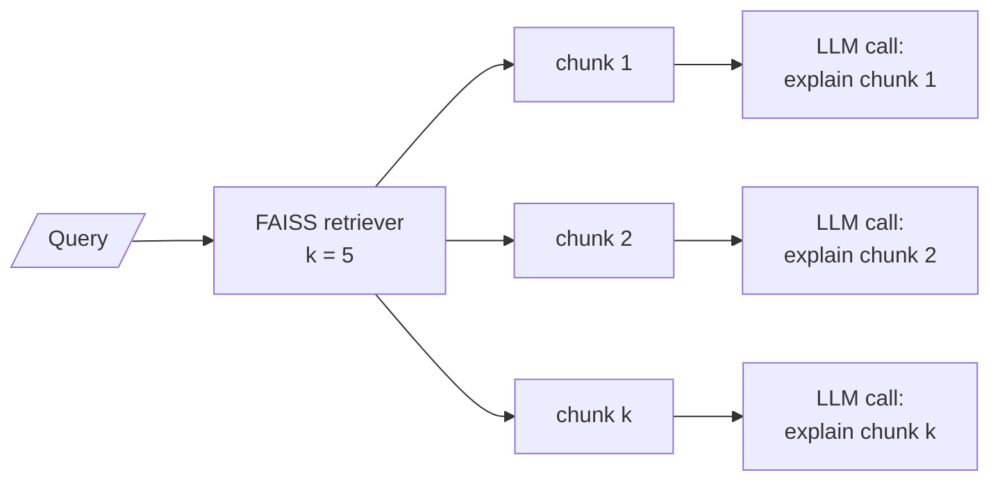

# M20.3 Theory: Explainable retrieval

*[M20 theory](../README.md) · Lesson 20.3 · Notebooks: [`03a_explainable_retrieval.ipynb`](../../../../course/p07_rag_applications/m20_end_to_end_rag_systems/notebooks/03a_explainable_retrieval.ipynb) · [All theory pages](../../../README.md)*

## Explaining a retrieved chunk

`ExplainableRetriever` wraps a FAISS index (OpenAI embeddings, `k=5`) and, for every chunk it returns, makes one more `gpt-4o-mini` call that writes a paragraph on why the chunk fits the query. The output is a list of `{"content", "explanation"}` pairs.

Three properties of this design decide where it is useful.

**It costs one call per chunk.** The loop calls the explanation chain `k` times, one after another. At `k=5` a single search becomes five model calls before any answer is written. Run them with `batch` to cut the wait, or explain only the chunks the answer cites.

**The prompt assumes relevance.** It says "Explain why this context is relevant to the query". The model never sees the similarity score or the other chunks, and it is not offered "this chunk is not relevant" as an answer. In the M11 TF-IDF index of the Larkspur handbook, *What happens if my server goes down?* ranks the `reboot` chunk first, on the shared word "server" ([M11.2](../../../p04_rag_foundations/m11_rag_lifecycle/02_indexing_from_scratch_with_tf_idf_and_nearest_neighbours/README.md#top-k)). Asked why `reboot` is relevant, with no way to say it is not, the model's likely reply is a reason, such as "rebooting is one way to recover a server" (a representative output). That reads as an explanation and is a rationalisation of a ranking error.

**It explains the text, not the ranking.** The chunk was ranked by cosine similarity between two vectors. The paragraph is the model's reading of the query and the chunk side by side, written after the fact. It can be a good guide for a user and a poor guide for an engineer: to debug retrieval, print the scores (`similarity_search_with_score`) and the rank of the chunk you expected.

A version that helps both readers changes the question it asks:

| The notebook asks | Ask instead |
|---|---|
| Why is this context relevant? | Is this context relevant to the query? Answer yes or no, then quote the sentence that decides it. |
| One free-text paragraph | A structured result: `relevant: bool`, `evidence: str` (verbatim), the retriever's score |
| Every retrieved chunk | Only the chunks the answer used, or the ones a user expands |

The yes or no form is a relevance grader. [M28](../../../p09_agentic_rag/m28_retrieval_grading_rewriting/README.md) uses it to filter chunks and rewrite the query, and [M32.1](../../../p09_agentic_rag/m32_reliability_feedback/01_reliable_rag_relevance_checks_hallucination_checks_source_highlighting/README.md#relevance-grading) adds a hallucination check and source highlighting on top.

Two notes on running the notebook today. `retrieve_and_explain` calls `self.retriever.get_relevant_documents(query)`, which langchain-core 1.7 no longer has, so it raises `AttributeError`; use `self.retriever.invoke(query)`. And the demo indexes three sentences with `k=5`; FAISS returns all three, so each query gets three explanations, including two for texts about photosynthesis and global warming when the question is why the sky is blue.

## Key Takeaways

- An explainable retriever adds one LLM call per chunk. Batch the calls, or explain only the chunks the answer cites.
- A prompt that asks why a chunk is relevant gets a reason even for a ranking error. The paragraph explains the text, not the cosine ranking, so debug retrieval with scores and ranks.
- Ask a yes or no relevance question with a verbatim quote and the retriever's score instead. That turns the explainer into a relevance grader.

## Check yourself

1. How many model calls does one search make with the explainable retriever at k of 5, and how can you reduce the cost?

Five explanation calls, one per chunk and one after another, before any answer is written. Run them with `batch` to cut the wait, or explain only the chunks the answer cites.

2. A TF-IDF index ranks the reboot chunk first for the question about a server going down. What will the explainer likely say, and what should an engineer check instead?

A reason, such as "rebooting is one way to recover a server", because the prompt asks why the chunk is relevant and offers no way to say it is not. That reads as an explanation and is a rationalisation of a ranking error. To debug retrieval, print the scores with `similarity_search_with_score` and the rank of the chunk you expected.

3. How would you change the explainer so it can catch an irrelevant chunk?

Ask whether the context is relevant, answered yes or no, and have the model quote the sentence that decides it. Return a structured result with `relevant: bool`, verbatim `evidence` and the retriever's score, and run it only on the chunks the answer used. That yes-or-no form is the relevance grader M28 uses.

---
*Previous: [20.2 Answers with sources and per-claim citations](../02_answers_with_sources_and_per_claim_citations/README.md). Next: [20.4 RAG over structured data: CSV and JSON](../04_rag_over_structured_data_csv_and_json/README.md).*
