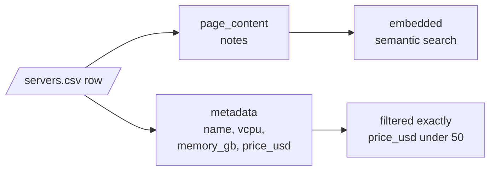
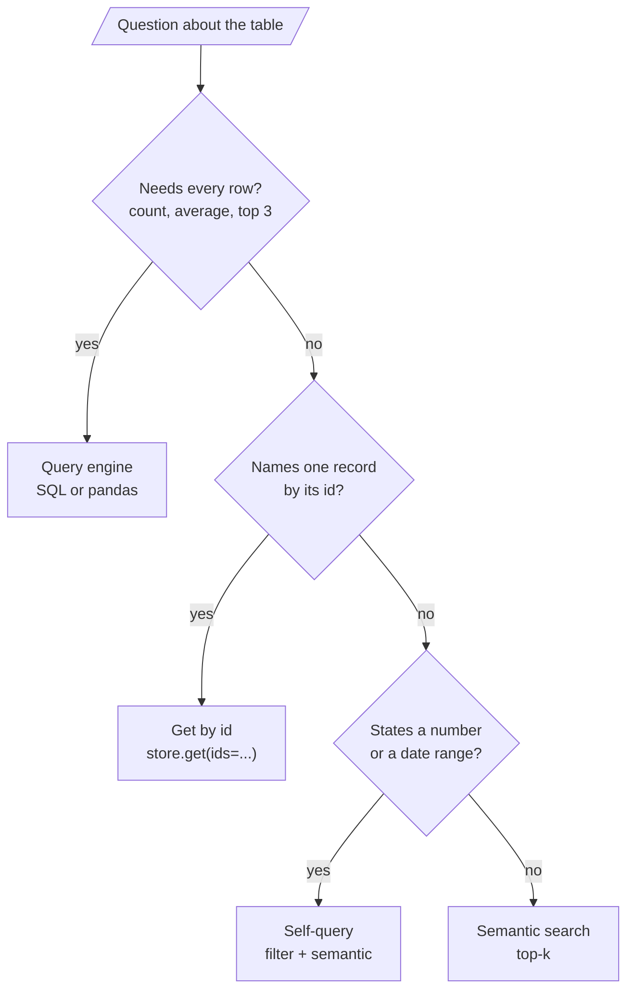

# M20.4 Theory: RAG over structured data: CSV and JSON

*[M20 theory](../README.md) · Lesson 20.4 · Notebooks: [`04a_structured_data_rag.ipynb`](../../../../course/p07_rag_applications/m20_end_to_end_rag_systems/notebooks/04a_structured_data_rag.ipynb), [`04b_simple_csv_rag.ipynb`](../../../../course/p07_rag_applications/m20_end_to_end_rag_systems/optional/04b_simple_csv_rag.ipynb) (optional), [`04c_json_rag.ipynb`](../../../../course/p07_rag_applications/m20_end_to_end_rag_systems/optional/04c_json_rag.ipynb) (optional) · [All theory pages](../../../README.md)*

## Record representation

A table row is a set of typed fields; an embedding model takes one string. Something has to turn the row into text, and that choice decides what the index can find. `04a` shows three ways to write the same row. On the Larkspur server catalogue (ten sizes, the table the lab uses), the `ls-mem-4` row becomes:

| Representation | Text that gets embedded |
|---|---|
| Every column (`CSVLoader` style) | `name: ls-mem-4` `vcpu: 4` `memory_gb: 32` `price_usd: 140` `notes: Memory-optimised server for large PostgreSQL databases and analytics queries.`, one field per line |
| Natural language | `A 4-vCPU, 32 GB server, ls-mem-4, at $140 a month. Memory-optimised server for large PostgreSQL databases and analytics queries.` |
| Description only | `Memory-optimised server for large PostgreSQL databases and analytics queries.` |

The notebook's rule picks the third and moves everything else to metadata: free text carries meaning and belongs in `page_content`; identifiers, categories, numbers and dates are things you filter on and belong in `metadata`, where a filter compares them exactly.

The lab measures what the choice does with real `all-MiniLM-L6-v2` scores:

- **Fields dilute the vector.** For *A server for a memory-hungry database*, the description-only index ranks `ls-mem-4` (0.733) and `ls-mem-2` (0.626) first, 0.115 ahead of the third row. Embed every column and the two still lead, but `ls-mem-2` (0.464491) beats the general-purpose `ls-small` (0.464116) by 0.0004. The names and numbers in each string pull every row towards every other.
- **Ids in the text make lookups a coin toss.** For *Tell me about ls-cpu-8.*, the description never names the server, so similarity matches "cpu" to "CPU cores" and ranks the sibling `ls-cpu-4` first (0.535 against 0.517). With every column embedded, `ls-cpu-8` wins by 0.050 (0.708 against 0.659). Neither is a lookup; `store.get(ids=["ls-cpu-8"])` is.

Two details from the notebook make the split work. `row_to_document` casts every number with `int()` before it goes into metadata, because a range filter compares numbers and `CSVLoader` returns strings ([M12.3](../../../p05_ingestion_and_indexing/m12_document_ingestion/03_semi_structured_sources_csv_rows_and_json_jsonl_with_jq_schemas/README.md)). And the context sent to the model adds the metadata back: its `format_docs` prints address, price, bedrooms and year after each description, so the model can quote a price it could not search on.

The rule is a default. "Built in 1962" carries meaning a buyer might search for, in a way "295000" does not; judge each field by whether its value has meaning or only magnitude.

### Nested JSON

JSON adds depth: a support ticket has a nested `customer` object, a `tags` list and a `messages` list. `ticket_to_document` in `04a` makes two separate decisions:

- **Meaning goes to `page_content`:** the subject and the conversation, one `from: body` line per message.
- **Filters go to flat `metadata`:** `customer.tier` becomes `customer_tier`, because Chroma rejects nested dicts in metadata.

Lists are the hard case. The notebook joins `tags` into `"export,performance,timeout"`, and an `$eq` filter on that string matches only the whole string in that order. Check what your store accepts before you flatten: the chromadb 1.5.9 installed here stores a list value as metadata, and `{"tags": {"$contains": "export"}}` matches list membership (in a scratch test it returned the record whose tags were `["export", "performance"]` and not the one holding the string `"export,timeout"`). Where the store has no list type, the options are a boolean field per tag or a relational table for tags with only ids in the vector store. When filtering is that relational, the vector store is the wrong primary home for the data.

The optional notebooks show the two ends. `04b` loads `customers-100.csv` with `CSVLoader` defaults (every column in the text) and asks *which company does Sheryl Baxter work for?*, an exact lookup by name. `04c` uses the `jrag` library with jsonpath expressions (`$.year`, `$.laureates[*].full_name`) to pick the fields of each Nobel Prize record that become `Year: …, Category: …` text before embedding.

## Retrieval reads a sample

Retrieval returns the `k` rows most similar to the question. Four kinds of question need something else, and on a table they look like ordinary questions:

| Question | Needs | Why retrieval cannot answer it |
|---|---|---|
| Aggregation: average, count, sum | every row | it reads `k` rows; raising `k` only moves the cliff and fills the context |
| Comparison: "under $50", "since 2025" | rows that pass a test | the number in the question is embedded as text and filters nothing |
| Exact lookup: by id, SKU, order number | one known row | identifiers have no useful similarity |
| Ranking: the three cheapest | a total order | similarity orders by meaning, not by price |

The [interactive lab](interactive/sample-or-population-lab.html) runs all four on the server catalogue. With description-only text:

- *What is the average monthly price of a Larkspur server?* The table's answer is $102.50. At `k = 4` the four retrieved rows average $36.25; at `k = 9`, $60.56. Only `k = 10`, the whole table, is right, because the most expensive server, `ls-gpu-1` ($480), ranks last for this question in both representations.
- *Which servers cost less than $50 a month?* Four servers qualify. `k = 4` retrieves three of them plus `ls-large` at $80; `k = 5` gets all four, with `ls-large` still in the context. With every column embedded it takes `k = 6`, and two over-budget rows come along.
- *Tell me about ls-cpu-8.* At `k = 1` the model reads only `ls-cpu-4` and would describe the wrong server.

<!-- lab: interactive/sample-or-population-lab.html -->

Each of these would come back as a fluent, specific answer. The notebook's comparison of the two approaches names the difference: query generation fails loudly (a bad query raises or returns nothing), retrieval fails quietly (it answers from whatever it retrieved).

So route by the kind of question, not the kind of data:

The notebook builds each branch in its simplest form:

- **Router.** One prompt classifies a question as `AGGREGATE`, `LOOKUP` or `SEMANTIC`, and `StructuredRAG` refuses the first two instead of answering from a sample.
- **Self-query.** `llm.with_structured_output(ListingQuery)` turns *Which properties cost less than $400,000?* into a semantic part and, when extraction works, `max_price=400000`, which becomes a Chroma filter `{"price": {"$lte": 400000}}`. (`$lte` lets a listing at exactly $400,000 through; "less than" is `$lt`.) The full version is [M18](../../../p06_retrieval_quality/m18_query_transformation/README.md)'s self-querying lesson.
- **Query generation.** The model writes one line of pandas over the schema and the notebook `eval`s it. That executes model-written code with full interpreter access, and a data field can carry a prompt injection. In production, generate SQL against a read-only connection with a timeout, or run a sandboxed executor.

## Key Takeaways

- Embed fields whose values carry meaning and put identifiers, numbers and dates in metadata, cast to their real types. Embedding every column dilutes the vector.
- Retrieval reads a sample of `k` rows. Aggregation, numeric comparison, exact lookup and ranking need every row, a filter or an id, and retrieval fails on them quietly with a fluent answer.
- Route by the kind of question: a query engine for aggregates, get-by-id for lookups, self-query filters for ranges, semantic search for the rest. Never `eval` model-written code without a sandbox.

## Check yourself

1. Why does the 04a rule embed only a server's description and keep its name, vCPUs, memory and price in metadata?

Free text carries meaning and belongs in `page_content`; identifiers, numbers and dates are things you filter on, and a filter compares metadata exactly. Fields also dilute the vector. With descriptions only, `ls-mem-4` and `ls-mem-2` rank first for the memory-hungry database question, 0.115 ahead of the third row; with every column embedded, `ls-mem-2` beats the general-purpose `ls-small` by 0.0004.

2. A user asks for the average monthly price of a Larkspur server, and the system retrieves 4 rows. What comes back, and why?

A fluent answer built on four rows that average $36.25, against the table's $102.50. The most expensive server, `ls-gpu-1` at $480, ranks last for this question, so only retrieving all 10 rows gets it right. Aggregation needs every row, so route it to a query engine (SQL or pandas).

3. A user asks Tell me about ls-cpu-8. Which route should handle it, and what goes wrong with semantic search?

Get by id: `store.get(ids=["ls-cpu-8"])`. With description-only text the description never names the server, so similarity ranks the sibling `ls-cpu-4` first (0.535 against 0.517). At `k = 1` the model reads only `ls-cpu-4` and would describe the wrong server.

---
*Previous: [20.3 Explainable retrieval](../03_explainable_retrieval/README.md). Next: [20.5 Fully local RAG with Hugging Face and FAISS](../05_fully_local_rag_with_hugging_face_and_faiss/README.md).*
