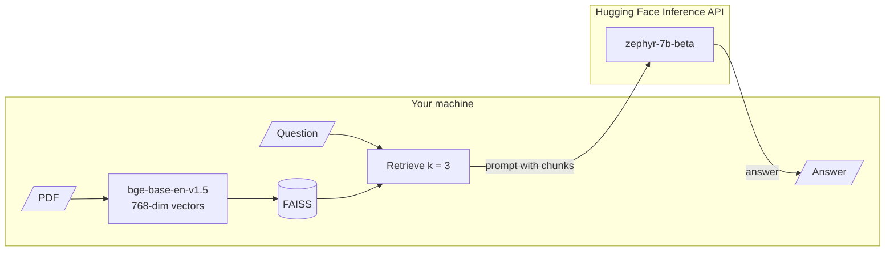

# M20.5 Theory: Fully local RAG with Hugging Face and FAISS

*[M20 theory](../README.md) · Lesson 20.5 · Notebooks: [`05a_local_rag_huggingface_faiss.ipynb`](../../../../course/p07_rag_applications/m20_end_to_end_rag_systems/notebooks/05a_local_rag_huggingface_faiss.ipynb) · [All theory pages](../../../README.md)*

## Local inference

The notebook replaces every OpenAI call with open models. Its configuration:

| Setting | Value |
|---|---|
| Document | `Understanding_Climate_Change.pdf`, loaded with `PyPDFLoader` |
| Chunks | 1,000 characters, 200 overlap |
| Embeddings | `BAAI/bge-base-en-v1.5` through `HuggingFaceEmbeddings`, on CPU, `normalize_embeddings=True`, 768 dimensions |
| Index | FAISS, in memory |
| Retrieval | `k = 3` |
| Generation | `HuggingFaceH4/zephyr-7b-beta` through `HuggingFaceEndpoint`, `max_new_tokens=256` |

"Local" has to be checked per component, because one remote call is enough to send the data out. Here the embedding model and the index run on your machine. The generator does not: `HuggingFaceEndpoint` calls the Hugging Face Inference API, and the notebook asserts that `HUGGINGFACEHUB_API_TOKEN` is set before it starts. Every prompt, with the three retrieved chunks inside it, leaves the machine.

So the notebook's own comparison table, which lists data privacy as "Stays local", is true only for indexing. Its "Next steps" names the fix: replace `HuggingFaceEndpoint` with `HuggingFacePipeline`, which loads the model weights and generates in your process. That is the version to offer a Larkspur customer whose contract says support tickets and the handbook may not leave their network.

| Component | `05a` as written | Fully offline |
|---|---|---|
| Embeddings | local, CPU | local, CPU |
| Vector index | local, FAISS in memory | local, FAISS saved to disk |
| Generator | remote, HF Inference API, needs a token | local, `HuggingFacePipeline`, needs the weights and enough memory |
| Data leaving the machine | every prompt, chunks included | none |

What you trade for keeping it local:

- **Hardware and latency.** A 7B model generating on your own CPU or GPU replaces a network call. Measure tokens per second on the target machine before you promise a latency.
- **One embedding model on both sides.** The query must be embedded by the model that embedded the chunks. Switching from OpenAI's 1,536-dimension vectors to bge's 768 means re-embedding the whole corpus, not only new documents.
- **Saving the index runs pickle.** The notebook's commented `FAISS.load_local(..., allow_dangerous_deserialization=True)` needs that flag because the docstore is a pickle file, and loading a pickle can run code. Load only index files your own pipeline wrote.

Two smaller things to change when you reuse the code:

- **`RunnableParallel(answer=rag_chain, sources=retriever)` retrieves twice**, once inside `rag_chain` and once for `sources` (a counting retriever in a scratch test was called two times). On a fixed FAISS index the two lists match, so the cost is the extra search. On an index that updates between the calls, the sources shown could differ from the context the model read. The `RunnablePassthrough.assign` pattern from [20.2](../02_answers_with_sources_and_per_claim_citations/README.md#returning-the-sources) retrieves once.
- **`ask` keeps the text after the last `Answer:`**, to strip a prompt echoed back with the completion. The installed `HuggingFaceEndpoint` already defaults to `return_full_text=False`, so the split guards against nothing today and cuts any answer that itself contains "Answer:". Drop it, or keep `return_full_text=False` explicit if you move to `HuggingFacePipeline`.

The notebook's fallback evaluation counts expected keywords in each answer ("carbon dioxide", "methane"). Substring matching rewards any answer that mentions the words, right or wrong; treat it as a smoke test and use the golden-set metrics from [M11](../../../p04_rag_foundations/m11_rag_lifecycle/README.md) for decisions.

---
*Previous: [20.4 RAG over structured data: CSV and JSON](../04_rag_over_structured_data_csv_and_json/README.md). Next: [M20 interview questions](../README.md#interview-spotlight-5-questions-you-might-get-asked).*
