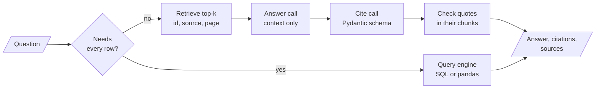

# M20 Theory: End-to-end RAG systems

*Part VII · Building Complete RAG Applications · [Module README](../../../course/p07_rag_applications/m20_end_to_end_rag_systems/README.md) · [All theory pages](../../README.md)*

A RAG pipeline returns an answer. A RAG system returns an answer a user can check: the chunks it came from, the sentences that support it, and a refusal when the evidence is missing or the question needs something other than retrieval. The M20 notebooks build on four ideas: grounding the answer in retrieved context, a schema for citations, how a table row becomes a retrievable record, and running the pipeline on your own hardware. Each idea has a page in the folder of the lesson that teaches it, listed under [Lessons](#lessons). This page has the overview, the interview questions and the takeaways.

The running example is the Larkspur Cloud handbook from M11 to M13 (refunds, exports, outages) plus its server catalogue: ten server sizes with vCPUs, memory, a monthly price and a one-line description. The golden questions are *Can I get a refund on my annual plan?* for citations, and four questions on the catalogue for structured data: the average monthly price, the servers under $50, the `ls-cpu-8` server, and a server for a memory-hungry database.

## TL;DR

- Grounded generation has three parts: evidence retrieved for this question, an instruction to use only that evidence, and permission to say "I don't know". Lesson 20.1's chain has all three but formats the metadata away, so its answers cannot be checked.
- `RunnablePassthrough.assign` keeps the retrieved chunks in the output with one retrieval. A second call fills a `QuotedCitations` schema (`id`, `source`, `title`, `page`, `quotes`); check every quote against its chunk in code, because the notebook's highlighter fails silently on a paraphrase.
- An LLM explanation per retrieved chunk costs `k` extra calls and, asked why a chunk is relevant, explains even a wrong one. Show scores to engineers and grade relevance with a yes or no.
- Put a record's description in `page_content` and its ids, numbers and dates in metadata. In the lab, embedding every column shrinks the lead of the right rows from 0.115 to 0.0004, and *What is the average monthly price?* answered from the top 4 rows gives $36.25 where the table says $102.50.
- The local pipeline embeds with `bge-base-en-v1.5` and searches FAISS on your machine, but generates through the Hugging Face Inference API. Fully local means `HuggingFacePipeline` as well.

## Mental model

<!-- animated: diagrams/cited-answer.anim.html -->

Each box adds something a reader can verify. The router keeps questions that need the whole table away from top-k retrieval; the metadata carried from retrieval to the answer is what makes a citation point somewhere; the quote check is the one step that runs as code, not as a model call.

## Lessons

| Lesson | Topic | Theory |
|---|---|---|
| 20.1 | Environment setup and a complete RAG system | [Grounded generation](01_environment_setup_and_a_complete_rag_system/README.md#grounded-generation) |
| 20.2 | Answers with sources and per-claim citations | [Returning the sources](02_answers_with_sources_and_per_claim_citations/README.md#returning-the-sources) [Citation schema](02_answers_with_sources_and_per_claim_citations/README.md#citation-schema) |
| 20.3 | Explainable retrieval | [Explaining a retrieved chunk](03_explainable_retrieval/README.md#explaining-a-retrieved-chunk) |
| 20.4 | RAG over structured data: CSV and JSON | [Record representation](04_rag_over_structured_data_csv_and_json/README.md#record-representation) [Retrieval reads a sample](04_rag_over_structured_data_csv_and_json/README.md#retrieval-reads-a-sample) |
| 20.5 | Fully local RAG with Hugging Face and FAISS | [Local inference](05_fully_local_rag_with_hugging_face_and_faiss/README.md#local-inference) |

## Interactive lab

[**Sample or population**](04_rag_over_structured_data_csv_and_json/interactive/sample-or-population-lab.html): open the file in a browser. Pick *What is the average monthly price of a Larkspur server?* and slide `k` from 1 to 10: the answer from the retrieved rows stays far below $102.50 until the last row, `ls-gpu-1` at $480, comes in. Then pick *Tell me about ls-cpu-8.* at `k = 1` and switch between Description only and Every column to see the lookup flip between the wrong server and a 0.050 win. Last, pick the memory-hungry database question, the one retrieval answers well, and compare the two texts' margins.

## How it connects

- **Before:** [M11](../../p04_rag_foundations/m11_rag_lifecycle/README.md) built the plain pipeline and its baseline; [M12](../../p05_ingestion_and_indexing/m12_document_ingestion/README.md) loaded CSV and JSON; [M15](../../p05_ingestion_and_indexing/m15_vector_stores/README.md) covered metadata filters; [M16](../../p05_ingestion_and_indexing/m16_advanced_indexing/README.md) built the contextual-retrieval index that lesson 20.2 cites from; [M18](../../p06_retrieval_quality/m18_query_transformation/README.md) covered self-query and routing; [M19](../../p06_retrieval_quality/m19_reranking_post_retrieval/README.md) decided which chunks reach the prompt.
- **Next:** [M21](../m21_multimodal_rag/README.md) extends retrieval to images and page scans. [M28](../../p09_agentic_rag/m28_retrieval_grading_rewriting/README.md) and [M29](../../p09_agentic_rag/m29_crag_and_self_rag/README.md) grade chunks and answers inside the loop; [M32](../../p09_agentic_rag/m32_reliability_feedback/README.md) adds hallucination checks and source highlighting; [M33](../../p10_memory_and_multi_agent/m33_conversational_memory_rag/README.md) adds the session history the module lab's research assistant keeps.

## Interview Spotlight: 5 Questions You Might Get Asked

*Production questions of the kind asked in applied AI engineering interviews.*

### 1. A Larkspur customer forwards a support answer about annual-plan refunds. Its citation quotes "Annual plans are fully refundable for 30 days" and points to page 0 of the handbook. Neither the sentence nor a page 0 exists. What happened, and what do you change?

**What a strong answer covers:**
- Two separate faults: the quote is a paraphrase the model wrote, and the page is the PDF loader's 0-based number shown without adding 1
- Logs the request: the retrieved chunk ids, the answer, the raw `QuotedCitations`, to confirm the cited `id` was among the retrieved chunks
- Adds a code check before display: each quote, whitespace-normalised, must appear in the chunk with that id; failures are dropped or flagged, never shown as citations
- Tracks the quote-failure rate per day and alerts on a jump, which signals a model, prompt or chunking change

### 2. The team wants to cut latency by asking for the answer and its citations in one structured call instead of two. What do you gain and lose?

**What a strong answer covers:**
- Gains one round trip and the tokens of sending the context twice
- In one call the model writes claims and their support together, which can tie each citation to a claim; in two calls citations are a post-hoc search for support
- Either way the quote check in code stays, since neither design makes quotes verbatim
- Decides on the golden set: citation precision, unsupported-claim rate and latency for both designs, not on intuition

### 3. After the citation feature ships, how do you know whether answers are better supported than before, and how do you keep watching it?

**What a strong answer covers:**
- Offline: on the golden set, citation precision (cited chunk supports the claim), citation recall (claims with a citation) and the quote-match rate
- Online: share of answers with at least one verified citation, share of "I don't know" answers, and quote-failure rate
- Samples traffic for an LLM or human judge of whether each claim is supported by its quote
- Watches refusals on questions the handbook does answer, since a stricter prompt can trade hallucinations for missed answers

### 4. Product adds the server catalogue to the index, and the assistant tells a customer the average Larkspur server costs about $36 a month. The real average is $102.50. Why, and what is the fix?

**What a strong answer covers:**
- Retrieval read the top 4 of 10 rows, the ones whose descriptions resemble the question most; they average $36.25, and the $480 GPU server ranks last
- No `k` fixes it below the whole table; aggregation, comparisons, id lookups and rankings need every row or an exact filter
- Routes by question type: aggregates to SQL on a read-only connection, id lookups to a get by id, price limits to a metadata filter, descriptive questions to the vector store
- Adds these four question kinds to the golden set, with the right answer computed from the table, so a regression shows up as a wrong number

### 5. A bank evaluating Larkspur's assistant requires that no customer data leaves its network. The team says the system is local because it uses `bge-base-en-v1.5` and FAISS. Is it, and what changes?

**What a strong answer covers:**
- Checks every component: embeddings and FAISS run locally, but `HuggingFaceEndpoint` sends each prompt, retrieved chunks included, to the Hugging Face Inference API
- Moves generation in-process with `HuggingFacePipeline` (or another self-hosted server inside the network) and removes the API token
- Sizes the hardware: memory for a 7B model, tokens per second on the target machine against the latency requirement
- Keeps the same embedding model for queries and documents, and loads saved FAISS indexes only from files the pipeline wrote, since `load_local` unpickles them

## Key Takeaways

- Carry metadata from the store to the answer. A chunk without its id, source and page in the output cannot be cited.
- Treat citations as model output to verify: check each quote against the chunk it names, show the page counting from 1, and count the failures.
- Route a question by what it needs. If it needs every row, a filter or one known record, send it to a query, a filter or a get by id, not to top-k retrieval.
- Call a pipeline local only after checking each component, the generator above all.

---
*Previous: [M19 Post-retrieval optimisation and reranking](../../p06_retrieval_quality/m19_reranking_post_retrieval/README.md). Next: [M21 Multimodal RAG](../m21_multimodal_rag/README.md).*
