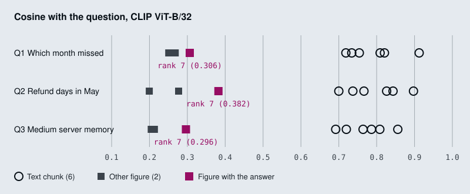

# M21.1 Theory: Shared text–image embedding space with CLIP

*[M21 theory](../README.md) · Lesson 21.1 · Notebooks: [`01a_multimodal_rag_with_clip.ipynb`](../../../../course/p07_rag_applications/m21_multimodal_rag/notebooks/01a_multimodal_rag_with_clip.ipynb) · [All theory pages](../../../README.md)*

## Joint embedding space

CLIP has two encoders, one for text and one for images, trained together so that an image and a caption that describes it land close in the same vector space (Radford et al., *Learning Transferable Visual Models From Natural Language Supervision*, 2021). With `openai/clip-vit-base-patch32`, the notebook's model, both encoders end in a 512-dimension vector. The notebook normalises each one to unit length, so a dot product is a cosine:

```python
def embed_text(text):
    inputs = clip_processor(text=text, return_tensors="pt", padding=True,
                            truncation=True, max_length=77)   # CLIP's max token length
    features = clip_model.get_text_features(**inputs)
    return (features / features.norm(dim=-1, keepdim=True)).squeeze().numpy()
```

`embed_image` does the same with `get_image_features`. Indexing walks each PDF page with PyMuPDF: `page.get_text()` goes through a `RecursiveCharacterTextSplitter` (500 characters, overlap 100) and each chunk is embedded with `embed_text`; every image from `page.get_images()` is embedded with `embed_image`, stored as base64 for the answer model, and indexed as a stub Document `"[Image: page_0_img_0]"` with `type: "image"` in its metadata. All vectors go into one FAISS index through `FAISS.from_embeddings(..., embedding=None)`. FAISS ranks by L2 distance, which on unit vectors orders results the same way as cosine.

At query time the question goes through `embed_text`, `similarity_search_by_vector` returns the top 5, and `create_multimodal_message` builds one `HumanMessage` for `gpt-4.1`: the text chunks as text parts, each retrieved image as an `image_url` part with a base64 data URL ([M06](../../../p02_prompt_engineering/m06_multimodal_prompting/README.md) covers that format).

Both encoders have hard input limits, and both matter for documents:

- **Text stops at 77 tokens.** The splitter's 500-character chunks run past that. Split the same way, page 2 of the Attention paper gives 11 chunks of 81 to 116 CLIP tokens, and even the sample PDF's 365-character page is 79. `truncation=True` drops the tail without a warning. CLIP was trained to match images with short captions, so a long paragraph is outside what it learned.
- **Images become 224 by 224.** The processor scales the shortest side to 224 and crops the centre square. A 400 by 300 chart is scaled to 299 by 224 and loses about a quarter of its width, then the encoder reads it as 7 by 7 patches of 32 pixels. Small axis labels and printed values rarely survive that.

On the notebook's own `multimodal_sample.pdf` the test cannot fail. The page holds one 365-character text chunk and one 400 by 300 image of three unlabelled bars, so the index has two items and `k = 5` returns both for any question. The CLIP scores still show the pattern the next section is about: for *What does the chart on page 1 show about revenue trends?* the text chunk scores 0.651 and the chart 0.270.



## One ranking, two modalities

The [interactive lab](interactive/chart-retrieval-lab.html) indexes the three Larkspur pages with the notebook's `embed_text` and `embed_image`: six text chunks and three figure images in one index, nine items. The scores split into two bands. Every text chunk scores between 0.692 and 0.912 against every question; every image scores between 0.200 and 0.382. Liang et al. measured this split across contrastive models and named it the modality gap (*Mind the Gap*, NeurIPS 2022).

Inside the image band, CLIP does its job. For each question the image with the answer is the best image:

| Question | Answer figure | Score | Best other image | Answer figure's rank |
|---|---|---|---|---|
| *Which month missed the 99.95% availability target?* | Figure 1 | 0.306 | 0.268 | 7 of 9 |
| *How many business days did a refund take in May?* | Figure 2 | 0.382 | 0.277 | 7 of 9 |
| *How much memory does the Medium server have?* | Table 1 | 0.296 | 0.213 | 7 of 9 |

In the shared ranking that does not help. Each answer figure sits behind all six text chunks, so the notebook's `k = 5` sends five text chunks and no image, and the model never sees a bar. It takes `k = 7` to reach the figure, and then the model reads six chunks of text to use one picture.

<!-- lab: interactive/chart-retrieval-lab.html -->

Scores from different modalities are not comparable, so do not rank them together:

- **Separate quotas.** Search text and images separately and send the top text chunks plus the top image. On the lab pages, top-1 image is the answer figure for all three questions.
- **One modality.** Turn figures into text ([lesson 21.2](../02_caption_then_index_with_a_vision_llm/README.md)) or text into images ([lesson 21.3](../03_page_image_retrieval_with_colpali/README.md)), so every score comes from the same comparison.
- **A text model for text.** Use a text embedding model (M14) for the chunks and keep CLIP for image search only; its 77-token text side is a weak paragraph retriever.

## Key Takeaways

- CLIP puts text and images in one 512-dimension space, but its text side stops at 77 tokens and its image side crops to 224 by 224, so long chunks and small chart labels are lost.
- Text and image scores sit in separate bands (0.692 to 0.912 against 0.200 to 0.382 on the lab pages). In one shared ranking the right figure falls behind every text chunk.
- Do not rank modalities together. Use separate quotas for text and images, convert everything to one modality, or embed text with a text model.

## Check yourself

<details>
<summary>1. Which two input limits make CLIP a weak retriever for document text and charts?</summary>

Text stops at 77 tokens, and the notebook's 500-character chunks run past that; `truncation=True` drops the tail without a warning. Images become 224 by 224: a 400 by 300 chart loses about a quarter of its width to the centre crop and is read as 7 by 7 patches of 32 pixels, so small labels and printed values rarely survive.

</details>

<details>
<summary>2. For the availability question, the answer figure is the best image at 0.306, yet the notebook's k of 5 sends no image. Why?</summary>

Every text chunk scores between 0.692 and 0.912 and every image between 0.200 and 0.382, the modality gap. The answer figure ranks 7 of 9, behind all six text chunks. It takes `k = 7` to reach it, and then the model reads six chunks of text to use one picture.

</details>

<details>
<summary>3. Should you fix the missing figure by raising k, or by something else?</summary>

By something else, because scores from different modalities are not comparable. Search text and images separately and send the top text chunks plus the top image; on the lab pages, the top image is the answer figure for all three questions. The alternatives are to put everything in one modality (captions or page images) or to use a text embedding model for the text.

</details>

---
*Previous: [M21 overview](../README.md). Next: [21.2 Caption-then-index with a vision LLM](../02_caption_then_index_with_a_vision_llm/README.md).*
