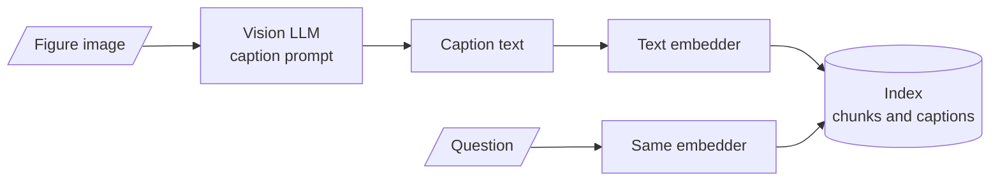

# M21.2 Theory: Caption-then-index with a vision LLM

*[M21 theory](../README.md) · Lesson 21.2 · Notebooks: [`02a_multimodal_rag_with_captioning.ipynb`](../../../../course/p07_rag_applications/m21_multimodal_rag/notebooks/02a_multimodal_rag_with_captioning.ipynb) · [All theory pages](../../../README.md)*

## Captioning

Captioning moves the vision work to index time. A vision model looks at each figure once and writes text about it, and from then on the figure is a text chunk: the same embedder, the same vector store and the same retriever as the paragraphs around it.

The notebook builds it on the Attention paper (`1706.03762v7.pdf`):

1. **Extract.** PyMuPDF reads each page's text into one Document per page and saves every embedded image to `extracted_images/`.
2. **Caption.** `gemini-1.5-flash`, through `google.generativeai`, gets each image with the prompt *"You are an assistant tasked with summarizing tables, images and text for retrieval. These summaries will be embedded and used to retrieve the raw text or table elements. Give a concise summary of the table or text that is well optimized for retrieval."*
3. **Index.** Page texts and captions both go through `RecursiveCharacterTextSplitter.from_tiktoken_encoder(chunk_size=400, chunk_overlap=50)`, are embedded with Cohere `embed-english-v3.0`, and share one Chroma collection.
4. **Answer.** The retriever returns `k = 1` item, and `command-r-plus` at temperature 0 answers from it.

The cost lands once per image, at index time, and never per question. The index holds only text, so every tool from M14 to M19 still applies to captions: hybrid search, reranking, metadata filters.

The test question in the notebook never reaches a caption. PyMuPDF finds three raster images in the paper: Figure 1 on page 3 and the two images that make up Figure 2 on page 4. Figures 3 to 5 are not stored as images, so `get_images()` returns nothing for them. *What is the BLEU score of the Transformer (base model)?* is answered by Table 2 on page 8, which is text. `get_text()` returns it with the rows flattened, one cell per line (`Transformer (base model)`, `27.3`, `38.1`, `3.3 · 1018`), and the training cost 3.3 × 10^18 comes out as "1018". The notebook's system prompt also says *"Answer the question based upon your knowledge"*, which invites the model to answer from memory rather than from the retrieved chunk. To test captioning, ask about something only a figure shows.

On the Larkspur pages the [interactive lab](../01_shared_text_image_embedding_space_with_clip/interactive/chart-retrieval-lab.html) embeds the captions with `all-MiniLM-L6-v2`, the same model as the text chunks. The captions are representative, written the way a vision model following the notebook's prompt would write them. Captions rank 2, 1 and 1 for the three questions. The first misses at `k = 1` because the paragraph *"Figure 1 shows monthly availability for April, May and June against the 99.95% target"* repeats the question's words and scores 0.747, against 0.693 for the caption. Captions compete with text chunks on one scale, so the ranking is fair, and a `k` of 2 or 3 sends both.

## What a caption must hold

The notebook's prompt asks for a summary "well optimized for retrieval". Retrieval needs less than the answer does. With a short caption that names the chart and leaves out the values, such as *"Bar chart of monthly availability in Q2 against a target line."*, the lab's embedder still ranks it 2, 3 and 2 for the three questions. It is found, and it cannot answer: nothing in it says May or 99.91%.

Write the caption prompt for the questions the figure must answer:

- **Every printed value**, with its label and unit: "April 99.98%, May 99.91%, June 99.97%".
- **The title, axes and legend**, and any reference line ("a dashed line marks the 99.95% target").
- **The figure's place**: document, page, figure number, so a citation can point at it.
- **An explicit escape** for anything unreadable, as M06 does with `[NOT_EXTRACTED]`, so the captioner leaves a gap instead of guessing.

A caption is model output, written once and then trusted on every query. If the vision model reads 8 GB as 16 GB, retrieval will find the wrong number with full confidence. The notebook already keeps the image file name in each caption's metadata (`name`), which is enough to retrieve on the caption and then send the original image to a vision model at answer time. The caption then only has to be good enough to find the figure. Where a PDF has a real text layer, an element-level parser that returns each table as HTML ([M12, lesson 12.4](../../../p05_ingestion_and_indexing/m12_document_ingestion/04_pdf_and_word_parser_comparison_and_element_level_parsing/README.md)) keeps rows and columns that a caption has to describe in prose.

---
*Previous: [21.1 Shared text–image embedding space with CLIP](../01_shared_text_image_embedding_space_with_clip/README.md). Next: [21.3 Page-image retrieval with ColPali](../03_page_image_retrieval_with_colpali/README.md).*
