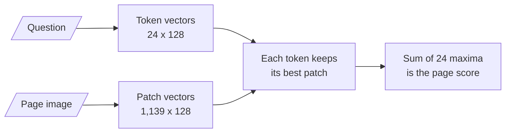

# M21.3 Theory: Page-image retrieval with ColPali

*[M21 theory](../README.md) · Lesson 21.3 · Notebooks: [`03a_multimodal_rag_with_colpali.ipynb`](../../../../course/p07_rag_applications/m21_multimodal_rag/optional/03a_multimodal_rag_with_colpali.ipynb) (optional) · [All theory pages](../../../README.md)*

## Late interaction

A single-vector retriever squeezes a chunk into one vector and a question into another, and compares them once. A cross-encoder (M19) reads question and chunk together, which is accurate and too slow to run over a whole index. Late interaction sits between them. It encodes the document and the question separately, as with single vectors, so documents can be encoded ahead of time. It keeps one vector per token instead of one per text, and compares them only at the end:

```
MaxSim(q, d) = sum over query vectors i of ( max over document vectors j of  q_i · d_j )
```

Each query token finds the document vector it matches best, and the page score is the sum of those best matches. ColBERT introduced this for text passages (Khattab and Zaharia, SIGIR 2020). ColPali applies it to page images (Faysse et al., *ColPali: Efficient Document Retrieval with Vision Language Models*, 2024): a vision language model reads the rendered page, and every image patch gets its own vector.


<!-- animated: diagrams/maxsim.anim.html -->

The figures in the diagram are real. The notebook's `vidore/colpali-v1.2` needs a GPU stack, so the lab pages were scored with `vidore/colSmol-256M`, a small model of the same family, through `colpali_engine`. Each 850 by 1100 page image became 1,139 vectors of 128 dimensions, and each question 24 vectors: its own tokens plus 10 `<end_of_utterance>` tokens the processor appends, which count in the sum like any other. `score_multi_vector` computes the formula above; a hand-written version matched it to within 2e-6.

For *Which month missed the 99.95% availability target?*, a few of the 24 per-token maxima:

| Query token | Page 1 (availability) | Page 2 (refunds) | Page 3 (server plans) |
|---|---|---|---|
| `month` | 0.65 | 0.61 | 0.42 |
| `%` | 0.73 | 0.45 | 0.22 |
| `availability` | 0.75 | 0.25 | 0.25 |
| `target` | 0.65 | 0.20 | 0.28 |
| 14 question tokens, summed | 9.04 | 6.80 | 3.89 |
| 10 appended tokens, summed | 6.91 | 2.94 | 2.93 |
| **MaxSim score** | **15.95** | **9.74** | **6.82** |

`month` scores 0.65 and 0.61 on pages 1 and 2, so it barely separates them. `availability` and `target` do: each finds a strong match on page 1 and nothing better than 0.28 elsewhere. One vector per page would have pooled those signals before the question was known; late interaction keeps them apart until it arrives.

## Page-level retrieval

The unit of retrieval is the page, and the answer model receives the page as an image. Nothing is extracted, split or captioned, so a chart, a table's grid and a scanned form arrive as they were printed. The notebook does it in four calls with byaldi:

```python
RAG = RAGMultiModalModel.from_pretrained("vidore/colpali-v1.2", verbose=1)
RAG.index(input_path="../../../../data/sample/1706.03762v7.pdf", index_name="attention_is_all_you_need",
          store_collection_with_index=True, overwrite=True)
results = RAG.search(query, k=1)
image_bytes = base64.b64decode(results[0].base64)
```

`store_collection_with_index=True` keeps a base64 copy of every page in the index, so `search` can return the image with the hit; each `Result` carries `doc_id`, `page_num`, `score`, `metadata` and `base64`. The notebook decodes the top page, saves it as `image.jpg` and passes it with the question to `gemini-1.5-flash`.

The source of byaldi 0.0.7 explains why the course marks this lesson platform-specific:

- **`from_pretrained` defaults to `device="cuda"`.** On a machine without CUDA, pass `device="mps"` or `device="cpu"`. byaldi loads ColPali weights in bfloat16.
- **PDFs go through `pdf2image.convert_from_path`**, which needs the poppler tools installed on the machine.
- **The Hugging Face token is read from the `hf_token` argument or the `HF_TOKEN` environment variable.** The notebook sets `os.environ["HF_token"]`, which byaldi never reads.

In the [interactive lab](../01_shared_text_image_embedding_space_with_clip/interactive/chart-retrieval-lab.html), choose Page images. ColSmol ranks the right page first for all three questions, by clear margins: 15.95 against 9.74, 15.93 against 10.66, and 12.97 against 6.41. At `k = 1` the model receives the page with the chart on it, so every answer is in what it reads. Some of page 1's lead comes from its paragraph, which says "availability" and "target"; that is fine, because the page brings its chart along.

Pages cost more than chunks in three places:

- **Storage.** 1,139 vectors of 128 dimensions is 145,792 numbers per page, about 583 KB in float32. An `all-MiniLM-L6-v2` chunk vector is 384 numbers. Lower precision, pooled patch vectors, or a cheap first stage with MaxSim only on its shortlist keep a large collection affordable.
- **Generation.** Each hit sends a whole page image to a vision model, so `k` stays small.
- **Granularity.** A page with five topics is retrieved whole, and a citation can point only to the page.

Use page images where layout carries the meaning or there is no text layer: scans, slides, forms, dense tables. Text-heavy documents with a few charts are cheaper to serve with captions ([lesson 21.2](../02_caption_then_index_with_a_vision_llm/README.md)).

## Check yourself

<details>
<summary>1. How does MaxSim score a page, and what does it keep that one vector per page would lose?</summary>

Each query token finds the page vector it matches best, and the page score is the sum of those best matches. One vector per page would pool every signal before the question is known; late interaction keeps one vector per token or patch and compares them only at the end. Pages are still encoded ahead of time, unlike a cross-encoder.

</details>

<details>
<summary>2. For the availability question, the token month scores 0.65 on page 1 and 0.61 on page 2. Which tokens separate the pages, and what are the final scores?</summary>

`availability` and `target`: each scores 0.75 or 0.65 on page 1 and nothing better than 0.28 elsewhere. The MaxSim scores are 15.95 for page 1, 9.74 for page 2 and 6.82 for page 3. The 10 appended `<end_of_utterance>` tokens count in the sum like any other.

</details>

<details>
<summary>3. Your corpus is text-heavy reports with a few charts. Should you index page images with ColPali?</summary>

Probably not; captions are cheaper there. Pages cost more in storage (1,139 vectors of 128 dimensions, about 583 KB per page in float32), in generation (each hit sends a whole page image, so `k` stays small) and in granularity (a citation can point only to the page). Use page images where layout carries the meaning or there is no text layer: scans, slides, forms, dense tables.

</details>

---
*Previous: [21.2 Caption-then-index with a vision LLM](../02_caption_then_index_with_a_vision_llm/README.md). Next: [M21 interview questions](../README.md#interview-spotlight-5-questions-you-might-get-asked).*
