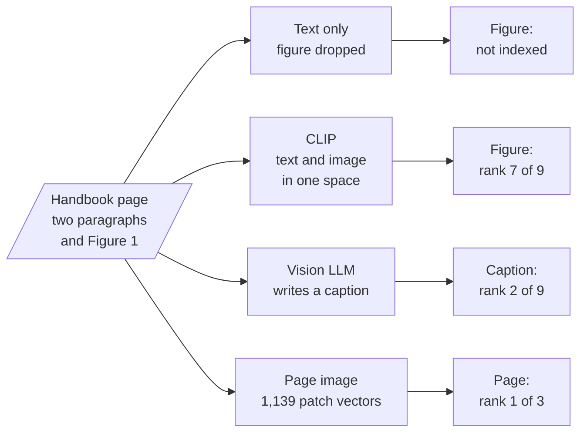

# M21 Theory: Multimodal RAG

*Part VII · Building Complete RAG Applications · [Module README](../../../course/p07_rag_applications/m21_multimodal_rag/README.md) · [All theory pages](../../README.md)*

A PDF loader that reads text keeps the paragraphs and drops the charts, so any fact that lives only in a figure never reaches the index. The three M21 notebooks get figures into retrieval three ways: embed the image beside the text with CLIP, have a vision model write a caption and index the caption, or embed the whole page as an image with ColPali. The M21 notebooks build on four ideas: one vector space for text and images, captions as a text stand-in for a figure, late interaction between query tokens and page patches, and retrieving whole pages instead of chunks. Each idea has a page in the folder of the lesson that teaches it, listed under [Lessons](#lessons). This page has the overview, the interview questions and the takeaways.

The running example is three pages of the Larkspur Cloud handbook from M11 to M13: availability, refunds and server plans. Each page has two short paragraphs and one figure, and the numbers are only in the figure. Three golden questions need them: *Which month missed the 99.95% availability target?* (May, at 99.91%, in Figure 1), *How many business days did a refund take in May?* (9, in Figure 2) and *How much memory does the Medium server have?* (8 GB, in Table 1). The lab indexes the three pages four ways with real models and ranks the results.

## TL;DR

- Text extraction keeps "Figure 1 shows monthly availability…" and drops the bars. A text-only index of the three pages cannot reach any of the three answers at any `k`.
- CLIP embeds text and images into one space, but on these pages its text-to-text cosines run from 0.692 to 0.912 and its text-to-image cosines from 0.200 to 0.382. In one shared ranking the right figure is the best image for every question and still ranks 7 of 9, so `k = 3` sends no figure at all.
- Captioning turns each figure into text once, at index time. The captions rank 2, 1 and 1, and the model can answer from them only as far as the caption wrote the numbers down.
- Late interaction keeps one vector per query token and one per page patch, and scores a page by summing each token's best match (MaxSim). ColSmol-256M, a small ColPali-family model, ranks the right page first for all three questions, at 1,139 vectors of 128 dimensions per page.
- Choose by what the model must read at answer time: a caption is cheap to store and search, while a page image keeps the chart, the table layout and the text together.

## Mental model

<!-- animated: diagrams/routes.anim.html -->

The ranks are for *Which month missed the 99.95% availability target?* in the lab. Every route ends in the same place: the top-`k` items go to a model that can read what they hold, text, a caption or an image. What differs is whether the figure survives indexing, and whether it can outscore the text around it.

## Lessons

| Lesson | Topic | Theory |
|---|---|---|
| 21.1 | Shared text–image embedding space with CLIP | [Joint embedding space](01_shared_text_image_embedding_space_with_clip/README.md#joint-embedding-space) [One ranking, two modalities](01_shared_text_image_embedding_space_with_clip/README.md#one-ranking-two-modalities) |
| 21.2 | Caption-then-index with a vision LLM | [Captioning](02_caption_then_index_with_a_vision_llm/README.md#captioning) [What a caption must hold](02_caption_then_index_with_a_vision_llm/README.md#what-a-caption-must-hold) |
| 21.3 | Page-image retrieval with ColPali | [Late interaction](03_page_image_retrieval_with_colpali/README.md#late-interaction) [Page-level retrieval](03_page_image_retrieval_with_colpali/README.md#page-level-retrieval) |

## Interactive lab

[**Four ways to index a chart**](01_shared_text_image_embedding_space_with_clip/interactive/chart-retrieval-lab.html): open the file in a browser. Start on CLIP joint space and slide `k` from 1 to 9: the figure stays below every text chunk until `k = 7`. Switch to Captions at `k = 1` and watch the first question miss, because the figure note outscores the caption, then pass at `k = 2`. Then try Page images, where `k = 1` answers all three.

## How it connects

- **Before:** [M06](../../p02_prompt_engineering/m06_multimodal_prompting/README.md) shows how to put an image or a PDF page into a prompt, which is where every route here ends. [M12](../../p05_ingestion_and_indexing/m12_document_ingestion/README.md) covers the loaders that drop figures, and [M14](../../p05_ingestion_and_indexing/m14_embeddings/README.md) the text embeddings the caption route reuses. The lab reports against the [M11](../../p04_rag_foundations/m11_rag_lifecycle/README.md) habit: fixed golden questions, the rank of the evidence, the cut at `k`.
- **Next:** [M22](../m22_llamaindex/README.md) rebuilds pipelines in LlamaIndex. A multimodal index is one more retriever in the agentic RAG designs of M28 to M31.

## Interview Spotlight: 5 Questions You Might Get Asked

*Production questions in the style of OpenAI, Anthropic and Google interviews for applied AI roles.*

### 1. Larkspur moves its quarterly service report into the handbook as a PDF. Customers ask which month missed the availability target, and the assistant says the handbook does not say. The text pipeline has not changed. What happened, and how do you confirm it?

**What a strong answer covers:**
- Prints what the loader produced for that page: the paragraph that says "Figure 1 shows…" is there and the 99.91% is not, because the number exists only as pixels
- Checks the retrieved chunks: the figure note ranks first, so retrieval did its job on what it was given
- Counts how many golden questions need a figure, table or scan to answer, which sizes the fix
- Adds a figure route (captions or page images) and a figure-only question to the golden set so the regression stays caught

### 2. A teammate wants one CLIP index for the whole handbook, text and images together, because "one index is simpler". What do you expect to happen, and what would you build instead?

**What a strong answer covers:**
- CLIP's text-to-text scores sit far above its text-to-image scores (0.692 to 0.912 against 0.200 to 0.382 on the lab pages), so images lose every mixed ranking
- Retrieving with separate quotas, top text chunks plus the top image, fixes the crowding: on the lab pages the right figure is the top image for all three questions
- CLIP's text encoder truncates at 77 tokens and was trained on captions, not paragraphs, so it is a weak text retriever as well
- Captions embedded with the text model, or page images, avoid comparing scores across modalities at all

### 3. You add captioning. How do you measure whether figure questions improved, and how do you watch it in production?

**What a strong answer covers:**
- A golden set split by evidence type (paragraph, figure, table, scan), with the rank of the evidence and answer correctness per split
- Compares against the text-only baseline on the same questions, as in the M11 lab
- Logs which retrieved items were captions and whether the answer quoted a number from one
- Re-captions and re-scores when the vision model or the caption prompt changes, since every caption is model output

### 4. A customer is told the Medium server has 16 GB. The table says 8 GB. Retrieval returned the right caption. What went wrong, and how do you guard against it?

**What a strong answer covers:**
- The caption itself is the suspect: a vision model can misread a row or a column, and nothing checks it after indexing
- Keeps the image id in the caption's metadata and sends the original image to a vision model at answer time, using the caption only to find it
- Spot-checks captions that contain numbers against the source, or extracts tables with a table parser where the PDF has a text layer
- Adds the question to the golden set with its exact expected value

### 5. Compliance wants scanned contracts, with no text layer, searchable alongside the handbook. ColPali looks right. What does it cost, and how do you keep it practical?

**What a strong answer covers:**
- Page-level late interaction needs no OCR and keeps layout, which suits scans
- Storage grows with patches: ColSmol-256M stored 1,139 vectors of 128 dimensions per lab page, 145,792 floats or about 583 KB in float32, against one vector per chunk for a text index
- Reduces it with lower precision or pooled patch vectors, or uses a cheap first stage and MaxSim only to rerank its shortlist
- The answer model must read a whole page image per result, so `k` stays small and the generation cost per question rises

## Key Takeaways

- Check what the loader keeps before you tune anything: a number that only exists in a figure is not in a text index.
- Never let text and image vectors from CLIP compete in one top-`k`; give each modality its own quota or turn images into text.
- A caption answers only what it wrote down. Store the image id with it and send the image when the question needs exact values.
- Page images with late interaction keep everything on the page and need no OCR, and they cost many vectors per page and a vision call per answer.

---
*Previous: [M20 End-to-end RAG systems](../m20_end_to_end_rag_systems/README.md). Next: [M22 Framework fluency with LlamaIndex](../m22_llamaindex/README.md).*
