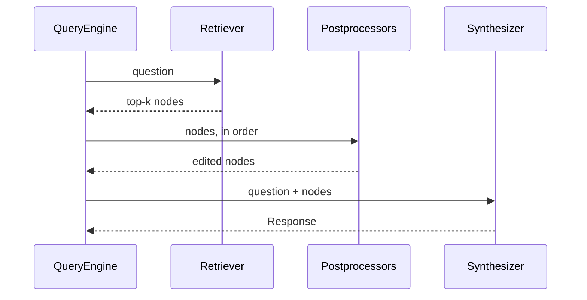

# M22.1 Theory: Simple PDF and CSV RAG in LlamaIndex

*[M22 theory](../README.md) · Lesson 22.1 · Notebooks: [`01a_simple_rag_with_llamaindex.ipynb`](../../../../course/p07_rag_applications/m22_llamaindex/notebooks/01a_simple_rag_with_llamaindex.ipynb), [`01b_simple_csv_rag_with_llamaindex.ipynb`](../../../../course/p07_rag_applications/m22_llamaindex/optional/01b_simple_csv_rag_with_llamaindex.ipynb) (optional) · [All theory pages](../../../README.md)*

## Nodes

LlamaIndex has two text objects where LangChain has one. A **Document** is what a reader loads: `SimpleDirectoryReader` turns the notebook's climate-change PDF into 33 Documents, one per page, and `PagedCSVReader` turns the 100-row customer CSV into 100 Documents, one per row. A **Node** is what the index stores: a piece of a Document with its own id, text, metadata, an optional embedding, and relationships. Every node that `SentenceSplitter` produces from the PDF carries three: `SOURCE` (its Document), `PREVIOUS` and `NEXT` (its neighbours). The neighbour links let a query engine fetch the text around a hit later; `PrevNextNodePostprocessor` follows them from the docstore.

The concepts map onto the LangChain pieces from M11 to M19:

| LangChain | LlamaIndex | What changes |
|---|---|---|
| `Document` from a loader | `Document` from a reader | Loaded unit; PDF readers give one per page in both |
| `Document` chunk from a text splitter | `TextNode` from a node parser | Node has an id and neighbour links |
| `RecursiveCharacterTextSplitter` | `SentenceSplitter` | Size in tokens, not characters |
| Embed, then `add_documents` | `IngestionPipeline`, then `VectorStoreIndex` | Transformations run as a list |
| `vectorstore.as_retriever(k=…)` | `index.as_retriever(similarity_top_k=…)` | Default `k` is 2 |
| `EnsembleRetriever` | `QueryFusionRetriever` | Four fusion modes (22.2) |
| Compressor or reranker wrapper | Node postprocessor | A list on the query engine (22.3) |
| A retrieval chain | `QueryEngine` | Retrieve, postprocess, synthesise |

Two differences change the chunks you get from the same numbers.

**`chunk_size` counts tokens.** `01a` sets `CHUNK_SIZE = 200` and `CHUNK_OVERLAP = 50` and says so in a comment: LangChain's splitter measures characters by default, `SentenceSplitter` measures tokens. 200 tokens is several times longer than 200 characters, so a "200" ported from a LangChain notebook is not the same split.

**Metadata counts against the chunk and goes into the embedding.** `SentenceSplitter` builds the metadata string a node will carry, measures it in tokens and subtracts it from `chunk_size` before splitting. The PDF reader attaches `page_label`, `file_name`, `file_path`, `file_type`, `file_size` and two dates, and excludes all of them from the embedding and LLM text except `page_label` and `file_path`. On the checkout used for this page those two come to 38 tokens, so a 200-token chunk holds at most 162 tokens of text; the largest of the 123 nodes holds 158. The absolute file path is part of every vector. Set `excluded_embed_metadata_keys` and `excluded_llm_metadata_keys` on the Documents before splitting when a field should be stored but not embedded.

Splitting never crosses a Document boundary. `02a` uses `SentenceSplitter()` with its defaults of 1,024 tokens and 200 overlap, and every PDF page fits in one chunk, so the 33 pages become exactly 33 nodes. The page, not the chunk size, decides what a chunk is.

On the Larkspur handbook the two sections load as two Documents. Lesson 22.4 splits them into one node per sentence: 13 for the refunds section and 4 for exports.

### What the `01a` ingestion actually builds

`01a` creates a FAISS index, passes it to `IngestionPipeline(..., vector_store=vector_store)`, then builds `VectorStoreIndex(nodes)`. With `llama-index-core` 0.14.25 two things go wrong:

- **The cleaner runs on Documents and crashes.** `TextCleaner` comes before the splitter, so it receives Documents, and `Document.text` is a read-only property: `AttributeError: property 'text' of 'Document' object has no setter`. `02a` puts the cleaner after `SentenceSplitter`, where the nodes' text can be set; `01a` needs the same order. With that change the 33 pages become 123 nodes.
- **FAISS stays empty.** The pipeline has no embedding transformation, and `IngestionPipeline` only adds nodes that already have an embedding to its vector store. After the run the FAISS index holds 0 vectors. `VectorStoreIndex(nodes)` then embeds the nodes again into the default in-memory store, and that is the index the notebook queries. The same pattern repeats in every M22 notebook.

To keep the vectors in FAISS, embed in the pipeline and give the store to the index:

```python
pipeline = IngestionPipeline(transformations=[SentenceSplitter(chunk_size=200, chunk_overlap=50), TextCleaner(), Settings.embed_model])
nodes = pipeline.run(documents=documents)            # nodes now carry embeddings
index = VectorStoreIndex(nodes, storage_context=StorageContext.from_defaults(vector_store=vector_store))
```

Run on the notebook's PDF with a local embedding model in place of OpenAI's: the pipeline makes 123 embedding calls, one per node, the index makes none, and FAISS ends with 123 vectors. `VectorStoreIndex.from_vector_store(vector_store)` does not work here, because the FAISS store keeps vectors but not text; it raises `Cannot initialize from a vector store that does not store text.`

## QueryEngine

`index.as_query_engine(similarity_top_k=2)` returns a `RetrieverQueryEngine`. Each `query(question)` call runs three stages and returns the `Response` to the caller:



- **The retriever** embeds the question and returns the `similarity_top_k` nearest nodes as `NodeWithScore` objects. The default is 2.
- **The postprocessors** are the `node_postprocessors` list, applied in order. `01a` passes none; lessons 22.3 and 22.4 add a reranker and a window replacement here.
- **The synthesizer** puts the nodes' text into a prompt for `Settings.llm`. The default `response_mode` is `compact`: it packs the nodes' text into as few prompts as the context window allows, then refines the answer across them.

`response.response` is the answer; `response.source_nodes` is the list of nodes the answer was built from, with their scores. `01a`'s `evaluate_rag` reads both: the answer goes to the correctness and faithfulness metrics, the source node texts become the retrieval context for DeepEval's `ContextualRelevancyMetric`. Logging `source_nodes` on every production query gives the same view without an evaluation run.

`query_engine.retrieve(QueryBundle(question))` runs the retriever and the postprocessors without the LLM, which is how the lab in 22.4 was checked. Building the engine still needs an LLM: `as_query_engine()` resolves `Settings.llm` when it is created, and with no model set and no OpenAI key it raises before any retrieval. Set `Settings.llm` (a `MockLLM` works for tests) or use `index.as_retriever()` when you only need nodes.

### The CSV variant

`01b` reads each CSV row as one Document whose text is one `column: value` line per field:

```
Index: 1
Customer Id: DD37Cf93aecA6Dc
First Name: Sheryl
Last Name: Baxter
Company: Rasmussen Group
…
```

It skips splitting, embeds each row, and asks *which company does sheryl Baxter work for?* with `similarity_top_k=2`. The answer is in row 1 (Rasmussen Group), and the row's own text names her, so one retrieved row is enough. A question about many rows ("how many customers are in Chile?") gets the same two rows, and no prompt can count the other 98. Row-per-Document RAG answers lookups; counts, sums and filters belong to a query over the table, which M20 covers.

## Check yourself

<details>
<summary>1. You port a LangChain notebook's chunk size of 200 to SentenceSplitter unchanged. Why are the chunks different?</summary>

`SentenceSplitter` counts tokens, not characters, so 200 tokens is several times longer than 200 characters. It also subtracts the node's metadata string from `chunk_size` before splitting: on the PDF, `page_label` and `file_path` come to 38 tokens, so a 200-token chunk holds at most 162 tokens of text.

</details>

<details>
<summary>2. After the 01a ingestion pipeline runs with a FAISS store, how many vectors does FAISS hold, and which index does the notebook query?</summary>

None. The pipeline has no embedding transformation, and `IngestionPipeline` only adds nodes that already have an embedding to its vector store. `VectorStoreIndex(nodes)` then embeds the nodes again into the default in-memory store, and that is the index queried. Put `Settings.embed_model` in the pipeline and pass the store through `StorageContext` to end with 123 vectors in FAISS.

</details>

<details>
<summary>3. The CSV variant answers which company Sheryl Baxter works for, but gets the number of customers in Chile wrong. Why?</summary>

With `similarity_top_k=2` the engine retrieves two rows, and no prompt can count the other 98. A lookup works because one row names her. Counts, sums and filters belong to a query over the table, which M20 covers.

</details>

---
*Previous: [M22 overview](../README.md). Next: [22.2 Fusion retrieval with QueryFusionRetriever](../02_fusion_retrieval_with_queryfusionretriever/README.md).*
