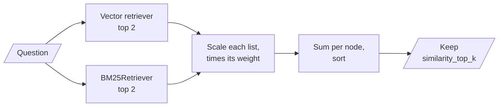

# M22.2 Theory: Fusion retrieval with QueryFusionRetriever

*[M22 theory](../README.md) · Lesson 22.2 · Notebooks: [`02a_fusion_retrieval_with_llamaindex.ipynb`](../../../../course/p07_rag_applications/m22_llamaindex/notebooks/02a_fusion_retrieval_with_llamaindex.ipynb) · [All theory pages](../../../README.md)*

## QueryFusionRetriever

`QueryFusionRetriever` is LlamaIndex's `EnsembleRetriever`: it runs several retrievers and merges their lists. `02a` gives it a vector retriever and a `BM25Retriever`, both at `similarity_top_k=2`:

```python
retriever = QueryFusionRetriever(
    retrievers=[vector_retriever, bm25_retriever],
    retriever_weights=[0.6, 0.4],
    num_queries=1,
    mode="dist_based_score",
    use_async=False,
)
```



Three of its defaults change what a port does:

- **`num_queries` defaults to 4.** The retriever keeps your question and asks `Settings.llm` to write 3 more, then runs every query on every retriever: with two retrievers, 8 retrievals and one LLM call per question. `02a` sets `num_queries=1`, which turns query generation off. M18 covers what the extra queries buy.
- **`similarity_top_k` defaults to 2.** It cuts the fused list. `02a` does not set it, so two retrievers with two hits each still return two nodes.
- **`mode` defaults to `simple`.** The four modes, as `llama-index-core` 0.14.25 implements them:

| Mode | Scaling inside each list | How lists combine |
|---|---|---|
| `relative_score` | Min-max: best 1, worst 0 | Times weight, summed per node |
| `dist_based_score` | Min-max between mean ± 3 std | Times weight, summed per node |
| `reciprocal_rerank` | `1 / (60 + rank)`, rank from 0 | Summed per node; weights ignored |
| `simple` | None | Highest raw score per node |

`retriever_weights` are divided by their sum, so `[0.6, 0.4]` stays as it is and `[3, 2]` becomes the same thing. Scores in the two score modes are also divided by `num_queries`.

On the Larkspur handbook, split into one node per sentence, the 45-day refund question gives two short lists. The vector side (`all-MiniLM-L6-v2`, run locally in place of the notebook's OpenAI model) returns the 30-day rule at 0.6922 and "Monthly plans are not refundable" at 0.5373. BM25 returns the 30-day rule at 2.3898 and the prorated rule, the one that answers the question, at 1.9076. Fused by the real `QueryFusionRetriever` with `02a`'s settings:

| Mode | Fused top 2 | Prorated rule |
|---|---|---|
| `dist_based_score` | 30-day rule 0.6667, monthly 0.2000 | 3rd, 0.1333 |
| `relative_score` | 30-day rule 1.0, monthly 0.0 | 3rd, 0.0 |
| `reciprocal_rerank` | 30-day rule 0.0333, monthly 0.0164 | 3rd, tied at 0.0164 |
| `simple` | 30-day rule 2.3898, prorated 1.9076 | 2nd |

Only `simple` keeps the answer, and for the wrong reason: it compares a BM25 score with a cosine similarity, and BM25 scores run higher. Three behaviours explain the rest of the table:

- **With two hits per list, `dist_based_score` ignores the gap.** Two scores have a mean halfway between them and a standard deviation of half their difference, so mean ± 3 std always maps the better one to 2/3 and the worse to 1/3. In a check with fixed scores, dropping the vector runner-up from 0.80 to 0.10 left every fused score unchanged. The 0.6 and 0.4 weights then decide the order: 0.6 × 1/3 = 0.2 for the vector runner-up beats 0.4 × 1/3 = 0.1333 for the BM25 runner-up. Flip the weights to 0.4 and 0.6 and the prorated rule wins the second place at 0.2.
- **`relative_score` with two hits sends every runner-up to 0.** Both second places score 0 here, and the cut falls between equal scores.
- **`reciprocal_rerank` drops `retriever_weights`.** The constant is 60 and ranks start at 0, so a node first in one list scores 1/60. `EnsembleRetriever` in M17 multiplies each term by its weight and counts ranks from 1; the two "RRF" scores are not interchangeable.

`02a`'s note on the modes says reciprocal rerank is unsuitable "since there is no normalization". Rank fusion never looks at the scores, so their scales cannot hurt it; the mode where scales collide is `simple`, the default. [M17's fusion lesson](../../../p06_retrieval_quality/m17_retrievers_hybrid_search/03_fusion_retrieval_score_normalisation_vs_rank_fusion/README.md) works through score and rank fusion in general. In LlamaIndex the same mode names carry different constants.

The BM25 side differs from LangChain's too. LlamaIndex's `BM25Retriever` runs `bm25s` with an English stemmer, English stop words and the token pattern `\b\w\w+\b`, so "refund" in the question matches "refunds" in the prorated rule. LangChain's `BM25Retriever` splits on whitespace and would not match them.

## Score direction

Every fusion mode assumes a higher score is better. The vector retriever in `02a` comes from `VectorStoreIndex(nodes)` with the default in-memory store, which returns cosine similarity, so the assumption holds. Wire the notebook's FAISS store in properly (22.1) and it stops holding: `IndexFlatL2` returns squared L2 distances as `score`, where lower is better.

The same three handbook sentences, retrieved for the 45-day question through two FAISS indexes:

| Sentence | `IndexFlatIP` score | `IndexFlatL2` score |
|---|---|---|
| 30-day full-refund rule | 0.6922 | 0.6155 |
| Monthly plans are not refundable | 0.5373 | 0.9254 |
| Prorated rule | 0.5267 | 0.9465 |

The order is the same; the scale runs the other way. On unit-length vectors the squared distance is 2 minus twice the cosine (2 - 2 × 0.6922 = 0.6156). Feed the L2 list to `relative_score` and the nearest sentence scales to 0 while the farthest gets the full weight. Use `IndexFlatIP` on normalised vectors when FAISS feeds a fusion retriever, and print each retriever's raw scores once before trusting the fused list.

## Key Takeaways

- Check the defaults before porting: `num_queries=4` adds an LLM call and multiplies retrievals, `similarity_top_k=2` cuts the fused list, and the default `simple` mode compares raw scores across retrievers.
- With two hits per list, the score modes flatten the gap and the weights decide the order. `reciprocal_rerank` ignores `retriever_weights` and counts ranks from 0.
- Every fusion mode assumes higher is better. Use inner product on normalised vectors rather than L2 distance, and print each retriever's raw scores once.

## Check yourself

<details>
<summary>1. With its default settings and two retrievers, how much work does QueryFusionRetriever do per question?</summary>

`num_queries` defaults to 4, so it keeps your question, asks `Settings.llm` for 3 more and runs every query on every retriever: 8 retrievals and one LLM call. `02a` sets `num_queries=1` to turn query generation off. The default `similarity_top_k` of 2 then cuts the fused list.

</details>

<details>
<summary>2. Under distance-based scoring with two hits per list, the prorated rule ends third. Why, and what weight change brings it into the top two?</summary>

With two scores per list, mean ± 3 std always maps the better one to 2/3 and the worse to 1/3, whatever the gap. The weights then decide: 0.6 × 1/3 = 0.2 for the vector runner-up beats 0.4 × 1/3 = 0.1333 for the BM25 runner-up, the prorated rule. Flip the weights to 0.4 and 0.6, and the prorated rule takes second place at 0.2.

</details>

<details>
<summary>3. You feed a FAISS IndexFlatL2 retriever into relative score fusion, and the nearest sentence gets the lowest fused score. What went wrong?</summary>

`IndexFlatL2` returns squared L2 distances, where lower is better, and every fusion mode assumes higher is better. Min-max scaling then maps the nearest sentence to 0 and gives the farthest the full weight. Use `IndexFlatIP` on normalised vectors, and print each retriever's raw scores once before trusting the fused list.

</details>

---
*Previous: [22.1 Simple PDF and CSV RAG in LlamaIndex](../01_simple_pdf_and_csv_rag_in_llamaindex/README.md). Next: [22.3 Reranking with node postprocessors](../03_reranking_with_node_postprocessors/README.md).*
