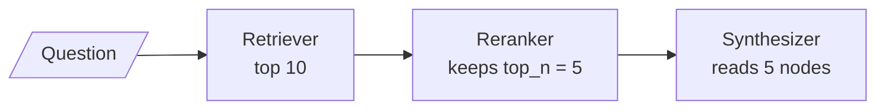

# M22.3 Theory: Reranking with node postprocessors

*[M22 theory](../README.md) · Lesson 22.3 · Notebooks: [`03a_reranking_with_llamaindex.ipynb`](../../../../course/p07_rag_applications/m22_llamaindex/notebooks/03a_reranking_with_llamaindex.ipynb) · [All theory pages](../../../README.md)*

## Postprocessors

A node postprocessor takes the retrieved list of `NodeWithScore` and the question, and returns a list. It can reorder the nodes, drop some, replace their scores or rewrite their text. A query engine runs its `node_postprocessors` in list order, after the retriever and before the synthesizer; outside an engine, `postprocess_nodes(nodes, QueryBundle(question))` runs one by hand, as `03a` does for its comparison.

`03a` uses the slot for two-stage retrieval ([M19](../../../p06_retrieval_quality/m19_reranking_post_retrieval/README.md)): retrieve wide with `similarity_top_k=10`, rerank, keep `top_n=5`.

The two rerankers in `03a` fill that box differently:

- **`LLMRerank(top_n=5)`** sends the nodes to `Settings.llm` in batches of `choice_batch_size` (default 10), so `03a`'s 10 nodes cost one call. The prompt numbers the documents and asks for lines like `Doc: 9, Relevance: 7`, a score from 1 to 10, and tells the model to leave out irrelevant documents. Listed nodes get that integer as their new score; unlisted nodes are dropped, and so are lines the parser cannot read, without an error. The result can be shorter than `top_n`, and integer scores tie often. The default `top_n` is 10.
- **`SentenceTransformerRerank(model="cross-encoder/ms-marco-MiniLM-L-6-v2", top_n=5)`** scores every question and node pair with a cross-encoder and keeps the best `top_n`. It reads each node's embedding text, metadata included, and replaces the retrieval score with the model's raw output; `keep_retrieval_score=True` copies the old score into the node's metadata first. Its defaults are `cross-encoder/stsb-distilroberta-base` and `top_n=2`, so a port that drops the arguments changes the model and the cut.

M19 compares the two families in depth ([LLM against cross-encoder reranking](../../../p06_retrieval_quality/m19_reranking_post_retrieval/03_llm_reranking_vs_cross_encoder_reranking/README.md)). In LlamaIndex both are node postprocessors and swap in the same list.

### The handbook, reranked

Split the Larkspur handbook into one node per sentence, ask *Can I get a refund on an annual plan after 45 days?*, retrieve 10 with `all-MiniLM-L6-v2` and rerank with `03a`'s cross-encoder keeping 2:

| | First | Second |
|---|---|---|
| Retrieval alone, top 2 | 30-day full-refund rule (0.6922) | Monthly plans are not refundable (0.5373) |
| Cross-encoder over top 10 | 30-day full-refund rule (7.0657) | Prorated rule after day 30 (-2.1011) |

The reranker brings the sentence that answers the question into the context. It also scores that sentence below zero. `ms-marco-MiniLM-L-6-v2` returns a logit, not a probability, so its scores only rank; a filter that drops nodes under 0 would have dropped the answer. Calibrate any cut-off on the golden set.

### The capital-of-France example

`03a` builds five chunks: three one-liners that repeat the question's words ("The capital of France is great.", "…huge.", "…beautiful.") and two longer passages about visiting Paris. Asked *what is the capital of france?*, the embedding retriever ranks the one-liners first. Run locally with the same two models as above:

| Chunk | Bi-encoder (`all-MiniLM-L6-v2`) | Cross-encoder (`ms-marco-MiniLM-L-6-v2`) |
|---|---|---|
| The capital of France is huge. | 0.8105 | 6.8955 |
| The capital of France is great. | 0.7805 | 8.0029 |
| The capital of France is beautiful. | 0.7687 | 7.3871 |
| Have you ever visited Paris? … | 0.5174 | 1.0889 |
| I really enjoyed my trip to Paris, France. … | 0.4769 | 0.1921 |

The cross-encoder reorders the one-liners and keeps all three above the Paris passages. None of the one-liners names Paris, so neither model surfaced the passage that answers the question. The notebook runs this comparison with `LLMRerank` on GPT-3.5-turbo and ships without output, so this page does not claim what that reranker returns; an LLM that knows Paris is the capital has the knowledge the cross-encoder lacks, which is the case for paying for LLM reranking on questions like this.

The cell that sets up the example also carries a port bug. It builds `Document(page_content=sentence)`, LangChain's keyword. LlamaIndex accepts the unknown keyword and creates a Document whose text is empty. `compare_rag_techniques` rebuilds the list with `Document(text=sentence)`, so the comparison still works, but the first list is five empty Documents, and nothing warns.

### Order in the list

Postprocessors see whatever the one before them produced. With lesson 22.4's `MetadataReplacementPostProcessor` in the same list, putting the reranker first means it scores the single sentence that was embedded; putting it second means it scores the whole window, which gives a cross-encoder more context at the cost of longer inputs. Decide which text the reranker should judge, and write the list in that order.

## Check yourself

1. Where does a node postprocessor run, and what may it do to the retrieved list?

It runs after the retriever and before the synthesizer, in the order of the `node_postprocessors` list. It can reorder the nodes, drop some, replace their scores or rewrite their text. `03a` uses the slot for two-stage retrieval: retrieve 10, rerank, keep `top_n=5`.

2. On the 45-day refund question, the cross-encoder gives the prorated rule a score of -2.1011. Would a filter that drops nodes below 0 be safe?

No: it would drop the sentence that answers the question. `ms-marco-MiniLM-L-6-v2` returns a logit, not a probability, so its scores only rank. Calibrate any cut-off on the golden set.

3. A query engine runs both a reranker and the sentence-window replacement. Should the reranker come before or after the replacement?

It depends on which text you want judged. First in the list, the reranker scores the single sentence that was embedded; second, it scores the whole window, which gives a cross-encoder more context at the cost of longer inputs. Decide, then write the list in that order.

---
*Previous: [22.2 Fusion retrieval with QueryFusionRetriever](../02_fusion_retrieval_with_queryfusionretriever/README.md). Next: [22.4 Sentence-window retrieval](../04_sentence_window_retrieval/README.md).*
