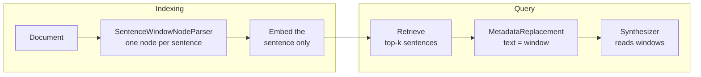

# M22.4 Theory: Sentence-window retrieval

*[M22 theory](../README.md) · Lesson 22.4 · Notebooks: [`04a_context_enrichment_window_with_llamaindex.ipynb`](../../../../course/p07_rag_applications/m22_llamaindex/notebooks/04a_context_enrichment_window_with_llamaindex.ipynb) · [All theory pages](../../../README.md)*

## Sentence window

Small chunks match a question precisely and large chunks answer it completely (M13). A sentence window does both: it embeds single sentences and, once one is retrieved, sends the model the sentences around it. LlamaIndex builds it from two pieces, a node parser at indexing time and a postprocessor at query time.

<!-- animated: diagrams/sentence-window.anim.html -->

**`SentenceWindowNodeParser`** splits each Document into sentences with NLTK's Punkt tokenizer and makes one node per sentence. For sentence `i` it stores two metadata fields: the sentences from `i - window_size` to `i + window_size` joined with spaces (`window`), and the sentence itself (`original_text`; `04a` renames it `original_sentence`). It adds both keys to the node's excluded embed and LLM metadata, so the vector is the sentence alone. `window_size` defaults to 3, seven sentences in all, as `04a`'s comment says, and must be greater than 0: `window_size=0` fails validation. A window never crosses into another Document.

**`MetadataReplacementPostProcessor(target_metadata_key="window")`** runs after retrieval and sets each node's text to its `window` metadata (a node without that key keeps its text). The synthesizer then reads the window. The notebook's note that "metadata replacement" sounds off-topic comes from this: the neighbours travel as metadata until this step puts them in the text.

On the Larkspur handbook the parser makes 17 nodes: 13 sentences in the refunds section and 4 in exports. The first sentence of each section carries the section title with it, because Punkt does not split at a blank line.

The [interactive lab](interactive/sentence-window-lab.html) runs that index with `all-MiniLM-L6-v2` (the notebook uses OpenAI's `text-embedding-3-small`, which scores differently), lets you move `window_size` from 0 (postprocessor off) to 5 and `similarity_top_k` between 1 and 2, and shows what the model receives. Its windows are a port of the parser's join, checked against the real LlamaIndex pipeline on all 30 settings of question, window and `k`: the same retrieved sentences, the same scores and the same window text, character for character. At `similarity_top_k=1`:

| Question | Window 0 | Window 1 | Window 2 | Window 3 |
|---|---|---|---|---|
| *Refund on an annual plan after 45 days?* | 142 chars, answer missing | **284**, answer in | 495 | 621 |
| *How long does a refund take to appear?* | **90**, answer in | 291 | 496 | 620 |
| *Export my data after I cancel?* | 86, 1 of 2 facts | 188, 1 of 2 | **272**, both | 272 |

<!-- lab: interactive/sentence-window-lab.html -->

- **The window changes what the model reads, never what is retrieved.** Every sentence scores the same at every window size, because the window is excluded from the embedding. Tuning `window_size` cannot fix a retrieval miss.
- **Each question needs a different window.** The 45-day question retrieves the 30-day full-refund rule; the prorated rule that answers it is the next sentence, so a window of 1 is enough. The refund-timing sentence answers its question alone. The export question needs the "Settings, then Data" sentence two places back.
- **The Document boundary caps the window.** The exports section has four sentences, so every window from 2 up sends the same 272 characters. A section split into its own Document limits how far a window can reach, which is useful when sections are independent and harmful when the answer spans two of them.
- **Two hits can send the same sentences twice.** At `similarity_top_k=2` the refund-timing question retrieves its sentence and the 30-day rule two places before it. At `window_size=3` their windows share 5 sentences, and the model reads 1,241 characters to cover 9 distinct sentences. Merge overlapping windows before synthesis when `k` is above 1.

The window is stored, not computed at query time. Each node holds its window and a copy of its sentence in metadata: on the handbook that is 5,249 characters of metadata at `window_size=1`, 9,313 at 3 and 12,342 at 5, against 1,380 characters of sentence text. At the notebook's default the metadata is 6.75 times the text, held in the docstore or the vector store's payload for every node.

[M19's enrichment windows](../../../p06_retrieval_quality/m19_reranking_post_retrieval/05_context_enrichment_windows/README.md) do the same job with character chunks and a neighbour lookup at query time. LlamaIndex moves the work to indexing time and the unit to the sentence, and `04a` compares it against a `SentenceSplitter()` index at its 1,024-token default, both at `similarity_top_k=1`. Both of `04a`'s pipelines are handed the same FAISS store, which stays empty for the reason in [22.1](../01_simple_pdf_and_csv_rag_in_llamaindex/README.md#nodes); each `VectorStoreIndex` builds its own in-memory store.

---
*Previous: [22.3 Reranking with node postprocessors](../03_reranking_with_node_postprocessors/README.md). Next: [M22 interview questions](../README.md#interview-spotlight-5-questions-you-might-get-asked).*
