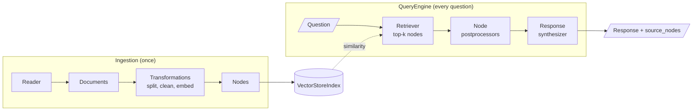

# M22 Theory: Framework fluency with LlamaIndex

*Part VII · Building Complete RAG Applications · [Module README](../../../course/p07_rag_applications/m22_llamaindex/README.md) · [All theory pages](../../README.md)*

M22 rebuilds pipelines you already know from the LangChain modules in LlamaIndex: a plain vector RAG, hybrid fusion, reranking and an enrichment window. The ideas are the same; the class names and several defaults change. The M22 notebooks build on four ideas: the Node as the unit LlamaIndex indexes, the QueryEngine that wraps retrieval and answering, the postprocessors that edit the retrieved list in between, and the sentence window that retrieves one sentence and sends its neighbours. Each idea has a page in the folder of the lesson that teaches it, listed under [Lessons](#lessons). This page has the overview, the interview questions and the takeaways.

The notebooks run on a 33-page climate-change PDF and a 100-row customer CSV. These pages and the lab use the Larkspur Cloud handbook from M11 to M13, loaded as two Documents: the refunds section from M13 and a short exports section. Three golden questions carry the module: *Can I get a refund on an annual plan after 45 days?*, *How long does a refund take to appear?* and *Can I export my data after I cancel my plan?* The first one is the hard case. Its best-matching sentence is the 30-day full-refund rule, and the answer sits in the sentence after it.

## TL;DR

- A LlamaIndex Node is a chunk with an id, metadata and links to its source Document and its neighbours. `chunk_size` counts tokens, and the metadata string counts against it: on the notebook's PDF the page label and file path take 38 of the 200 tokens.
- `index.as_query_engine()` builds a retriever, a list of node postprocessors and a response synthesizer, and returns the answer with its `source_nodes`. Check the defaults: `similarity_top_k` is 2, and `QueryFusionRetriever` makes 4 queries (3 of them written by the LLM) unless you set `num_queries=1`.
- Postprocessors run in list order on the retrieved nodes. On the handbook, retrieving 10 sentences and letting the `ms-marco-MiniLM-L-6-v2` cross-encoder keep 2 brings in the prorated-refund rule that plain top-2 retrieval misses.
- A sentence window embeds one sentence and sends up to `window_size` sentences on each side. In the lab the retrieval scores are identical for every window size; only the text the LLM reads changes, from 142 characters for the bare sentence to 621 at the notebook's `window_size=3`.
- The notebooks pass a FAISS store to `IngestionPipeline` without an embedding step, so FAISS stays empty and `VectorStoreIndex(nodes)` builds a second, in-memory index. Read what each object actually holds before trusting a port.

## Mental model

<!-- animated: diagrams/llamaindex-pipeline.anim.html -->

The diagram is M11's lifecycle with LlamaIndex names on the boxes, plus a stage M11 does not have. Node postprocessors sit between retrieval and the LLM, and reranking, filtering and window replacement all plug in there. Each one takes a scored list of nodes and returns another.

## Lessons

| Lesson | Topic | Theory |
|---|---|---|
| 22.1 | Simple PDF and CSV RAG in LlamaIndex | [Nodes](01_simple_pdf_and_csv_rag_in_llamaindex/README.md#nodes) [QueryEngine](01_simple_pdf_and_csv_rag_in_llamaindex/README.md#queryengine) |
| 22.2 | Fusion retrieval with QueryFusionRetriever | [QueryFusionRetriever](02_fusion_retrieval_with_queryfusionretriever/README.md#queryfusionretriever) [Score direction](02_fusion_retrieval_with_queryfusionretriever/README.md#score-direction) |
| 22.3 | Reranking with node postprocessors | [Postprocessors](03_reranking_with_node_postprocessors/README.md#postprocessors) |
| 22.4 | Sentence-window retrieval | [Sentence window](04_sentence_window_retrieval/README.md#sentence-window) |

## Interactive lab

[**Sentence window lab**](04_sentence_window_retrieval/interactive/sentence-window-lab.html): open the file in a browser. Pick *Can I get a refund on an annual plan after 45 days?* with `window_size` at 0: the model gets the 30-day rule and no answer. Move it to 1 and the prorated rule arrives in 284 characters. Then pick the export question, where the window stops growing at 2 because the exports Document has only four sentences, and set `similarity_top_k` to 2 on the refund-timing question to see neighbouring windows send the same sentences twice.

## How it connects

- **Before:** [M11](../../p04_rag_foundations/m11_rag_lifecycle/README.md) is the lifecycle this module renames. [M13](../../p05_ingestion_and_indexing/m13_chunking/README.md) wrote the refunds section and the small-chunk trade-off the sentence window answers. [M17](../../p06_retrieval_quality/m17_retrievers_hybrid_search/README.md) covers score fusion and rank fusion in LangChain, and [M19](../../p06_retrieval_quality/m19_reranking_post_retrieval/README.md) covers cross-encoder and LLM reranking and character-based enrichment windows.
- **Next:** M23 starts Part VIII, where the retriever becomes one tool an agent can call; M31 wraps a RAG pipeline as that tool.

## Interview Spotlight: 5 Questions You Might Get Asked

*Production questions of the kind asked in applied AI engineering interviews.*

### 1. You port Larkspur's hybrid retriever to LlamaIndex: a FAISS `IndexFlatL2` vector store and BM25, fused with `QueryFusionRetriever(mode="relative_score")`. The fused top result is now the least relevant handbook passage. What happened?

**What a strong answer covers:**
- Prints each retriever's raw scores before fusion. With `IndexFlatL2`, LlamaIndex's FAISS store returns squared L2 distances as `score`, so lower is better
- `relative_score` min-max scales each list with higher meaning better, so the nearest chunk gets 0 and the farthest gets the full weight
- Fixes the direction at the source: `IndexFlatIP` on normalised vectors (cosine similarity), or a retriever wrapper that flips distances
- Adds a golden-set check that compares fused results with each retriever alone, so a scale or direction bug shows up as a regression

### 2. The refund assistant answers "Can I get a refund after 45 days?" with "No, only within 30 days." The handbook prorates refunds after day 30. Do you raise `window_size`, raise `similarity_top_k`, or add a reranker?

**What a strong answer covers:**
- Checks the retrieved sentence first: it is the 30-day rule, and the prorated rule is the next sentence, ranked third
- A window of 1 sends both rules in 284 characters; `similarity_top_k=2` adds "Monthly plans are not refundable" instead
- A cross-encoder over the top 10 also brings the prorated rule into the top 2, at the cost of a model call per candidate
- Weighs storage too: at `window_size=3` the handbook's window metadata is 6.75 times its text, held on every node

### 3. The M22 lab asks you to port the Part VI hybrid-plus-rerank pipeline to LlamaIndex and confirm the metrics match. They do not. How do you find out why?

**What a strong answer covers:**
- Compares retrieved node ids per golden question before comparing answer scores, so retrieval and generation differences separate
- Lists the default changes: `chunk_size` in tokens against LangChain's characters, metadata counted in the chunk budget and embedded with the text, and `similarity_top_k=2`
- Checks BM25 tokenisation: LlamaIndex's `BM25Retriever` stems and drops English stop words, LangChain's splits on whitespace
- Checks fusion: LlamaIndex's `reciprocal_rerank` ignores `retriever_weights`, while `EnsembleRetriever` applies weights to RRF

### 4. `LLMRerank(top_n=5)` sometimes returns one node, and on a few questions none. The answers that follow are thin or refuse. What is going on, and what do you change?

**What a strong answer covers:**
- The default prompt tells the LLM to leave out documents that are not relevant, so the output can be shorter than `top_n`
- Nodes the LLM omits are dropped, and the parser skips lines it cannot read without raising, so a reply in another format drops its whole batch of up to 10
- Logs the raw reranker reply and the count in and out per query, and alerts on empty results
- Falls back to the retrieval order when the reranker returns too few nodes, or uses a cross-encoder, which always scores every candidate

### 5. A refactor removed `num_queries=1` from the fusion retriever. Retrieval quality looks the same on the golden set, but latency and the LLM bill went up. Why?

**What a strong answer covers:**
- `QueryFusionRetriever` defaults to `num_queries=4`: one LLM call writes 3 extra queries, and each query runs on every retriever
- With two retrievers that is 8 retrievals and one generation call before the answer step starts
- Treats default parameters as part of the pipeline's config: pin them explicitly and diff them in code review
- Measures per-stage latency and token use in traces, not only end-to-end quality, so a cost regression shows even when accuracy holds

## Key Takeaways

- Map the concepts first: Document and Node, retriever, postprocessor, QueryEngine. Then read the defaults, because they differ from LangChain's.
- Check what each component holds after the pipeline runs: vectors in the store, metadata in the embedding text, and the score direction of every retriever.
- Put reranking, filtering and window replacement in `node_postprocessors`, in the order you want them applied.
- Retrieve small, send big: a sentence window keeps the retrieval scores of a sentence and gives the model the paragraph around it. Size the window per question type and watch overlap when `k` is above 1.

---
*Previous: [M21 Multimodal RAG](../m21_multimodal_rag/README.md). Next: [M23 The agent loop and tool calling](../../p08_agent_foundations/m23_agent_loop_and_tools/README.md).*
