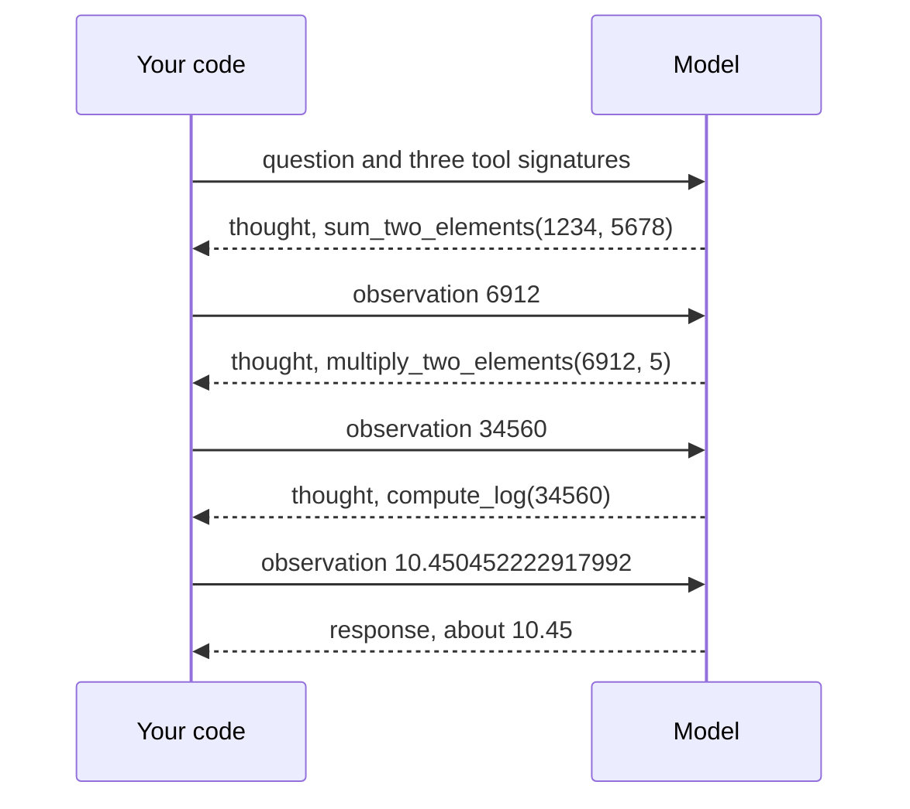

# M23.1 Theory: Agentic patterns from scratch: reflection, tool use, ReAct planning

*[M23 theory](../README.md) · Lesson 23.1 · Notebooks: [`01b_tool_use_pattern.ipynb`](../../../../course/p08_agent_foundations/m23_agent_loop_and_tools/notebooks/01b_tool_use_pattern.ipynb), [`01c_planning_pattern_react.ipynb`](../../../../course/p08_agent_foundations/m23_agent_loop_and_tools/notebooks/01c_planning_pattern_react.ipynb), [`01a_reflection_pattern.ipynb`](../../../../course/p08_agent_foundations/m23_agent_loop_and_tools/optional/01a_reflection_pattern.ipynb) (optional) · [All theory pages](../../../README.md)*

## Agent loop

The three notebooks build the same machine three times, each with more of a loop in it. They use only the raw OpenAI SDK and `gpt-4o-mini`: no `tools=` parameter and no framework, so every step that frameworks hide is a line of Python you can read.

| Pattern | Notebook | What repeats | Stops when |
|---|---|---|---|
| Reflection | `01a` (optional) | Generate a draft, critique it with a second persona, regenerate | The critic answers `<OK>`, or after `n_steps` rounds |
| Tool use | `01b` | Nothing: one round of tool calls, then the answer | The model has answered from the observation |
| ReAct planning | `01c` | Thought, tool call, observation | The model writes `<response>`, or after `max_rounds` (10 by default) |

**Tool calling by hand.** In `01b` the model never receives a function. It receives text: a system prompt that lists each tool's signature inside `<tools>` tags and asks for calls in a fixed format. The model answers *What's the current temperature in Madrid, in Celsius?* with text, not an answer:

```
<tool_call>
{"name": "get_current_weather","arguments": {"location": "Madrid", "unit": "celsius"}}
</tool_call>
```

Your code does the rest: a regular expression strips the tags, `json.loads` turns the call into a dict, `get_current_weather(**arguments)` runs it, and the result goes back as a user message, `Observation: {"temperature": 25, "unit": "celsius"}`. A second model call turns that into the sentence the user reads. The `@tool` decorator automates the signature (name, docstring, type hints), and `validate_arguments` casts values to the annotated types, so `"5"` becomes `5` when the hint says `int`.

`01b`'s `ToolAgent` stops after one round. It cannot use one tool's result to choose the next call, and that is the gap ReAct fills.

**The ReAct loop.** `01c` gives the model a protocol: think inside `<thought>`, act with a `<tool_call>`, read the `<observation>` your code sends back, and finish inside `<response>`. The notebook's task needs three calls in order, each depending on the one before:



Dependent steps work because every observation stays in the chat history for the next turn. Written out, `ReactAgent.run()` is a short loop:

```python
for _ in range(max_rounds):                    # 10 by default
    reply = model(history)
    if has_tag(reply, "response"):
        return the response                    # the model says it is done
    for call in tool_calls(reply):
        history.append(observation(run(call)))  # results feed the next turn
```

The loop has two exits. The `<response>` tag is the model's own decision to stop. `max_rounds` is yours: without it, a model that keeps asking for tools (because the tool keeps returning nothing useful, say) runs and bills forever.

**What the hand-written version cannot guarantee.** Nothing forces the model to write valid JSON, name a real tool or supply every argument; the parser raises `ValueError` when the tags or the JSON are wrong. The type casting covers four types (`int`, `str`, `bool`, `float`). Native tool calling (lesson 23.4) moves the schema into the API, so the provider returns structured `tool_calls` with ids. The loop stays the same.

For Larkspur's support agent the loop is identical with different tools. *How long does a refund take?* becomes a thought ("I need the refund policy"), a call to `search_handbook`, an observation holding the retrieved chunks, and a response that quotes them. The M23 lab runs that question through LangGraph's version of this loop, including a first call that fails.

## Check yourself

<details>
<summary>1. Why can the ReAct agent chain three dependent tool calls when the one-round tool-use agent cannot?</summary>

The `ToolAgent` in `01b` runs one round of tool calls and then answers, so it cannot use one result to choose the next call. `ReactAgent.run()` loops, and every observation stays in the chat history, so the model sees `6912` before it asks to multiply it by 5.

</details>

<details>
<summary>2. The ReAct task sums 1234 and 5678, multiplies the result by 5, then takes the log. How many observations does your code send back, and what is the second?</summary>

Three observations: `6912`, `34560` and `10.450452222917992`. The second, `34560`, is the result of `multiply_two_elements(6912, 5)`. After the third the model finishes inside `<response>` with about 10.45.

</details>

<details>
<summary>3. A hand-written ReAct agent keeps calling a search tool that returns nothing useful, and the bill keeps growing. Which exit was missing?</summary>

`max_rounds`, the exit you own (10 by default). The `<response>` tag only fires when the model decides it is done, and a model that keeps asking for tools never decides that. Without `max_rounds` the loop runs and bills forever.

</details>

---
*Previous: [M23 overview](../README.md). Next: [23.3 Defining tools and binding them to a model](../03_defining_tools_and_binding_them_to_a_model/README.md).*
