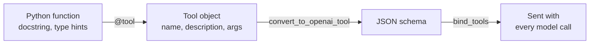

# M23.3 Theory: Defining tools and binding them to a model

*[M23 theory](../README.md) · Lesson 23.3 · Notebooks: [`03a_defining_tools.ipynb`](../../../../course/p08_agent_foundations/m23_agent_loop_and_tools/notebooks/03a_defining_tools.ipynb) · [All theory pages](../../../README.md)*

## Tool schema

A tool never reaches the model as Python. When you bind tools to a model, LangChain turns each one into a JSON schema with three parts, and that schema is all the model reads when it decides whether to call the tool and with what arguments.



| Part | Comes from | What the model uses it for |
|---|---|---|
| `name` | The function name, or `name=` | The call it writes; your code dispatches on it (`tool_mapping[name]` in lesson 23.4) |
| `description` | The docstring, or `description=` | Deciding *when* to call the tool, out of all the tools it holds |
| `parameters` | Type hints, or a Pydantic `args_schema` | Deciding *what* to pass: each argument's type, its description, and which are `required` |

The function body is the one part the model never sees. A vague description produces wrong or missing calls however good the code behind it is.

**Typed arguments or none.** The notebook's first `multiply` has no type hints. Its arguments come out as `{'a': {'title': 'A'}, 'b': {'title': 'B'}}`, with no type at all, and `multiply.invoke({'a': 2, 'b': 'abc'})` returns `abcabc`, because Python multiplies a string by an integer without complaint. The Pydantic version (`StructuredTool.from_function` with an `args_schema`) declares both as `number` with a description each, and the same call fails with a `ValidationError` before the function runs.

Here is Larkspur's `search_handbook` at the same three levels, as `convert_to_openai_tool` prints them with `langchain-core` 1.7:

| Definition | `parameters` the model receives |
|---|---|
| `@tool` on `def search_handbook(query)` | `{"properties": {"query": {}}, "required": ["query"], "type": "object"}` |
| `@tool` on `def search_handbook(query: str) -> str` | `{"properties": {"query": {"type": "string"}}, "required": ["query"], "type": "object"}` |
| `StructuredTool` with a Pydantic `Field(description=…)` | the typed version plus `"description": "Words to look up in the handbook, for example 'refund window'"` on `query` |

The full schema of the last one:

```json
{
  "type": "function",
  "function": {
    "name": "search_handbook",
    "description": "Search the Larkspur Cloud handbook and return the two best-matching chunks. Use it for policy questions: billing, refunds, exports, outages, server sizing.",
    "parameters": {
      "properties": {
        "query": {
          "description": "Words to look up in the handbook, for example 'refund window'",
          "type": "string"
        }
      },
      "required": ["query"],
      "type": "object"
    }
  }
}
```

The description says what the tool returns and which questions it is for, so the model can tell it apart from `get_server_status`. The argument description says what a good query looks like. Passing `{"query": 3}` to this tool fails Pydantic validation (`Input should be a valid string`); in an agent that error goes back to the model as a message (lesson 23.5).

**Built-in and wrapped tools.** LangChain's built-in tools carry their own schema: `WikipediaQueryRun` is named `wikipedia` and takes one string, `query`. Wrapping one in `Tool(name=…, func=…, description=…)` gives it your name and description, and changes its argument to the generic `tool_input`, which is worth checking before you bind it. Whatever the source, print `tool.name`, `tool.description` and `tool.args` (or the `convert_to_openai_tool` output) before you trust a tool in a loop: that printout is exactly what the model will read.

The from-scratch signatures in lesson 23.1 wrote Python type names (`"type": "int"`) into a prompt. The native schema uses JSON Schema types (`string`, `number`) and travels in the API request, so the provider can return structured calls against it.

## Key Takeaways

- The model reads only the schema: `name`, `description` and `parameters`, never the function body. A vague description gives wrong or missing calls however good the code is.
- Type every argument. An untyped tool accepts anything (`multiply` turns 2 and `"abc"` into `abcabc`), while a Pydantic `args_schema` rejects bad input before the function runs.
- Print `tool.name`, `tool.description` and `tool.args` before you bind a tool, especially a wrapped built-in, because that printout is exactly what the model sees.

## Check yourself

<details>
<summary>1. The model never sees a tool's function body. Which three parts of the schema does it read, and what does each one decide?</summary>

`name`, `description` and `parameters`. The name is the call it writes and your code dispatches on; the description decides when to call the tool out of all the tools it holds; the parameters decide what to pass, with each argument's type, description and whether it is required. A vague description gives wrong or missing calls however good the code is.

</details>

<details>
<summary>2. The untyped multiply tool gets 2 and the string abc. What comes back, and what does the Pydantic version do with the same call?</summary>

The untyped tool returns `abcabc`, because its schema has no types and Python multiplies a string by an integer without complaint. The `StructuredTool` with an `args_schema` declares both arguments as `number`, so the same call fails with a `ValidationError` before the function runs.

</details>

<details>
<summary>3. You wrap the built-in Wikipedia tool in Tool with your own name and description, and the agent starts passing odd arguments. What should you check before binding it?</summary>

The argument name. Wrapping changes the built-in's `query` argument to the generic `tool_input`. Print `tool.name`, `tool.description` and `tool.args`, or the `convert_to_openai_tool` output, before you trust a tool in a loop, because that printout is exactly what the model reads.

</details>

---
*Previous: [23.1 Agentic patterns from scratch: reflection, tool use, ReAct planning](../01_agentic_patterns_from_scratch_reflection_tool_use_react_planning/README.md). Next: [23.4 The manual tool loop and the augmented LLM in LangGraph](../04_the_manual_tool_loop_and_the_augmented_llm_in_langgraph/README.md).*
