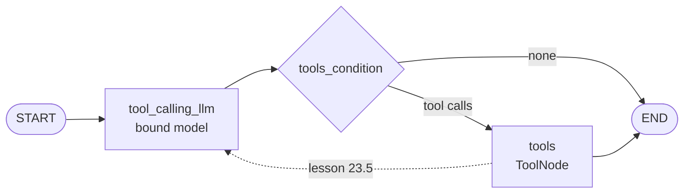

# M23.4 Theory: The manual tool loop and the augmented LLM in LangGraph

*[M23 theory](../README.md) · Lesson 23.4 · Notebooks: [`04a_tool_calling_manual_loop.ipynb`](../../../../course/p08_agent_foundations/m23_agent_loop_and_tools/notebooks/04a_tool_calling_manual_loop.ipynb), [`04b_augmented_llm_with_tools_langgraph.ipynb`](../../../../course/p08_agent_foundations/m23_agent_loop_and_tools/notebooks/04b_augmented_llm_with_tools_langgraph.ipynb) · [All theory pages](../../../README.md)*

## Native tool calls and the message trace

`llm.bind_tools(tools)` returns a model that sends the tool schemas with every request. Its reply is an `AIMessage` with empty `content` and a `tool_calls` list. In `04a`, *How will the weather be in Munich today?* comes back as one call:

```python
[{'name': 'fake_weather_api', 'args': {'city': 'Munich'}, 'id': 'call_GRGobvpFuPRkrEUTERCcyNIw', 'type': 'tool_call'}]
```

Ask about the weather and outdoor seating together and the same reply holds two calls, one per tool, with `finish_reason: 'tool_calls'`. The model asks for both at once because neither depends on the other; there is no extra round trip.

The model still runs nothing. The loop from lesson 23.1 is now four steps over typed messages:

1. Send the `HumanMessage` and append the model's `AIMessage` with its `tool_calls`.
2. For each call, look the tool up by `name` and invoke it with `args`.
3. Append one `ToolMessage(output, tool_call_id=call["id"])` per call.
4. Call the model again with the whole list; it answers from the results.

The `tool_call_id` is what pairs a result with its request. With two parallel calls the model would otherwise have two unlabelled strings and no way to tell which tool produced which. OpenAI's API also rejects a history in which an `AIMessage`'s tool call has no matching `ToolMessage`, so a loop that drops a failed call's result breaks the next request.

The lab's two-tool question shows the shape on Larkspur's tools:

| # | Message | Content |
|---|---|---|
| 0 | `HumanMessage` | *Is my server web-1 running, and does a reboot change its IP address?* |
| 1 | `AIMessage` | two calls: `get_server_status(server_id='web-1')`, `search_handbook(query='reboot server IP address')` |
| 2 | `ToolMessage` | `web-1: running` |
| 3 | `ToolMessage` | `reboot (0.747): You can reboot a server from the console. A reboot takes about a minute and does not change the server IP address.` and `sizing (0.156): …` |
| 4 | `AIMessage` | the answer, no tool calls |

Five messages, two of them tool results. The scores are real TF-IDF over the M11 chunks; the model turns are scripted.

For a model without native tool calling, `04a` ends with the old route: `render_text_description(tools)` writes the signatures into the system prompt, and `JsonOutputParser` reads a `{"name": …, "arguments": …}` blob from the reply. It works on the notebook's two questions, but nothing guarantees valid JSON, a real tool name or every argument. Use it only when the model leaves no choice.

## The augmented LLM

`04b` hands step 2 to LangGraph. A `tool_calling_llm` node calls the bound model, the prebuilt `tools_condition` routes to a `ToolNode` when the reply has `tool_calls` and to `END` when it has none, and the `ToolNode` runs every requested call and writes the `ToolMessage`s into state.



The solid edges are `04b`'s graph. *Explain AI in 2 bullets* ends at the first `END` with a direct answer. *What is the latest news on OpenAI product releases* calls `search_web`, and the run ends on the raw Tavily JSON in a `ToolMessage`: nobody reads the result, the user gets no sentence, and a second, dependent call is impossible.

That graph is an augmented LLM. One more edge makes it an agent: `tools` back to the model instead of to `END` (the dashed line). Lesson 23.5's `create_tool_agent` adds it with `graph.add_edge("tools", "agent")`, and the graph becomes the loop in the module's mental model.

## Key Takeaways

- A bound model returns an `AIMessage` with `tool_calls` and runs nothing. Independent calls arrive together in one reply, saving a round trip.
- Answer every call with one `ToolMessage` carrying its `tool_call_id`. The id pairs results with requests, and OpenAI rejects a history with an unanswered call.
- A graph that goes from tools to `END` is an augmented LLM. One edge from tools back to the model turns it into an agent loop.

## Check yourself

<details>
<summary>1. Why does every ToolMessage carry the id of the tool call it answers?</summary>

The `tool_call_id` pairs a result with its request. With two parallel calls the model would otherwise get two unlabelled strings and no way to tell which tool produced which. OpenAI's API also rejects a history in which a tool call has no matching `ToolMessage`, so dropping a failed call's result breaks the next request.

</details>

<details>
<summary>2. A customer asks if web-1 is running and if a reboot changes its IP. How many messages does the trace hold, and why are both tools requested at once?</summary>

Five: the `HumanMessage`, one `AIMessage` with two calls (`get_server_status` and `search_handbook`), two `ToolMessage`s and the final `AIMessage`. Neither call depends on the other, so the model asks for both at once and saves a round trip.

</details>

<details>
<summary>3. The graph from the second notebook answers a news question with raw Tavily JSON and no sentence. What is missing, and which one change fixes it?</summary>

The `tools` node goes straight to `END`, so nobody reads the result and no dependent call is possible. That graph is an augmented LLM. Adding the edge from `tools` back to the model (`graph.add_edge("tools", "agent")` in lesson 23.5's `create_tool_agent`) makes it an agent loop.

</details>

---
*Previous: [23.3 Defining tools and binding them to a model](../03_defining_tools_and_binding_them_to_a_model/README.md). Next: [23.5 Tool errors and evaluating tool calls](../05_tool_errors_and_evaluating_tool_calls/README.md).*
