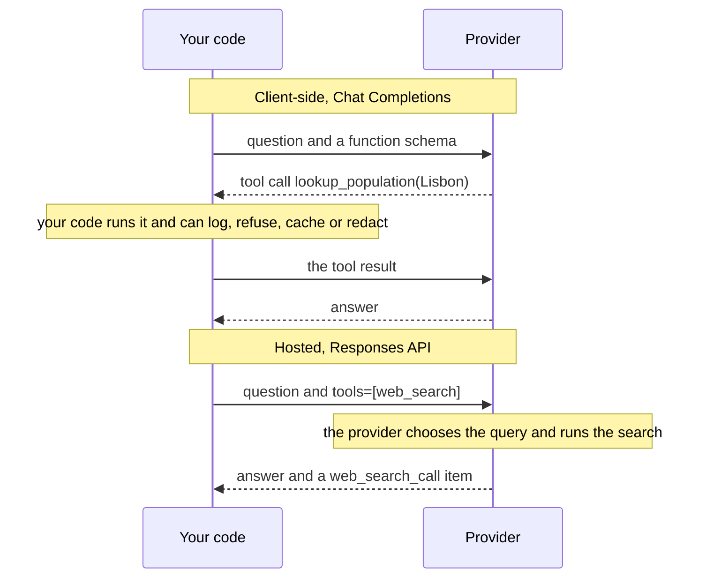

# M23.6 Theory: Hosted vs client-side tools: code execution and image generation

*[M23 theory](../README.md) · Lesson 23.6 · Notebooks: [`06a_hosted_vs_client_side_tools.ipynb`](../../../../course/p08_agent_foundations/m23_agent_loop_and_tools/notebooks/06a_hosted_vs_client_side_tools.ipynb), [`06b_hosted_code_execution.ipynb`](../../../../course/p08_agent_foundations/m23_agent_loop_and_tools/optional/06b_hosted_code_execution.ipynb) (optional), [`06c_agentic_image_generation.ipynb`](../../../../course/p08_agent_foundations/m23_agent_loop_and_tools/optional/06c_agentic_image_generation.ipynb) (optional) · [All theory pages](../../../README.md)*

## Hosted vs client-side tools

Every tool so far ran on your machine: the model returned a call, your code ran it, you sent the result back. A hosted tool runs on the provider's infrastructure instead, and the reply arrives with the result already folded in. The API difference is a few lines; the difference in what you can see and control is large.

`06a` answers *What is the current population of Lisbon?* both ways with `gpt-4o-mini`:

In the notebook's run the client-side path took two round trips and 1.86 s; the hosted path took one round trip and 3.16 s. One run proves little about latency, but it does show that one round trip is not automatically faster. The hosted reply carries a `web_search_call` output item with its status and the query the provider chose (`current population of Lisbon 2023`). That item is your only window into the execution: you did not choose the query, you cannot see the raw results, and nothing of yours ran between retrieval and generation.

| | Client-side | Hosted |
|---|---|---|
| Who executes | Your process | The provider's infrastructure |
| See the arguments | Yes, before execution | Sometimes, after the fact |
| Intercept or refuse a call | Yes, it is your code | No |
| Deterministic tests | Yes, stub the function | No, it hits the live world |
| Failure | Your exception, your retry | A status across an API boundary; you can only re-run the whole request |
| Cost | Tokens and your infrastructure | Tokens and a fee per tool call (code interpreter: per container session) |

**The seam.** The gap between "the model asked" and "the model sees the result" is where policy lives. `06a`'s `guarded_lookup` is four lines that refuse any city outside an allow-list; asked about Pyongyang, it returns an error and the model says it cannot retrieve that population. Allow-lists, tenant scoping, PII redaction and spend caps all sit in that seam, and choosing a hosted tool means choosing not to have it.

**Visibility varies by tool.** The optional notebooks refine the rule that a hosted tool shows you nothing:

| Hosted tool | What comes back besides the answer |
|---|---|
| `web_search` | The query, roughly; no raw results |
| `code_interpreter` (`06b`) | The source it ran, its output and any files, so you can audit the method |
| `image_generation` (`06c`) | The `revised_prompt` the model wrote for itself and the image as base64 |

Code interpreter is also configurable: `06b` sets a memory ceiling and a network policy (`{"type": "disabled"}` for a sandbox that works only on data you supplied). What you still cannot do is approve the code before it runs, veto one call, or stub it in a test. `06c` adds a different caution: the agent narrates what it *meant* to draw, and only feeding the image back to a vision model shows what it actually drew. The model also has to leave the tool alone when a turn asks for advice; `06c` checks that it does.

For Larkspur's support agent the split follows the data:

- `search_handbook` and `get_server_status` stay client-side. They read the customer's account and Larkspur's own policy, need tenant scoping and logging, and must be stubbed in tests (the M23 lab runs them deterministically for this reason).
- A hosted `web_search` fits questions the handbook cannot answer, about public software or third-party services, where there is nothing to enforce between the call and the result.
- Hosted code execution fits arithmetic on numbers the customer pasted into the chat. `06b`'s point holds: a model that runs three lines of Python computes, while one that answers directly samples plausible digits.

Hosted tools exist only on OpenAI's Responses API; Chat Completions offers function tools only. `06a` calls `client.responses.create` on the raw OpenAI client, because LangChain does not surface hosted-tool configuration. A third placement, a tool on a server you run that the model reaches over a protocol, is MCP (M38 to M40), and it gives back much of the seam that hosted tools remove.

## Check yourself

1. What do you give up when you move a tool from client-side to hosted?

The seam between the model asking and the model seeing the result, which is where policy lives: allow-lists, tenant scoping, PII redaction and spend caps. You also lose the chance to see arguments before execution, refuse a call, or stub the tool in a deterministic test, and a failure can only be handled by re-running the whole request.

2. Larkspur's support agent needs the customer's server status and an answer about a third-party service. Which should run client-side, and which suits a hosted tool?

`get_server_status` stays client-side: it reads the customer's account, needs tenant scoping and logging, and must be stubbed in tests. A hosted `web_search` fits the third-party question, which the handbook cannot answer and where there is nothing to enforce between the call and the result.

3. The hosted search took one round trip and 3.16 s, the client-side path two and 1.86 s. Is hosted the way to cut latency?

Not on this evidence. One round trip is not automatically faster: in that run the hosted path was the slower one. One run also proves little about latency, so measure on your own traffic. And going hosted removes the seam where your code could log, refuse or redact the call.

---
*Previous: [23.5 Tool errors and evaluating tool calls](../05_tool_errors_and_evaluating_tool_calls/README.md). Next: [M23 interview questions](../README.md#interview-spotlight-5-questions-you-might-get-asked).*
