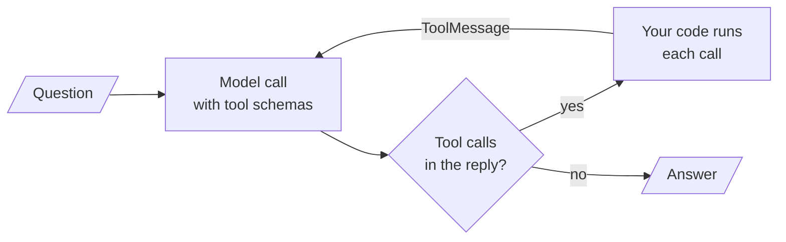

# M23 Theory: The agent loop and tool calling

*Part VIII · Agent Foundations for RAG · [Module README](../../../course/p08_agent_foundations/m23_agent_loop_and_tools/README.md) · [All theory pages](../../README.md)*

An agent is a model call inside a loop. The model reads the conversation and either answers or asks for tools; your code runs the tools, appends their results, and calls the model again. The M23 notebooks build on four ideas: the loop itself, the schema a tool becomes when the model reads it, how to score whether the model called the right tool with the right arguments, and who runs the tool, you or the provider. Each idea has a page in the folder of the lesson that teaches it, listed under [Lessons](#lessons). This page has the overview, the interview questions and the takeaways.

The running example is a support agent for Larkspur Cloud, the fictional host from M11 to M13. It has two client-side tools: `search_handbook`, which ranks the twelve handbook chunks from the [M11 lab](../../p04_rag_foundations/m11_rag_lifecycle/README.md) with TF-IDF and returns the best two, and `get_server_status`, which looks up one of the customer's servers. The golden questions are an M11 one (*Can I export my data after I cancel my plan?*), a two-tool one (*Is my server web-1 running, and does a reboot change its IP address?*), and two that fail on purpose: a server that does not exist and a tool call with the wrong argument name.

## TL;DR

- The loop has one rule: while the model's reply holds tool calls, run them and call the model again; a reply with no tool calls is the answer. Cap the rounds (the from-scratch `ReactAgent` stops at `max_rounds=10`).
- A tool reaches the model only as a schema: a name, a description and typed parameters. Without type hints the `@tool` decorator emits `"query": {}`, and the model gets no type to follow.
- Tool results go back as one `ToolMessage` per call, matched by `tool_call_id`. A two-tool question in the lab ends with 5 messages; a retried call ends with 6.
- A tool error has to reach the model as a message. `ToolNode`'s default only catches bad arguments and re-raises exceptions from inside the tool; in the lab, `handle_tool_errors=True` answers 4 of 4 questions, the default 3 and `False` 2.
- Score tool selection, tool input and synthesis separately. Run code yourself when it touches customer data; use a hosted tool for commodity work where nothing needs enforcing between the call and the result.

## Mental model

<!-- animated: diagrams/agent-loop.anim.html -->

The model never runs anything. It writes a request; your code decides whether to run it, runs it, and writes the result into the conversation. Every later agent in this course, from `create_agent` to a multi-agent graph, is this loop with more around it.

## Lessons

| Lesson | Topic | Theory |
|---|---|---|
| 23.1 | Agentic patterns from scratch: reflection, tool use, ReAct planning | [Agent loop](01_agentic_patterns_from_scratch_reflection_tool_use_react_planning/README.md#agent-loop) |
| 23.2 | A real-world agent on raw API calls (Hacker News chatbot) | *planned* |
| 23.3 | Defining tools and binding them to a model | [Tool schema](03_defining_tools_and_binding_them_to_a_model/README.md#tool-schema) |
| 23.4 | The manual tool loop and the augmented LLM in LangGraph | [Native tool calls and the message trace](04_the_manual_tool_loop_and_the_augmented_llm_in_langgraph/README.md#native-tool-calls-and-the-message-trace) [The augmented LLM](04_the_manual_tool_loop_and_the_augmented_llm_in_langgraph/README.md#the-augmented-llm) |
| 23.5 | Tool errors and evaluating tool calls | [Where tool errors go](05_tool_errors_and_evaluating_tool_calls/README.md#where-tool-errors-go) [Tool-call evaluation](05_tool_errors_and_evaluating_tool_calls/README.md#tool-call-evaluation) |
| 23.6 | Hosted vs client-side tools: code execution and image generation | [Hosted vs client-side tools](06_hosted_vs_client_side_tools_code_execution_and_image_generation/README.md#hosted-vs-client-side-tools) |

## Interactive lab

[**Where a tool error goes**](05_tool_errors_and_evaluating_tool_calls/interactive/tool-error-routing-lab.html): open the file in a browser. Pick *Is my server web-9 up?* and switch `handle_tool_errors` between `default`, `True` and `False`: only `True` turns the `ValueError` into a message the model can answer from. Then pick *How long does a refund take?*, where the model names the argument `q`: the default setting survives it with one extra round trip, and `False` crashes. The table under the trace counts how many of the four questions each setting answers.

## How it connects

- **Before:** [M11](../../p04_rag_foundations/m11_rag_lifecycle/README.md) built the handbook index that `search_handbook` wraps. M09 and M10 taught the LangGraph state, reducers and conditional edges the 23.4 and 23.5 graphs use. M20 is the end-to-end retriever the module lab asks you to wrap as a tool.
- **Next:** [M24](../m24_react_agents/README.md) packages this loop as a ReAct agent with LangChain's `create_agent`, and M25 to M27 add workflow patterns, planning and human approval around it. M28 to M31 put the retriever inside the loop (agentic RAG), and M38 to M40 reach tools over MCP, a server you run that the model calls through a protocol.

## Interview Spotlight: 5 Questions You Might Get Asked

*Production questions in the style of OpenAI, Anthropic and Google interviews for applied AI roles.*

### 1. Larkspur's support agent returns a 500 whenever a customer mistypes a server name ("Is web-9 up?"). The logs show `ValueError: Unknown server 'web-9'`. The tool works for valid names. What is wrong, and what do you change?

**What a strong answer covers:**
- The exception escapes the `ToolNode`: its default catches invalid arguments but re-raises exceptions from inside the tool, so `graph.invoke` fails and the model never sees the error
- Two fixes: set `handle_tool_errors=True`, or have the tool catch the failure and return a descriptive string; either way the model receives a `ToolMessage` with status error
- Makes the error text useful to the model: list the customer's real servers, so the model can ask "did you mean web-1?" instead of apologising
- Adds the typo to the test set and alerts on the share of `ToolMessage`s with status error per tool, so a new failure mode shows up before customers report it

### 2. A product manager wants to drop `search_handbook` and give the agent the provider's hosted web search, since "the handbook is public anyway". What do you weigh before agreeing?

**What a strong answer covers:**
- Execution location decides control: with a client-side tool you see the arguments before execution, can refuse or redact, and own the raw result; with hosted web search you see a status and the query after the fact
- Accuracy and scope: the handbook index returns Larkspur's own current policy with chunk ids to cite, while web search can return third-party pages or an old cached copy
- Testing and cost: a client-side tool can be stubbed for deterministic tests; a hosted call hits the live web and bills per call on top of tokens
- A reasonable split: client-side for anything that touches customer data or policy, hosted search only for questions the handbook cannot answer, and log which path answered

### 3. You change the description of `get_server_status` and swap in a new model in the same release. How do you know the agent still calls the right tool with the right arguments?

**What a strong answer covers:**
- A golden set of questions with the expected tool calls, run before and after; change one thing at a time, so a regression points at its cause
- Scores tool selection and tool input deterministically from the trace (names match, arguments validate against the schema), with no judge needed
- Uses an LLM judge only for synthesis, from a different and ideally stronger model than the agent, checked against a few human-graded traces, because a model grading its own run tends to be lenient
- Watches production too: per-tool call rates, the share of error results, and rounds per run, segmented by question type

### 4. A trace shows the agent calling `search_handbook` eight times with slightly different queries for "How long does a refund take?" before it gives up. What is going on, and how do you stop it?

**What a strong answer covers:**
- Checks the tool results first: TF-IDF matches exact tokens, so "refund" never meets "Refunds" in the `refund-timing` chunk; the tool returned the wrong chunk or nothing, and the model kept rephrasing
- Fixes the retriever (embeddings or query rewriting, M14 and M18) rather than the loop, and makes the empty result say so plainly, so the model can stop
- Caps the loop anyway: `max_rounds` in the from-scratch agent, `recursion_limit` in LangGraph, with a fallback answer when the cap is hit
- Detects repeated near-identical calls in the trace as a monitoring signal, since they cost a model call each round

### 5. The model sometimes calls `get_server_status` with "my database server" instead of an id like `db-1`. The schema says `server_id: string`. How do you make wrong arguments rarer, and what catches the ones that remain?

**What a strong answer covers:**
- The schema is the only thing the model reads: add a `Field` description with the id format and an example, and say in the tool description when to use it
- Constrains the type where the values are known, for example an enum of the customer's server ids, so a free-text value fails validation
- Validation errors go back as messages (the `ToolNode` default does this), so the model can retry with a valid id
- Measures the tool-input score on the golden set before and after the description change, and keeps the version that scores better

## Key Takeaways

- Write the loop's exit conditions first: no tool calls means answer, and a round cap means stop with a fallback.
- Treat the tool schema as the interface. Type every argument and describe it, because the model reads nothing else.
- Every tool failure must come back as a `ToolMessage` the model can read. Set `handle_tool_errors` deliberately and test it with a tool that raises.
- Run tools that touch customer data in your own process, where you can log, refuse and stub them. Hosted tools fit commodity capabilities with nothing to enforce.

---
*Previous: [M22 Framework fluency: LlamaIndex](../../p07_rag_applications/m22_llamaindex/README.md). Next: [M24 ReAct agents and LangChain create_agent](../m24_react_agents/README.md).*
