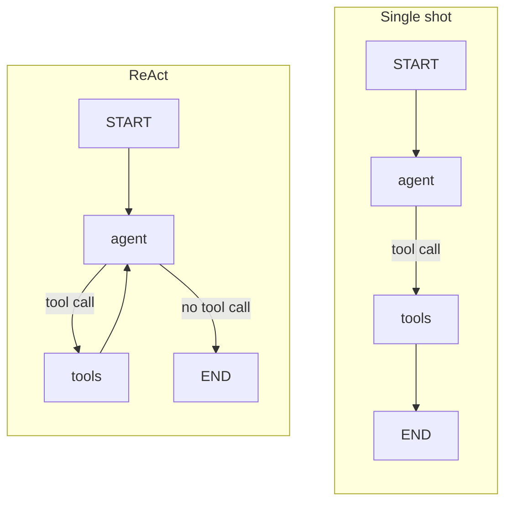

# M24.1 Theory: The ReAct loop in LangGraph; tool calling vs ReAct

*[M24 theory](../README.md) · Lesson 24.1 · Notebooks: [`01a_react_agent_langgraph.ipynb`](../../../../course/p08_agent_foundations/m24_react_agents/notebooks/01a_react_agent_langgraph.ipynb), [`01b_tool_calling_vs_react.ipynb`](../../../../course/p08_agent_foundations/m24_react_agents/notebooks/01b_tool_calling_vs_react.ipynb) · [All theory pages](../../../README.md)*

## Reason–act–observe

A ReAct agent does not plan its steps up front. It reasons about the next step only, acts by calling a tool, observes the result, and reasons again with that result in front of it. The loop ends when the model replies without asking for a tool (Yao et al., *ReAct: Synergizing Reasoning and Acting in Language Models*, ICLR 2023).

In LangGraph the whole run lives in one state key, a message list with the `add_messages` reducer, so every model call sees everything that came before:

```
HumanMessage   the question
AIMessage      tool_calls=[search_handbook(...)]     reason + act
ToolMessage    what the tool returned                observe
AIMessage      another tool call, or the answer
```

The model never runs a tool. `bind_tools()` lets it return a *request* for a tool call; `ToolNode` executes the request and appends the `ToolMessage`. The difference between a one-shot augmented LLM and an agent is one edge:



With `tools → END`, the last message is the `ToolMessage` itself: the user gets search snippets, and no search can build on another. With `tools → agent`, `tools_condition` sends the run back to the model after every observation and ends it when the model stops calling tools. The notebook asks both graphs a question that needs a chain of searches (the company behind *Dune*, its CEO, its latest film, that film's budget). The single-shot graph returned a `ToolMessage`; the loop wrote an answer from several searches, each naming something only an earlier result contained. The same loop costs nothing extra on a question that needs no tool: *Explain AI in 2 bullets* goes `START → agent → END` in one call.

The [interactive lab](interactive/react-loop-lab.html) runs this loop over the twelve Larkspur handbook chunks from the M11 lab. The tool, `search_handbook`, returns the top two chunks by real TF-IDF. The model is scripted: it writes the queries a model might write and answers once the evidence is in the message list. The retrieval, the loop and the counts are computed. On the three M11 golden questions:

| Question | Single shot | ReAct | ReAct, `run_limit=3` |
|---|---|---|---|
| *Can I export my data after I cancel my plan?* | evidence 1.00, raw tool output | 1.00, 2 calls, answered | answered |
| *How long does a refund take?* | 0.50, raw tool output | 1.00, 3 calls, answered | answered |
| *What happens if my server goes down?* | 0.00, raw tool output | 1.00, 4 calls, answered | stopped at the cap, evidence 1.00 |
| Mean, total | 0.50, 3 calls, 0 of 3 answered | **1.00, 9 calls, 3 of 3 answered** | 8 calls, 2 of 3 answered |

What the numbers show:

- **Single shot equals the M11 baseline.** One top-2 retrieval per question gives the same mean recall, 0.50, and the user receives chunks instead of an answer.
- **The loop recovers vocabulary mismatch by rewording.** The refund question's first search misses `refund-timing` ("Refunds" in the chunk, "refund" in the question); the second, written after reading the first result, finds it. The outage question needs three searches: the question's own words and "server outage" both rank `reboot` and `sizing` first, and "what happens during an outage incident" returns `incidents` and `sla`.
- **Every call rereads the whole list.** The outage run reads about 451 tokens of context over four calls, against 9 for the single search. Cost grows with every round, which is why a loop needs a cap (lesson 24.2).
- **A cap set too low cuts off the answer, not the search.** At `run_limit=3` the outage run already holds both evidence chunks when the middleware stops it; the call it blocks is the one that would have written the answer.

<!-- lab: interactive/react-loop-lab.html -->

ReAct earns its extra calls on questions whose path depends on what the searches find. When you already know the fixed sequence of steps, a workflow is cheaper, more predictable and easier to test (lesson 24.5, M25).

## Native tool calls vs text-based ReAct

The ReAct paper predates tool-calling APIs. It drove the loop with text: the prompt listed the tools and asked the model to write `Thought:`, `Action:` and `Action Input:` lines; the framework stopped generation at `Observation:`, parsed the action with a regular expression, ran the tool and pasted the result back. Native tool calling moves the same loop onto structured `tool_calls` returned by the provider.

| | Native tool calling | Text-based ReAct |
|---|---|---|
| How the call travels | Structured `tool_calls` from the provider API | Free text, parsed with a regex |
| Needs a tool-calling model | Yes | No, any instruction-following model |
| Parallel calls in one turn | Yes | No, one `Action` per turn |
| Visible reasoning | Optional | Always, the `Thought:` lines |
| Typical failure | Wrong tool or bad arguments | Format drift, or arguments polluted by quotes and whitespace |

The notebook runs both on the same two stub tools. With `gpt-4o-mini`, the text agent often wrote `Action Input: 'Tokyo'` with the quotes, the tool looked up the city `'Tokyo'` and found nothing, and the calculator received `'0.25 * 80'` as a quoted string. The model knew which tool it wanted; the transport failed. Text-driven tools need input cleaning, and `handle_parsing_errors=True` turns a format break into an observation the model can react to.

On *What's the weather in Tokyo and calculate 25% of 80?* the native agent asked for both tools in one turn and needed 2 model calls; the text agent, one `Action` per turn, needed 3. LangChain 1.x `create_agent` uses native tool calls, so there is nothing to parse. The ReAct idea, read every observation before choosing the next step, is unchanged.

## Check yourself

<details>
<summary>1. Why does adding one edge from the tools node back to the agent turn a single-shot graph into a ReAct agent?</summary>

With `tools → END` the last message is the `ToolMessage`, so the user gets search snippets and no search can build on another. With `tools → agent`, `tools_condition` sends the run back to the model after every observation, so each search can use what earlier results named. The run ends when the model replies without a tool call.

</details>

<details>
<summary>2. In the lab, the first search for the refund question misses the refund-timing chunk. What does the loop do next, and how many calls does the run need?</summary>

The model reads the first result and rewords its query, and the second search finds `refund-timing` (the chunk says "Refunds", the question says "refund"). The ReAct run takes 3 calls and reaches evidence 1.00, against 0.50 for the single shot.

</details>

<details>
<summary>3. A text-based ReAct agent picks the weather tool for Tokyo but the tool finds no such city. What failed, and how do you fix it?</summary>

The transport failed, not the choice: the model wrote `Action Input: 'Tokyo'` with the quotes, so the tool looked up `'Tokyo'`. Text-driven tools need input cleaning, and `handle_parsing_errors=True` turns a format break into an observation. Native tool calling, as in `create_agent`, removes the parsing step.

</details>

---
*Previous: [M24 overview](../README.md). Next: [24.2 ReAct with LangChain `create_agent`](../02_react_with_langchain_create_agent/README.md).*
