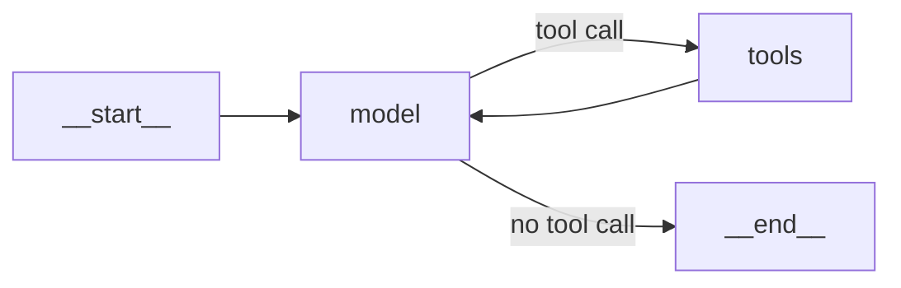

# M24.2 Theory: ReAct with LangChain `create_agent`

*[M24 theory](../README.md) · Lesson 24.2 · Notebooks: [`02a_react_with_create_agent.ipynb`](../../../../course/p08_agent_foundations/m24_react_agents/notebooks/02a_react_with_create_agent.ipynb) · [All theory pages](../../../README.md)*

## create_agent

`create_agent(model, tools, system_prompt=...)` from `langchain.agents` builds the loop of lesson 24.1 for you and returns a compiled LangGraph graph (`CompiledStateGraph`). The notebook prints its structure:

```
nodes: __start__, model, tools, __end__
__start__ -> model
model -> tools      (conditional: the model asked for a tool)
tools -> model      (the ReAct feedback loop)
model -> __end__    (conditional: no tool call)
```



Because it is a graph, everything from M09 and M10 applies: `.stream(..., stream_mode="values")` replaces 0.x's `verbose=True`, and a checkpointer plus a `thread_id` gives memory. Input and output are message lists: `invoke({"messages": [...]})` returns the whole trail, and `result["messages"][-1]` is the answer.

The model decides how much to do per turn:

- **Dependent calls take one turn each.** *Get Google's price, then email it to an analyst* needs `get_stock_price`, an observation, then `send_email`, because the email body needs the price.
- **Independent calls share a turn.** *Weather in Bangalore and Mumbai, and 25 * 4* came back as three tool calls in one `AIMessage`; the `tools` node ran all three before the model's second and last call.

What changed from LangChain 0.x, from the notebook's migration table:

| LangChain 0.x | LangChain 1.x |
|---|---|
| `initialize_agent(...)`, `create_tool_calling_agent` + `AgentExecutor`, or LangGraph's `create_react_agent(prompt=...)` | `create_agent(llm, tools, system_prompt=...)` |
| `max_iterations=3` | `ModelCallLimitMiddleware(run_limit=3)` |
| `verbose=True` | `.stream(..., stream_mode="values")` |
| `memory=ConversationBufferMemory(...)` | `checkpointer=` plus `thread_id` in the config |
| `invoke({"input": ...})` returns `{"output": ...}` | `invoke({"messages": [...]})` returns `{"messages": [...]}` |

Renaming only the function is not enough: the old `prompt=` argument raises `TypeError` on `create_agent`, which takes `system_prompt=`. `create_react_agent` in `langgraph.prebuilt` is deprecated since LangGraph v1.0.

Tools come in three weights. `load_tools` (now in `langchain_community`) gives ready-made ones such as `llm-math`; `@tool` turns a function into a tool; a `BaseTool` subclass carries configuration, such as which vector store to search. In every case the model chooses tools by their name and description, so the description is prompt text.

## Call limits and runaway loops

A loop that decides its own length can run long. The notebook builds the failure on purpose: a restaurant FAQ indexed badly, with only the questions stored and the answers lost. Asked *When does the restaurant open?*, a plain agent searched once, saw four questions and no hours, and said it could not answer. An agent told to keep searching until it found the answer reworded its query again and again, getting the same answerless questions back each time, until `ModelCallLimitMiddleware(run_limit=3, exit_behavior="end")` ended the run and appended its notice. The cap bounded the bill; the user still had no opening hours.

The notebook ranks the fixes by how much they change what the model sees:

| Fix | Where |
|---|---|
| 1. Fix the data: store each question with its answer | ingestion |
| 2. Retrieve more documents (`search_kwargs={"k": 6}`) | the retriever |
| 3. Format results clearly ("Restaurant Information:" headers) | the tool's return value |
| 4. Say in the description what the tool returns | the tool's `description` |
| 5. Raise the call cap | `create_agent(middleware=[...])` |

Fix 5 is the least effective: it buys more attempts at a retrieval problem. With fixes 1 to 4 the same question took one search and one answer, under the same cap.

`ModelCallLimitMiddleware` counts model calls per run (`run_limit`) and per thread across runs (`thread_limit`). It checks before each model call; at the limit, `exit_behavior="end"` jumps to the end with an `AIMessage` such as `Model call limits exceeded: run limit (3/3)`, and `"error"` raises `ModelCallLimitExceededError`. In the [M24.1 lab](../01_the_react_loop_in_langgraph_tool_calling_vs_react/interactive/react-loop-lab.html) the golden questions need 2, 3 and 4 calls; at `run_limit=2` only the export question is answered, even though the refund run already holds both evidence chunks. Set the cap from the call counts your golden set needs, with headroom, and alert when runs hit it.

---
*Previous: [24.1 The ReAct loop in LangGraph; tool calling vs ReAct](../01_the_react_loop_in_langgraph_tool_calling_vs_react/README.md). Next: [24.3 Models, messages and structured output in LangChain 1.x](../03_models_messages_and_structured_output_in_langchain_1_x/README.md).*
