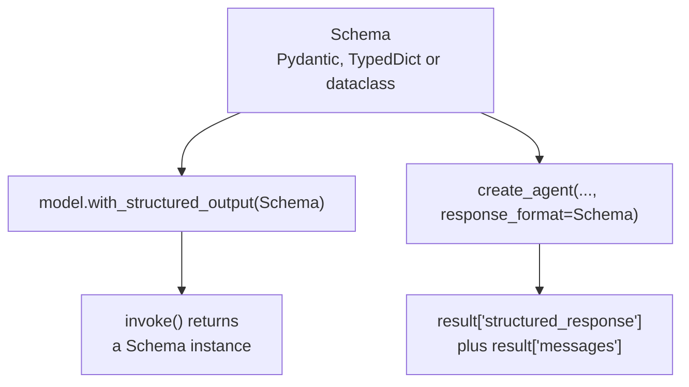

# M24.3 Theory: Models, messages and structured output in LangChain 1.x

*[M24 theory](../README.md) · Lesson 24.3 · Notebooks: [`03c_structured_output.ipynb`](../../../../course/p08_agent_foundations/m24_react_agents/notebooks/03c_structured_output.ipynb), [`03a_model_integration.ipynb`](../../../../course/p08_agent_foundations/m24_react_agents/optional/03a_model_integration.ipynb) (optional), [`03b_messages.ipynb`](../../../../course/p08_agent_foundations/m24_react_agents/optional/03b_messages.ipynb) (optional) · [All theory pages](../../../README.md)*

## Structured output

An agent's last message is prose. When the next consumer is code (a ticket queue, a database row, a judge's score), ask for a schema instead. The schema goes to the provider, not into the prompt as an instruction: providers that support structured output constrain decoding to it, so the reply parses.

There are two places to attach a schema:

- **On a model.** `llm.with_structured_output(Movie)` returns a new runnable; `llm` itself is unchanged. Its `invoke()` returns a `Movie` instead of an `AIMessage`. The judge in lesson 24.1 is built this way, so its scores are fields rather than sentences.
- **On an agent.** `create_agent(model=llm, response_format=ContactInfo)` runs the agent as usual and adds `structured_response` to the result state, next to `messages`. It selects `ProviderStrategy` where the provider supports native structured output.

The three schema styles differ in what they check:

| Style | Returns | Validation | Optional field |
|---|---|---|---|
| Pydantic `BaseModel` | an instance | yes, raises on a wrong type | `budget: float \| None = Field(None, description=...)` |
| `TypedDict` | a plain `dict` | none | `Annotated[float \| None, None, "description"]` |
| `@dataclass` | an instance | none | |

Choose Pydantic when the data crosses a trust boundary: if a provider returns a string where you declared an `int`, Pydantic raises and `TypedDict` hands you the string. Two `TypedDict` traps from the notebook: `= Field(...)` inside a `TypedDict` is silently discarded, so the field stays required and its description never reaches the model; and `NotRequired[...]` is rejected by LangChain's schema converter (`TypeError: NotRequired accepts only a single type`). Use the middle slot of `Annotated` for the default.

Three details matter in production:

- **Descriptions are prompt text.** `Field(description="The movie's rating out of 10")` tells the model the scale; without it the model guesses one.
- **Optional fields stop invented values.** A field the source may not contain (a budget, a refund amount on a question that has none) should be optional with a `None` default, so the model is not forced to write a number.
- **`include_raw=True`** returns `{"raw", "parsed", "parsing_error"}`. You keep the `AIMessage` with its `usage_metadata` (119 input and 22 output tokens for the notebook's four-field `Movie`), and a parse failure becomes a value you can branch on instead of an exception.

Not every model supports structured output. `llm.profile` (LangChain 1.1) reports capabilities from the open `models.dev` data; for `gpt-4o-mini` it lists `structured_output: true`, `tool_calling: true` and `max_input_tokens: 128000`. Branch on it rather than guessing.

The two optional notebooks cover the parts underneath. `init_chat_model` builds a model for any provider behind one interface, with streaming and batching. Messages are the unit of context: `SystemMessage`, `HumanMessage`, `AIMessage` and `ToolMessage`, and the list you pass is all the model sees. An `AIMessage` that asks for a tool usually has `content=""` and carries the call in `.tool_calls`, so print both when you debug a run.

## Check yourself

1. When should a structured-output schema be a Pydantic model rather than a TypedDict?

When the data crosses a trust boundary. Pydantic returns an instance and raises if the provider sends a string where you declared an `int`; a `TypedDict` returns a plain `dict` with no validation and hands you the string.

2. A ticket schema has a required refund amount, and the model writes a number even for questions that mention no refund. What change stops it?

Make the field optional with a `None` default, for example `refund_amount: float | None = Field(None, description=...)`. A required field forces the model to write a value, while an optional one lets it leave a missing fact empty.

3. You add a field description inside a TypedDict with an equals Field call, yet the field stays required and the model never sees the description. What happened?

`= Field(...)` inside a `TypedDict` is silently discarded. `NotRequired[...]` will not help either, because LangChain's schema converter rejects it. Put the default and description in `Annotated[float | None, None, "description"]`, or switch to Pydantic.

---
*Previous: [24.2 ReAct with LangChain `create_agent`](../02_react_with_langchain_create_agent/README.md). Next: [24.4 Middleware, including human-in-the-loop](../04_middleware_including_human_in_the_loop/README.md).*
