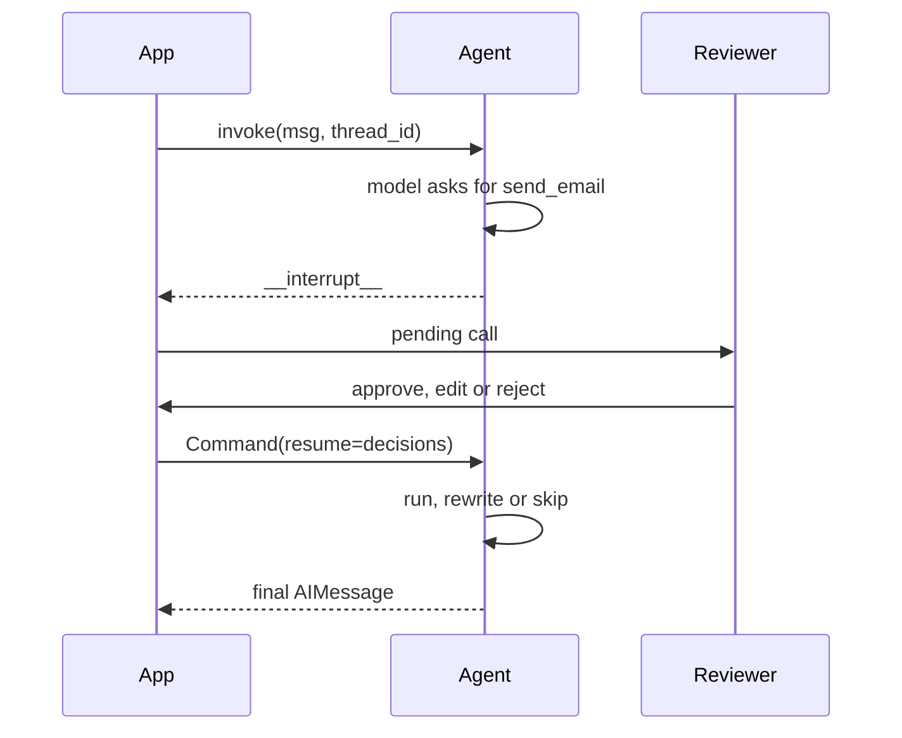

# M24.4 Theory: Middleware, including human-in-the-loop

*[M24 theory](../README.md) · Lesson 24.4 · Notebooks: [`04a_middleware.ipynb`](../../../../course/p08_agent_foundations/m24_react_agents/notebooks/04a_middleware.ipynb) · [All theory pages](../../../README.md)*

## Middleware

Middleware attaches hooks at fixed points of the `create_agent` loop: before the model call, after it, and around a model or tool call. You use it for observability (logging, timing), transformation (rewriting the prompt, filtering tools), control flow (retries, early exit) and guardrails (call limits, PII redaction, human approval), without rebuilding the loop as raw LangGraph nodes.

Each hook compiles to a node in the agent's graph. The notebook prints them:

```
SummarizationMiddleware              model, SummarizationMiddleware.before_model
HumanInTheLoopMiddleware             model, tools, HumanInTheLoopMiddleware.after_model
PIIMiddleware("email") + call limit  model, tools, PIIMiddleware[email].before_model, PIIMiddleware[email].after_model,
                                     ModelCallLimitMiddleware.before_model, ModelCallLimitMiddleware.after_model
```

The built-ins the notebooks use:

| Middleware | What it does | Key arguments |
|---|---|---|
| `SummarizationMiddleware` | Before the model call, replaces old history with a summary, keeps recent messages verbatim | `model` (the summariser), `trigger` and `keep` in `("messages", n)`, `("tokens", n)` or `("fraction", f)` |
| `HumanInTheLoopMiddleware` | After the model call, pauses before a gated tool call runs | `interrupt_on={tool: {"allowed_decisions": [...]}}`, or `False` to let a tool run |
| `PIIMiddleware` | Before and after the model call, redacts one PII type in inputs and tool results | the type (`"email"`, `"credit_card"`, `"ip"`, ...), `strategy="redact"`, `apply_to_input`, `apply_to_tool_results` |
| `ModelCallLimitMiddleware` | Counts model calls after each call, checks them before the next, and ends the run at the cap | `run_limit`, `thread_limit`, `exit_behavior` |

With `trigger=("messages", 10)` and `keep=("messages", 4)`, the notebook's history grew 2, 4, 6, 8, 10 over five turns and dropped to 6 on the sixth, when the summary replaced the older turns. A message count is predictable but a poor proxy for context pressure; tokens track what runs out, and a fraction of the context window keeps its meaning when you change models. Summarisation and human approval both need a checkpointer, because they rewrite or suspend the run between calls.

Middleware runs in the order you list it. A custom one subclasses `AgentMiddleware` and overrides the hook it needs, with two rules that are easy to break. Every hook takes `(self, state, runtime)`; leaving out `runtime` raises `TypeError` at run time. And a hook returns a state update instead of mutating `state`: to pass a value from `before_model` to `after_model`, declare it on a custom `state_schema` and `return {"key": value}`. To end a run early, follow `ModelCallLimitMiddleware`'s own `before_model`: it is decorated with `@hook_config(can_jump_to=["end"])` and returns `{"jump_to": "end", "messages": [AIMessage(...)]}`. The M24 lab brief's off-topic guard has the same shape.

### Human-in-the-loop

`HumanInTheLoopMiddleware` turns an irreversible tool call into a decision. Gate the writes (sending email, issuing a refund) and let the reads run; pausing on reads is friction with no safety gain.



The pause is a real suspension: the state is checkpointed under the `thread_id` and nothing runs until you resume with one decision per gated call. The three decisions, as the notebook's message trails show them:

- **Approve.** The tool runs with the model's arguments.
- **Edit.** `{"type": "edit", "edited_action": {"name": ..., "args": {...}}}` replaces the arguments, and the tool runs with yours. The `ToolMessage` tells the model a reviewer replaced its call, so it does not re-issue the original.
- **Reject.** The tool never runs. The model receives a `ToolMessage` saying the user rejected the call and not to retry unless asked, and it explains to the user that it could not send.

One pitfall breaks real deployments. When the middleware interrupts, the `AIMessage` with the tool call is already saved on the thread. Invoking that thread again with a new user message instead of `Command(resume=...)` leaves the call unanswered, and the provider rejects the next request: *An assistant message with 'tool_calls' must be followed by tool messages responding to each 'tool_call_id'* (OpenAI, error 400). Resume a parked thread, or start a new one.

---
*Previous: [24.3 Models, messages and structured output in LangChain 1.x](../03_models_messages_and_structured_output_in_langchain_1_x/README.md). Next: [24.5 Applied ReAct: web research, SWE and computer-use agents](../05_applied_react_web_research_swe_and_computer_use_agents/README.md).*
