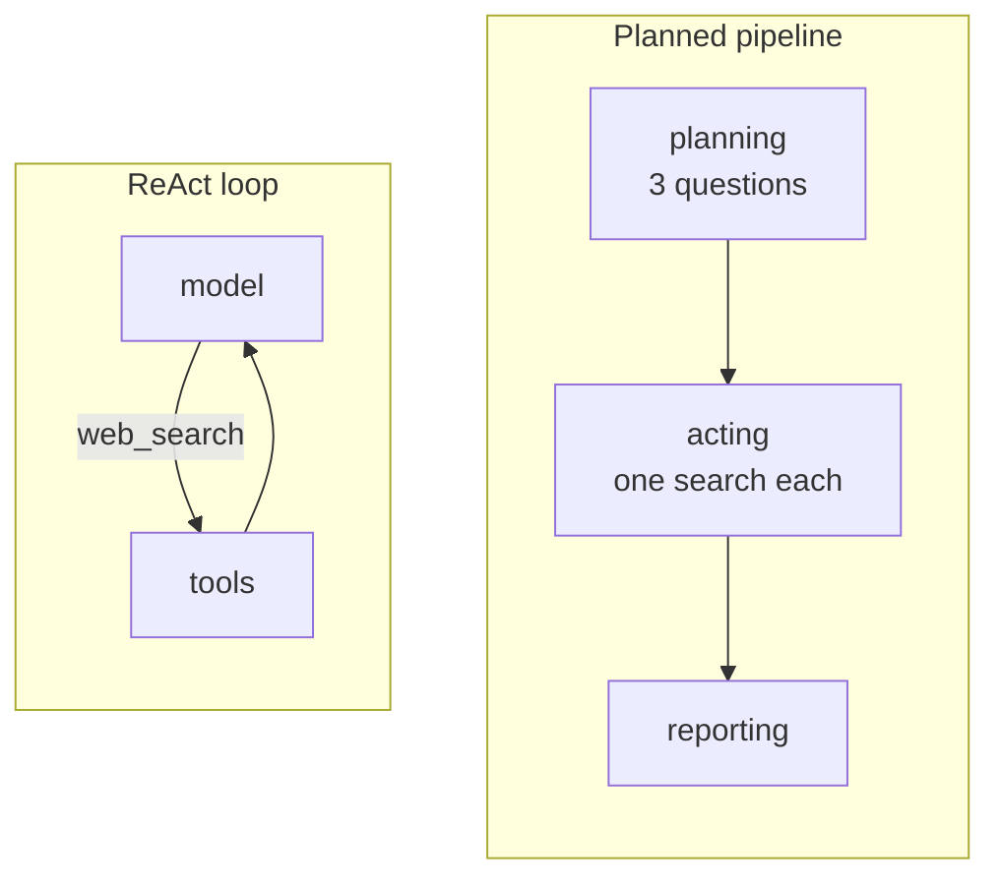

# M24.5 Theory: Applied ReAct: web research, SWE and computer-use agents

*[M24 theory](../README.md) · Lesson 24.5 · Notebooks: [`05a_web_research_agent.ipynb`](../../../../course/p08_agent_foundations/m24_react_agents/notebooks/05a_web_research_agent.ipynb), [`05b_swe_agent_applied.ipynb`](../../../../course/p08_agent_foundations/m24_react_agents/optional/05b_swe_agent_applied.ipynb) (optional), [`05c_browser_agent_computer_use.ipynb`](../../../../course/p08_agent_foundations/m24_react_agents/optional/05c_browser_agent_computer_use.ipynb) (optional), [`05d_vision_driven_computer_use.ipynb`](../../../../course/p08_agent_foundations/m24_react_agents/optional/05d_vision_driven_computer_use.ipynb) (optional) · [All theory pages](../../../README.md)*

## Planned pipeline vs ReAct loop

The most common "research agent" is not a loop. It plans every search up front and runs them in a straight line. The notebook builds both on the same topic, *Artificial Intelligence in Healthcare*:

The pipeline's state carries more than messages: the topic, the planned questions, a `{question: results}` dict merged by a custom reducer, the report, and a log appended with `operator.add`. Each node returns only the keys it changes. The plan is fixed before any result comes back, and no edge goes back, so the pipeline cannot notice an empty search or follow a lead. The ReAct researcher is `create_agent` with one `web_search` tool, a prompt asking for one search per turn and 3 to 5 in all, and `ModelCallLimitMiddleware` as the bound.

One live run (search results change, so the counts vary between runs):

| | Planned pipeline | ReAct agent |
|---|---|---|
| Web searches | 3 | 4 |
| LLM calls | 2 | 5 |
| Report characters | 7,229 | 4,298 |

The pipeline's three questions were written together and are broad and parallel. The agent started broad, then searched for things its results had named (AI models in surgery at Duke University, physician adoption statistics). The trade-off:

| | Planned pipeline | ReAct agent |
|---|---|---|
| Who chooses the searches | The plan, up front | The model, after each observation |
| Cost | Fixed and predictable | Varies; bound it with a call cap |
| Reacts to empty or surprising results | No | Yes |
| Easy to test and debug | Yes, same steps every run | Harder, the path changes run to run |
| Good for | Known-shape reports, batch jobs | Open questions, multi-hop facts |

Many production researchers combine them: plan first, then let each step react. M25 treats the pipeline side as workflow patterns.

## The same loop in other environments

The optional notebooks keep the `agent ⇄ tools` graph and change only the tools and the environment.

- **SWE agent.** The actions are file edits and the observation is a test run. Every file sits in a `tempfile.mkdtemp()` sandbox, paths are reduced to a filename inside it, and `run_tests()` runs one fixed `pytest` command, so the model cannot touch anything else whatever it writes. Tests are the reward signal; diff the changes and re-run the tests yourself instead of trusting the final message.
- **Browser agent.** `screenshot_text`, `click`, `type_text` and `navigate` are ordinary tools over a deterministic mock browser. Actions now change state, so the turn cap becomes a safety bound, and success is graded on the environment (the cart's contents), not the agent's words.
- **Vision-driven computer use.** When the observation is pixels, locating a control is the hard part. In the notebook's runs `gpt-4o-mini` missed 53 of 53 clicks, even with every miss fed back; `gpt-4o` missed 15 of 26 and met the goal in 2 of 3 runs, at half the cost per screenshot. A miss raises no error, so the step cap is the only bound on the loop. Prefer selectors to coordinates.

## Key Takeaways

- A planned pipeline fixes its searches up front. Its cost is predictable and it is easy to test, but it cannot react to an empty result or follow a lead.
- A ReAct researcher picks each search after reading the last result, so it suits open and multi-hop questions at a variable cost that needs a call cap. Many production researchers plan first, then let each step react.
- Moving the loop to code, browsers or screens changes only the tools. Sandbox the actions, grade success on the environment rather than the agent's words, and prefer selectors to coordinates.

## Check yourself

1. Why can the planned research pipeline not follow a lead that one of its searches turns up?

Its questions are fixed before any result comes back, and no edge goes back to planning, so it cannot notice an empty search or add one. The ReAct researcher chooses each search after reading the last observation, which is how it went on to search for things its results had named.

2. You need a weekly report with the same sections on a fixed topic, at a predictable cost. Planned pipeline or ReAct agent?

The planned pipeline. It suits known-shape reports and batch jobs, its cost is fixed, and it runs the same steps every time, so it is easy to test. A ReAct agent suits open questions and multi-hop facts, and its cost varies and needs a call cap.

3. A vision-driven computer-use agent keeps clicking, never reaches its goal and raises no error. What is going on, and what stops it?

It cannot locate the controls from pixels: in the notebook `gpt-4o-mini` missed 53 of 53 clicks even with every miss fed back. A miss raises no error, so the step cap is the only bound on the loop. Prefer selectors to coordinates.

---
*Previous: [24.4 Middleware, including human-in-the-loop](../04_middleware_including_human_in_the_loop/README.md). Next: [M24 interview questions](../README.md#interview-spotlight-5-questions-you-might-get-asked).*
