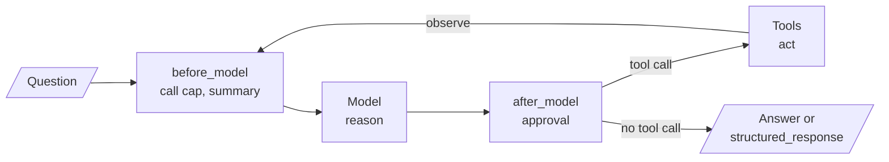

# M24 Theory: ReAct agents and LangChain create_agent

*Part VIII · Agent Foundations for RAG · [Module README](../../../course/p08_agent_foundations/m24_react_agents/README.md) · [All theory pages](../../README.md)*

A ReAct agent reasons about one step, acts with a tool, reads the result and decides again, until it can answer. LangChain 1.x packages that loop as `create_agent` and opens it to middleware, which is where call limits, redaction and human review go. The M24 notebooks build on four ideas: the reason, act and observe loop, the `create_agent` graph, structured output, and middleware. Each idea has a page in the folder of the lesson that teaches it, listed under [Lessons](#lessons). This page has the overview, the interview questions and the takeaways.

The running example is a support agent for the Larkspur Cloud handbook from M11 to M13. Its one tool, `search_handbook`, is the M11 lab's TF-IDF retriever over twelve chunks, and its questions are the M11 golden set: *Can I export my data after I cancel my plan?*, *How long does a refund take?* and *What happens if my server goes down?* The interview questions add the tools a real support agent would have, such as an account lookup and a refund action.

## TL;DR

- ReAct interleaves reasoning and tool calls, and reads every observation before choosing the next step. The difference from a single-shot tool call is one edge, `tools → model`.
- In the lab, the loop lifts mean evidence recall on the M11 golden set from 0.50 (one search, the M11 baseline) to 1.00 by rewording failed searches, for 9 model calls instead of 3. Every call rereads the whole message list, so cost grows each round.
- `create_agent(model, tools, system_prompt=...)` returns that loop as a compiled LangGraph graph (`model ⇄ tools`) on native tool calls, so there is no text to parse.
- `response_format=Schema` on an agent, or `with_structured_output(Schema)` on a model, returns typed data the next system can trust; Pydantic is the style that validates it.
- Middleware hooks run before and after each model call: `ModelCallLimitMiddleware` bounds the loop, `HumanInTheLoopMiddleware` pauses irreversible tool calls for approve, edit or reject, `PIIMiddleware` redacts, `SummarizationMiddleware` compresses history.

## Mental model

<!-- animated: diagrams/react-loop.anim.html -->

The model is the only part that decides; the graph executes and the middleware guards. A run is as long as the model's decisions make it, so every production agent pairs the loop with a cap, and every irreversible tool with a checkpoint where a person can stop it.

## Lessons

| Lesson | Topic | Theory |
|---|---|---|
| 24.1 | The ReAct loop in LangGraph; tool calling vs ReAct | [Reason, act, observe](01_the_react_loop_in_langgraph_tool_calling_vs_react/README.md#reasonactobserve) [Native tool calls vs text-based ReAct](01_the_react_loop_in_langgraph_tool_calling_vs_react/README.md#native-tool-calls-vs-text-based-react) |
| 24.2 | ReAct with LangChain `create_agent` | [create_agent](02_react_with_langchain_create_agent/README.md#create_agent) [Call limits and runaway loops](02_react_with_langchain_create_agent/README.md#call-limits-and-runaway-loops) |
| 24.3 | Models, messages and structured output in LangChain 1.x | [Structured output](03_models_messages_and_structured_output_in_langchain_1_x/README.md#structured-output) |
| 24.4 | Middleware, including human-in-the-loop | [Middleware](04_middleware_including_human_in_the_loop/README.md#middleware) |
| 24.5 | Applied ReAct: web research, SWE and computer-use agents | [Planned pipeline vs ReAct loop](05_applied_react_web_research_swe_and_computer_use_agents/README.md#planned-pipeline-vs-react-loop) [The same loop in other environments](05_applied_react_web_research_swe_and_computer_use_agents/README.md#the-same-loop-in-other-environments) |
| 24.6 | Exercise: intelligent travel assistant agent (with solution) | *planned* |

## Interactive lab

[**The ReAct loop and its call cap**](01_the_react_loop_in_langgraph_tool_calling_vs_react/interactive/react-loop-lab.html): open the file in a browser. Pick *What happens if my server goes down?* and switch between single shot and ReAct: one search returns `reboot` and `sizing`, the loop rewords twice and finds `incidents` and `sla`. Then drag the call cap down to 3 and watch the run stop with both evidence chunks already in the message list, one call short of the answer.

## How it connects

- **Before:** M23 introduces the agent loop and tool calling this module names ReAct. M09 and M10 teach the LangGraph state, persistence and interrupts that `create_agent` and its middleware compile to. The lab's tool is the [M11](../../p04_rag_foundations/m11_rag_lifecycle/README.md) baseline retriever, and its rewording does by hand what query rewriting (M18) does on purpose.
- **Next:** M25 sets fixed workflows beside this loop, M26 adds planning and reflection, and M27 uses human approval in applied single-agent builds. M28 to M32 build agentic RAG on these pieces; M31 makes the retriever an agent tool.

## Interview Spotlight: 5 Questions You Might Get Asked

*Production questions of the kind asked in applied AI engineering interviews.*

### 1. Larkspur's support agent cost three times as much yesterday as the day before. Traces show some runs making a dozen `search_handbook` calls with reworded queries before giving up. What do you check, and what do you change?

**What a strong answer covers:**
- Reads the `ToolMessage`s in the long runs first: a loop that keeps rewording usually means the tool returns nothing useful, such as an index re-ingested without the answer text
- Checks what changed that day (an index rebuild, a new document type, a prompt that says "never give up") against the calls-per-run distribution
- Fixes what the model sees (data, retrieval depth, result formatting, the tool description) before touching the cap; raising the cap only buys more attempts
- Keeps a `ModelCallLimitMiddleware` with `run_limit` sized from the golden set's call counts plus headroom, and alerts on the share of runs that hit it

### 2. Product wants a monthly account summary for every Larkspur customer: usage, invoices, open incidents. A teammate wants to reuse the ReAct support agent. What do you build instead, and why?

**What a strong answer covers:**
- The steps are known in advance, so a planned pipeline (fetch usage, fetch invoices, fetch incidents, write) is cheaper, has a fixed cost per customer and runs the same way every time
- ReAct pays off when the next step depends on what a result says; a batch report has no such step
- Testing and debugging are easier when every run takes the same path; failures are recorded per step instead of steering the run
- Keeps the agent for open support questions, and considers plan first, then react, if a summary section sometimes needs follow-up

### 3. You replace the M11 baseline retriever with a ReAct agent that uses it as a tool. How do you show the change is worth it?

**What a strong answer covers:**
- Runs the frozen golden set through both and reports evidence recall and answer quality per question, not only the mean (in the lab, mean recall goes from 0.50 to 1.00)
- Reports what the loop costs: model calls per question (the lab's questions need 2, 3 and 4), tokens read, latency at p50 and p95
- Grades answers with a judge that is not the agent's own model, since live search results and sampling make single runs noisy
- Checks the questions the baseline already answered for regressions, such as a loop that over-searches easy questions

### 4. Larkspur's agent can call `issue_refund` behind `HumanInTheLoopMiddleware`. A support engineer, tired of waiting, pastes the customer's message into the same conversation again, and the next model call fails with a 400 about `tool_call_ids`. What happened, and how do you prevent it?

**What a strong answer covers:**
- The interrupt saved the `AIMessage` with the `issue_refund` call on the thread; the new user message left that call without a `ToolMessage`, which the provider rejects
- The only valid next step on a parked thread is `Command(resume={"decisions": [...]})`, with one decision per gated call
- The UI shows pending interrupts per `thread_id` and blocks new messages until a reviewer approves, edits or rejects
- Uses `edit` to fix a wrong amount instead of rejecting, and keeps reads such as an account lookup ungated so approval stays rare

### 5. The ticketing system needs `{category, priority, refund_amount}` from every Larkspur conversation. Some days the agent returns prose; on questions with no refund it writes `refund_amount: 0`. How do you make the output reliable?

**What a strong answer covers:**
- Passes a Pydantic schema as `response_format` on `create_agent` and reads `structured_response`, so the provider constrains the reply
- Makes `refund_amount` optional with a `None` default, so the model is not forced to invent a number; `0` and "no refund" stay distinct
- Writes field descriptions as instructions (units, allowed categories), because they reach the model as part of the schema
- Logs parse failures with `include_raw=True` where the model is called directly, and checks `llm.profile` for structured-output support before switching models

## Key Takeaways

- Use ReAct when the next step depends on what a tool returns; use a planned pipeline when the steps are known.
- Read the `ToolMessage`s before you blame the model. A loop that keeps searching usually has a tool that returns the wrong thing.
- Give every loop a call cap sized from your golden set, and gate every irreversible tool with human approval.
- When code consumes the answer, ask for a schema, validate it with Pydantic, and make fields optional when the source may not contain them.

---
*Previous: [M23 The agent loop and tool calling](../m23_agent_loop_and_tools/README.md). Next: [M25 Agentic workflow patterns](../m25_agentic_workflow_patterns/README.md).*
