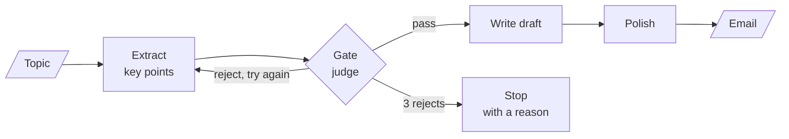

# M25.1 Theory: Prompt chaining with quality gates

*[M25 theory](../README.md) · Lesson 25.1 · Notebooks: [`01a_prompt_chaining_langgraph.ipynb`](../../../../course/p08_agent_foundations/m25_agentic_workflow_patterns/notebooks/01a_prompt_chaining_langgraph.ipynb), [`01b_prompt_chaining_structured_output.ipynb`](../../../../course/p08_agent_foundations/m25_agentic_workflow_patterns/optional/01b_prompt_chaining_structured_output.ipynb) (optional), [`01c_prompt_chaining_lcel.ipynb`](../../../../course/p08_agent_foundations/m25_agentic_workflow_patterns/optional/01c_prompt_chaining_lcel.ipynb) (optional) · [All theory pages](../../../README.md)*

## Workflow vs agent

Anthropic's *Building Effective Agents* (December 2024), the source every M25 notebook cites, draws the line by who controls the next step. In a **workflow**, LLM calls and tools run along code paths you defined in advance. In an **agent**, the model directs its own process: it picks the next tool, reads the result and decides when to stop. The ReAct agent of M24 is an agent. All five M25 patterns are workflows.

| | Workflow (M25) | Agent (M24) |
|---|---|---|
| Who picks the next step | Your edges. The model at most chooses among edges you wrote | The model, on every turn |
| LLM calls per request | Known, or bounded by a cap in your code | Known only when it stops; bounded by a step limit |
| Testing | Each node and each router, like a function | Whole trajectories, end to end |
| A failed run | Ends at a node you named, with a reason | Shows up in the trajectory: a repeated tool call, an early stop |
| Fits | Tasks you can draw before they run | Tasks whose steps depend on what the model finds |

Each workflow pattern hands the model exactly one kind of decision, and keeps the rest in code:

| Pattern | Code fixes | The model decides |
|---|---|---|
| Prompt chaining (25.1) | the order of the steps | each step's content, and a gate's verdict |
| Routing (25.2) | the set of handlers | which single handler runs |
| Parallelization (25.3) | the branches and the merge | each branch's content, each vote |
| Orchestrator-worker (25.4) | the worker's job and the merge | how many workers run, and what each one gets |
| Evaluator-optimizer (25.5) | the criteria and the iteration cap | the grade, and so whether to go round again |

The lesson 25.1 graph shows how little the model controls. `get_graph()` prints five nodes and eight edges; three edges are conditional, and all three leave the gate. Everything else is a fixed `add_edge`. A Larkspur refund reply has the same shape: pull the plan and the purchase date out of the ticket, check them, draft, polish. A question nobody drew a path for, such as investigating why one customer's servers keep rebooting, is where an agent earns its extra calls.

## Quality gates

Prompt chaining splits one task into a fixed sequence of focused calls, each reading the previous step's output. The 25.1 chain turns a topic into an email: extract three key points, draft, polish. A **quality gate** sits between steps and decides whether the intermediate result may go on. Failing at step 1 costs one cheap check; failing at the end costs a draft and a polish written from nothing.

<!-- animated: diagrams/gated-chain.anim.html -->

The notebook's gate has three parts, and each choice is deliberate:

- **The check.** A keyword rule ("does it mention *request*, *deadline*, *support*?") leaks: philosophical key points mention "support" too. The gate is a `gpt-4o-mini` judge at temperature 0 returning a structured `GateVerdict` with `actionable: bool` and a one-sentence `reason`.
- **The split.** A node, `check_key_points`, runs the judge and writes `gate_passed` to state. A pure function, `route_after_check`, reads it and returns `write_draft`, `regenerate` or `fail`. The router makes no LLM call, so it can be tested like any function.
- **The bound.** `retry_count` is `Annotated[int, operator.add]`, so each extraction adds 1. At `MAX_VALIDATION_RETRIES = 3` the router takes the `fail` edge to a terminal node that writes why the chain stopped. A `recursion_limit` of 12 is the second net, in case the router itself has a bug. Regeneration helps only because the extractor runs at temperature 0.7; at temperature 0 it would return the same key points three times.

The two runs in the notebook:

| Topic | Extraction attempts | Gate verdicts | Reached the draft | LLM calls |
|---|---|---|---|---|
| *Request for project deadline extension due to technical challenges* | 1 | pass | yes | 4 (extract, judge, draft, polish) |
| *The meaning of life and happiness* | 3 | reject, reject, reject | no, ended in `fail_validation` | 6 (three extracts, three judges) |

The second run spent three judge calls to avoid writing and polishing an email with no purpose, and it ended with a reason a caller can show or log.

The optional notebooks move the gate around. In LCEL (`01c`) the gate is a `RunnableLambda` that passes the payload through or raises `KeyPointsRejected`; `.with_retry(stop_after_attempt=3)` re-runs extraction and gate together, which plays the part of the `regenerate` edge, and `.with_fallbacks(...)` plays `fail_validation`. With structured output (`01b`) every step returns a validated Pydantic object, so a schema check runs at every hop for free. A schema guarantees fields and types, though, and says nothing about whether the content is usable; that still needs a gate like the judge here.

For Larkspur, the gate belongs right after extraction: does the ticket name a plan and a purchase date? Without them the refund-window chunk cannot be applied, and the right next step is to ask the customer, which a terminal node with a reason makes easy.

---
*Previous: [M25 overview](../README.md). Next: [25.2 Routing by handler and by model tier](../02_routing_by_handler_and_by_model_tier/README.md).*
