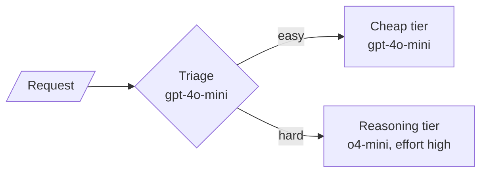

# M25.2 Theory: Routing by handler and by model tier

*[M25 theory](../README.md) · Lesson 25.2 · Notebooks: [`02a_routing_langgraph.ipynb`](../../../../course/p08_agent_foundations/m25_agentic_workflow_patterns/notebooks/02a_routing_langgraph.ipynb), [`02b_routing_by_model_tier.ipynb`](../../../../course/p08_agent_foundations/m25_agentic_workflow_patterns/notebooks/02b_routing_by_model_tier.ipynb), [`02c_routing_lcel_runnable_branch.ipynb`](../../../../course/p08_agent_foundations/m25_agentic_workflow_patterns/optional/02c_routing_lcel_runnable_branch.ipynb) (optional) · [All theory pages](../../../README.md)*

## Routing by handler

A router classifies the input once and sends it down exactly one specialist path. The model makes one small decision, a label from a fixed set, and everything after it is ordinary Python dispatch.

The 25.2 router has the same two-part shape as the 25.1 gate:

- **A constrained classifier.** `with_structured_output(ContentRoute)`, where `content_type` is `Literal["story", "poem", "joke"]`. The model cannot return a label the graph has no edge for, which a free-text answer like "I think they want a poem" could.
- **A pure condition function.** `determine_next_step` maps the stored label to a node name with `.get(..., "generate_story")`, so even an unexpected label lands somewhere.

The notebook tests it with phrasing that implies the category without naming it: *Tell me something funny about artificial intelligence*, *I want to hear a tale about a brave knight*, *Create something poetic about the ocean*. All three reached the expected handler. Each request cost two LLM calls, one to classify and one in the handler, however many handlers exist; a fourth category is one more `Literal` value, one node and one edge. The LCEL version (`02c`) builds the same router with `RunnableBranch` and confirms that exactly one specialist chain runs per request.

For Larkspur, the closed set is the ticket queue: billing, technical, sales. The test that matters is the one the notebook models: check the routing decision itself, not only whether the final answer reads well.

## Routing by model tier

The second notebook routes on a different axis. The conditional edge picks a **model**, not a handler: a cheap model triages each request as `easy` or `hard`, easy work stays on the cheap model and hard work goes to a reasoning model. You pay reasoning prices only on the traffic that needs them.

Both answering nodes send the same prompt; only the model differs, so a measured difference belongs to the model. Two details bite on the first real call: o-series models reject a custom temperature, so the reasoning tier passes `temperature=1`, and `reasoning_effort="high"` only means something to a reasoning model.

The workload is mixed the way real traffic is, mostly easy: seven requests, four easy (extract an order id, a capital, a time conversion, reply "ok") and three hard (a deploy-schedule puzzle, an LRU eviction, a backoff sum). A router means nothing without "cheaper than what", so the notebook runs all three strategies:

| Strategy | Accuracy | Answering time, total | Reasoning calls |
|---|---|---|---|
| All cheap | 71% | 5.2 s | 0 of 7 |
| **Routed** | **86%** | **13.4 s** | **1 of 7** |
| All reasoning | 100% | 20.1 s | 7 of 7 |

The time column counts the answering calls only; the routed row also pays one triage call per request on top. With seven requests one question moves accuracy by 14 points, so read the table for its shape: routed accuracy should track all-reasoning while its reasoning-call count tracks all-cheap. A router that sends everything to `hard` is worse than no router, because it adds triage to the full reasoning bill.

The router predicts difficulty; it does not observe it. So it has a confusion matrix:

| | Sent to reasoning | Sent to cheap |
|---|---|---|
| Truly hard | 1 | **2**, one answered wrong (the LRU question) |
| Truly easy | 0 | 4 |

The two errors are not symmetric. Easy sent to reasoning wastes money: bounded, and visible on a bill. Hard sent to cheap returns a confident wrong answer: invisible until someone acts on it. So bias the triage prompt toward `hard` on borderline cases and accept the overspend as insurance. The same asymmetry fixes the fallback direction. "Try cheap, detect a bad answer, retry on reasoning" needs a reliable wrong-answer detector, and if you had one you would not need the router. Escalate on uncertainty before answering.

On Larkspur, *Can I get a refund after 45 days?* is the case to watch: it looks like a lookup and needs proration arithmetic. Put questions like it in the labelled set the router is measured on.

## Key Takeaways

- A router makes one small decision, a label from a fixed set, and dispatches in plain code. Each request costs two calls however many handlers exist, so test the routing decision itself.
- Routing by model tier pays reasoning prices only on hard traffic. In the notebook the routed strategy reached 86% accuracy with 1 of 7 reasoning calls, against 71% all cheap and 100% all reasoning.
- Hard work sent to the cheap tier returns confident wrong answers, while easy work sent up only costs money. Lean the triage prompt toward `hard` on borderline cases and accept the overspend.

## Check yourself

1. Why does the content router classify with a structured output limited to a fixed set of labels instead of free text?

With `content_type` typed as `Literal["story", "poem", "joke"]`, the model cannot return a label the graph has no edge for, which a free-text answer like "I think they want a poem" could. The pure function `determine_next_step` then maps the label to a node, with a `.get` default so even an unexpected label lands somewhere.

2. A Larkspur customer asks whether they can get a refund after 45 days. Why is this a risky question for the model-tier router?

It looks like a lookup but needs proration arithmetic, so triage may label it `easy` and send it to the cheap tier, which can return a confident wrong answer. Put questions like it in the labelled set the router is measured on.

3. A teammate proposes trying the cheap model first and retrying on the reasoning model when the answer is bad. Why does this fail?

It needs a reliable wrong-answer detector, and if you had one you would not need the router. A hard question answered on the cheap tier returns a confident wrong answer that stays invisible until someone acts on it. Escalate on uncertainty before answering, and bias triage toward `hard` on borderline cases.

---
*Previous: [25.1 Prompt chaining with quality gates](../01_prompt_chaining_with_quality_gates/README.md). Next: [25.3 Parallelization: sectioning and voting](../03_parallelization_sectioning_and_voting/README.md).*
