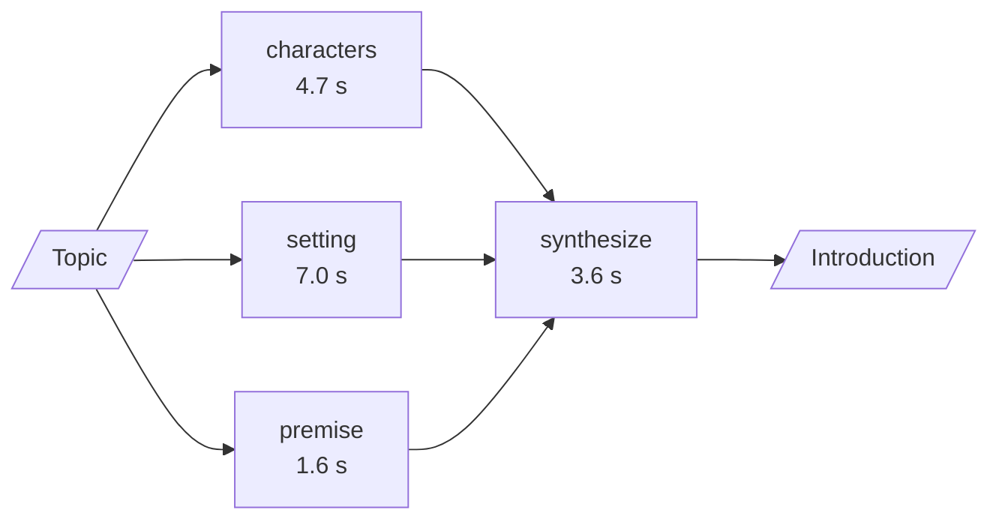

# M25.3 Theory: Parallelization: sectioning and voting

*[M25 theory](../README.md) · Lesson 25.3 · Notebooks: [`03a_parallelization_langgraph.ipynb`](../../../../course/p08_agent_foundations/m25_agentic_workflow_patterns/notebooks/03a_parallelization_langgraph.ipynb), [`03b_parallelization_sectioning_and_voting.ipynb`](../../../../course/p08_agent_foundations/m25_agentic_workflow_patterns/notebooks/03b_parallelization_sectioning_and_voting.ipynb), [`03c_parallelization_lcel.ipynb`](../../../../course/p08_agent_foundations/m25_agentic_workflow_patterns/optional/03c_parallelization_lcel.ipynb) (optional) · [All theory pages](../../../README.md)*

## Fan-out / fan-in

Chaining runs steps one after another and routing runs one of several. Parallelization runs **all** of a fixed set of branches at once. In LangGraph the graph says it with edges alone:

- **Fan-out:** several edges leave one node. Their targets run in the same step, concurrently.
- **Fan-in:** several edges enter one node. It waits until every one of them has finished.
- **Uneven branches:** when one path is longer (A to B to X, beside A to C), `add_edge(["x", "c"], "d")` is the explicit sync point.
- **Shared keys need a reducer.** Two branches writing the same state key at once lose a write unless the key has one, such as `Annotated[list, operator.add]`. Branches that each own a key (`character_profiles`, `story_setting`, `plot_premise`) need none.

Wall time follows the longest path, not the sum. The notebooks measure it with nodes that sleep 0.5 s each, then with real LLM calls:

| Graph | Wall time | Why |
|---|---|---|
| A, B, C, D in a line | 2.01 s | four steps, one after another |
| A, then B and C in parallel, then D | 1.51 s | B and C overlap: three steps' worth |
| A, then B to X beside C, then D | 2.02 s | paced by the longer path A, B, X, D |
| Three story sections, then synthesis | 10.6 s | sections finish at 1.6, 4.7 and 7.0 s; a sequence would take about 13.4 s |

The synthesis step cannot overlap anything: it needs every section. That is the general shape of a fan-out's cost: the step before, plus the slowest branch, plus the merge.

Production adds a limit the toy graphs do not have: the API behind the branches is rate-limited, so you cap how many run at once. In LCEL the cap is `config={"max_concurrency": n}` on the call, and the `03c` notebook measures it: six 0.5 s branches took 0.51 s unbounded and 1.51 s at two at a time, three rounds of two. The [interactive lab](interactive/fan-out-lab.html) schedules the notebooks' measured durations the way the thread pool does, branches submitted in order and each starting on the first free slot. On the story sections:

| Concurrency cap | Submitted | Merge starts | Wall time |
|---|---|---|---|
| 3 (all at once) | as written | 7.0 s | 10.6 s |
| 2 | as written | 7.0 s | **10.6 s** |
| 2 | fastest first | 8.6 s | 12.2 s |
| 1 | any order | 13.3 s | 16.9 s |

A cap of 2 is free here: `setting` (7.0 s) gets a slot at once, and `premise` runs after `characters` in the other slot, finishing at 6.3 s. Submit the fast branches first and `setting` waits 1.6 s for a slot, which the whole request pays. Under a cap, submit the slowest branch first. (The lab sums the printed one-decimal times, so its sequence shows 13.3 s where the notebook printed 13.4 s.)

<!-- lab: interactive/fan-out-lab.html -->

For Larkspur, the natural fan-out is retrieval from independent sources for one question: the handbook index, the status page, the customer's account. The answer arrives when the slowest source returns, so each branch needs a timeout and a fallback value, and each source should stay labelled in the merged context so the model can cite it.

## Sectioning and voting

The same mechanics serve two different jobs:

| | Sectioning | Voting |
|---|---|---|
| Branches do | different parts of one task | the same kind of task, independently |
| 25.3 example | characters, setting and premise of a story | three security reviews of one function |
| State | one key per branch, no reducer | one shared `votes` list, reducer required |
| Fan-in | an LLM call that weaves the parts together | plain Python that counts and applies a threshold |
| Buys you | latency | confidence |

The voting graph gives each reviewer one concern (injection, secrets handling, input validation), and no reviewer sees another's vote. Each returns a structured `Vote`; the aggregator blocks the code when at least `FLAG_THRESHOLD = 2` of 3 flag it:

| Snippet | Flags | Verdict |
|---|---|---|
| SQL built with an f-string from user input, a hard-coded password printed to the log | 3 of 3 | BLOCK |
| Parameterised query, validated username, password read from the environment | 0 of 3 | APPROVE |

The threshold trades false alarms against misses. Raising it to 3 blocks less often: fewer false alarms, more misses. Lowering it to 1 blocks on any single flag. On the unsafe snippet the validation reviewer flagged the SQL injection too, outside its own concern, so the votes are not fully independent; count on that when you set the threshold.

For Larkspur, voting fits a check before a reply goes out: does it promise a refund the policy does not allow, does it quote the right refund window, does it commit to a support response time. Three narrow reviewers and a threshold are easier to tune than one judge asked about everything.

## Key Takeaways

- A fan-out costs the step before, plus the slowest branch, plus the merge. Give any state key that parallel branches share a reducer, or one of the writes is lost.
- Rate limits force a concurrency cap, and then submission order matters. A slow branch that waits for a free slot delays the whole request, so start it first.
- Sectioning splits one task to cut latency; voting repeats one check to raise confidence. Set the vote threshold knowing it trades false alarms against misses and that reviewers are not fully independent.

## Check yourself

1. Why does a fan-out's wall time follow its slowest branch rather than the sum of its branches?

The targets of a fan-out run in the same step, concurrently, and the fan-in node waits until all of them finish. So the cost is the step before, plus the slowest branch, plus the merge: the three story sections took 10.6 s, against about 13.4 s in sequence.

2. Under a concurrency cap of 2, the story sections take 1.6, 4.7 and 7.0 seconds. Should you submit the fastest or the slowest branch first?

The slowest first. Submitted as written, `setting` (7.0 s) gets a slot at once and the request still takes 10.6 s, the same as with no cap. Submitted fastest first, `setting` waits 1.6 s for a slot, the merge starts at 8.6 s and the request takes 12.2 s.

3. The security vote blocks code at 2 of 3 flags and raises too many false alarms. Which way do you move the threshold, and what does it cost?

Raise it to 3. The aggregator then blocks less often: fewer false alarms, but more misses. Allow for the votes not being fully independent, since the validation reviewer flagged the SQL injection outside its own concern.

---
*Previous: [25.2 Routing by handler and by model tier](../02_routing_by_handler_and_by_model_tier/README.md). Next: [25.4 Orchestrator-worker with the Send API](../04_orchestrator_worker_with_the_send_api/README.md).*
