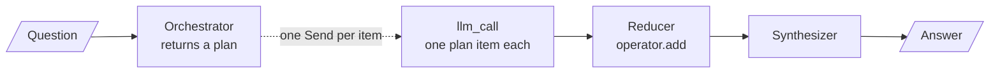

# M25.4 Theory: Orchestrator–worker with the Send API

*[M25 theory](../README.md) · Lesson 25.4 · Notebooks: [`04a_orchestrator_worker_send_api.ipynb`](../../../../course/p08_agent_foundations/m25_agentic_workflow_patterns/notebooks/04a_orchestrator_worker_send_api.ipynb), [`04b_orchestrator_worker_lcel_map.ipynb`](../../../../course/p08_agent_foundations/m25_agentic_workflow_patterns/optional/04b_orchestrator_worker_lcel_map.ipynb) (optional) · [All theory pages](../../../README.md)*

## Dynamic fan-out with Send

Orchestrator-worker looks like parallelization: several LLM calls run at once and a final step merges them. The difference is who decides the branches. In parallelization you wrote them into the graph; here an orchestrator LLM decides, per input, how many subtasks there are and what each one covers.

| | Parallelization (25.3) | Orchestrator-worker (25.4) |
|---|---|---|
| Who decides the subtasks | you, when you build the graph | the orchestrator, at run time |
| Number of branches | fixed | follows the input |
| Branch identity | known in advance (characters, setting, premise) | generated (whatever sections this topic needs) |
| Graph shape | static `add_edge` fan-out | one conditional edge returning a list of `Send` |

The same graph is often called **map-reduce**: the plan is the list, the `Send` fan-out is the map, and the synthesizer is the reduce.

<!-- animated: diagrams/send-fanout.anim.html -->

The parts, as the notebook builds them:

- **A plan with a variable length.** The orchestrator calls `with_structured_output(ReportPlan)`, where `sections` is a `list[Section]`, each with a `name` and a `description`.
- **Dispatch from the plan.** A normal conditional edge returns one node name. `assign_workers` returns a list, one `Send("llm_call", {"topic": ..., "section": section})` per planned section, and LangGraph starts that many runs of `llm_call`. The graph drawing shows the `orchestrator` to `llm_call` edge once, because the graph does not know the count until the orchestrator has run.
- **A narrow worker state.** Each worker gets a `WorkerState` with the topic and its one section, and its prompt uses `section.description`. That is what makes the plan load-bearing.
- **A reducer for the results.** `completed_sections` is `Annotated[list, operator.add]`, because an unknown number of workers write to it at once. The notebook notes that the merged list follows the order the `Send`s were created, while `stream_mode="updates"` reports workers in the order they finish.

Two failure modes come from the notebook. The first is in the prompt: a planner told "simple topics might need 2 sections, broad topics 5+" answered with five sections, Introduction and Conclusion included, for every topic. Asking for one section per distinct question and banning padding sections let the plan size follow the input. The second is the anti-pattern of a plan nobody reads: the orchestrator runs, but five fixed workers wired with `add_edge` ignore its output. If the set of workers that ran is the same for every input while the plan changes, the plan does not drive execution. That graph is parallelization with a decorative LLM call in front.

LCEL can express the fan-out with `.map()` (`04b`), with four gaps against `Send`:

| | LangGraph `Send` | LCEL `.map()` |
|---|---|---|
| Worker identity | each `Send` names its own target node | every item goes to the same runnable |
| Results land in | shared state, merged by a reducer | an ordered list matching the input |
| One worker fails | the graph can route around it | the whole batch raises, unless you use `batch(..., return_exceptions=True)` |
| Durability | per-worker checkpoints, interrupts, resume | none: the chain is stateless |

This is the shape of query decomposition (M18) and of the module lab: the orchestrator splits a Larkspur question into sub-questions, each worker retrieves and answers one, and the synthesizer writes the reply. *Can I export my data after I cancel my plan?* splits into "how do I export?" and "what happens to my data after I cancel?", whose evidence is the `export` and `retention` chunks of the M11 golden set. *How long does a refund take?* should get a plan of one item. Bound the plan in code as well as in the prompt: a maximum number of `Send`s, a direct path for one-item plans, and a decision about what an empty plan returns.

## Check yourself

1. Both orchestrator-worker and parallelization run several LLM calls at once and merge them. What separates them?

Who decides the branches. In parallelization you wrote them into the graph with a static `add_edge` fan-out. In orchestrator-worker an LLM decides at run time how many subtasks there are and what each covers, and one conditional edge returns a list of `Send`, one per plan item.

2. How should the orchestrator plan the export-after-cancelling question and the refund-duration question?

The export question splits into "how do I export?" and "what happens to my data after I cancel?", whose evidence is the `export` and `retention` chunks. The refund question should get a plan of one item. Bound the plan in code too: a maximum number of `Send`s, a direct path for one-item plans and a decision about what an empty plan returns.

3. The orchestrator's plan changes with every topic, yet the same five workers run every time. What is wrong?

The plan drives nothing: five fixed workers wired with `add_edge` ignore the orchestrator's output, so the graph is parallelization with a decorative LLM call in front. Dispatch from the plan with one `Send` per section, and let each worker's prompt use its `section.description`.

---
*Previous: [25.3 Parallelization: sectioning and voting](../03_parallelization_sectioning_and_voting/README.md). Next: [25.5 Evaluator-optimizer loops, always bounded: LangGraph vs LCEL](../05_evaluator_optimizer_loops_always_bounded_langgraph_vs_lcel/README.md).*
