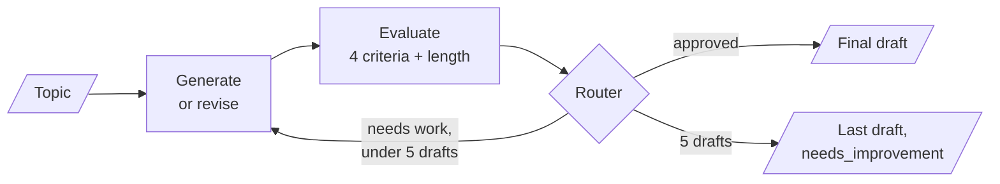

# M25.5 Theory: Evaluator–optimizer loops, always bounded: LangGraph vs LCEL

*[M25 theory](../README.md) · Lesson 25.5 · Notebooks: [`05a_evaluator_optimizer_langgraph.ipynb`](../../../../course/p08_agent_foundations/m25_agentic_workflow_patterns/notebooks/05a_evaluator_optimizer_langgraph.ipynb), [`05b_evaluator_optimizer_lcel.ipynb`](../../../../course/p08_agent_foundations/m25_agentic_workflow_patterns/notebooks/05b_evaluator_optimizer_lcel.ipynb) · [All theory pages](../../../README.md)*

## Bounded loops

Evaluator-optimizer generates a draft, grades it against explicit criteria and feeds the critique into the next draft, until the grade passes. The 25.1 gate checked once and stopped; this check feeds back into the generator. It pays off when two things hold: the criteria are clear, and feedback measurably improves the next attempt.

The evaluator is only as useful as its criteria. A first version of the notebook asked for one holistic grade against loose criteria such as "is it genuinely funny?", and with `gpt-4o-mini` the loop almost never converged: the evaluator kept finding something that could be better. The working version changes three things:

- **One boolean per criterion.** `JokeReview` asks four yes-or-no questions: a clear punchline, a punchline that depends on agentic AI specifically, no stock template, appropriate. A met criterion passes even if the joke could be better.
- **Code checks what code can check.** Length is `len(joke.split()) <= MAX_WORDS` with `MAX_WORDS = 40`, not an LLM judgement.
- **The verdict is computed.** `approved` only when every criterion and the length check pass. The model never asserts the grade itself, and `improvement_feedback` names a fix for each failed criterion.

The generator runs at temperature 0.7 so a revision can differ from the draft before it, and the evaluator at 0 so the same draft gets the same grade. Later passes receive the previous draft plus the feedback, so they revise instead of starting over.

A structured verdict does not guarantee the evaluator will ever approve. So the router checks a cap: approved ends the run, `iteration >= MAX_ITERATIONS` (5) ends it too, anything else loops back. The notebook proves the cap with a stub reviewer that rejects every draft; without the `iteration_cap_reached` branch that cell would never finish. The cap also bounds cost: each pass is one generator call and one evaluator call, so a run makes at most ten.

The bound can live in three places, one per implementation:

| Implementation | The loop is | The bound is |
|---|---|---|
| LangGraph (`05a`) | a conditional edge back to `generate_content` | `MAX_ITERATIONS` checked in the router, with LangGraph's `recursion_limit` as a backstop |
| LCEL plus Python (`05b`) | a `for` loop around two chains | `range(1, MAX_ITERATIONS + 1)` |
| `create_agent` middleware (`05b`) | `after_model` returning `jump_to="model"` | `ModelCallLimitMiddleware(run_limit=5, exit_behavior="end")` |

A run that ends at the cap returns the last draft marked `needs_improvement`, so count it as a failure. Watch the share of runs that end there. It rises when the criteria drift, or when a new evaluator model is stricter than the old one.

For Larkspur, an answer-quality check is the natural evaluator, written as booleans: does the reply cite a handbook chunk, does it state the refund window the chunk states, does it avoid promising anything the handbook does not say, and is it under a length limit counted in code. CRAG (M29) applies the same loop to retrieval: grade the documents, rewrite the query, try again, within a bound.

## Where LCEL stops

Every earlier pattern is a directed acyclic flow, so each maps onto an LCEL operator. This one has a cycle, and LCEL has no operator for "go back and try again until a predicate passes". `a | b | a` does not loop: it builds a three-step chain that runs `a` twice. `.with_retry()` comes close but retries blind, with no memory of why the last attempt failed, and feeding the critique forward is the point of the pattern.

| Pattern | LangChain 1.x primitive | Full coverage |
|---|---|---|
| Prompt chaining | `\|` plus `.with_retry()` plus `.with_fallbacks()` | yes |
| Routing | `RunnableBranch` | yes |
| Parallelization | `RunnableParallel` | yes |
| Orchestrator-worker | `.map()` | the fan-out; shared state and per-worker durability need `Send` |
| Evaluator-optimizer | a Python loop, or `after_model` plus `jump_to` | yes |

Choosing between the two LangChain loops comes down to what you need around the loop. The Python `for` loop is easy to read and returns a dict you shaped, but traces each pass as separate chain runs and has no streaming, checkpointing or interrupts. The middleware loop is one agent run with every pass nested, keeps the full message history as its state, and inherits tools, streaming and persistence from the agent runtime. Two details matter there: `can_jump_to=["model"]` on the decorator is what creates the conditional edge, and the critique reaches the next draft as an appended `HumanMessage`. When the loop needs checkpoints, interrupts or a human in it, that is the point to move to LangGraph.

## Check yourself

1. Why did replacing one holistic grade with one boolean per criterion make the joke loop converge?

Against a loose holistic grade the evaluator kept finding something that could be better. With four yes-or-no criteria, a met criterion passes even if the joke could improve, length is checked in code (`MAX_WORDS = 40`), and `approved` is computed only when every check passes, so the model never asserts the grade itself.

2. With a cap of 5 iterations, how many LLM calls can one run make at most, and how should you count a run that hits the cap?

Ten, because each pass makes one generator call and one evaluator call. A run that ends at the cap returns its last draft marked `needs_improvement`, so count it as a failure and watch the share of runs that end there.

3. A teammate builds the loop in LCEL by piping generator, evaluator and generator again, or by adding a retry. Why does neither work?

`a | b | a` builds a three-step chain that runs `a` twice; it never loops. `.with_retry()` retries blind, with no memory of why the last attempt failed, and feeding the critique forward is the point of the pattern. Use a Python `for` loop or `after_model` with `jump_to`, and move to LangGraph when the loop needs checkpoints or interrupts.

---
*Previous: [25.4 Orchestrator-worker with the Send API](../04_orchestrator_worker_with_the_send_api/README.md). Next: [M25 interview questions](../README.md#interview-spotlight-5-questions-you-might-get-asked).*
