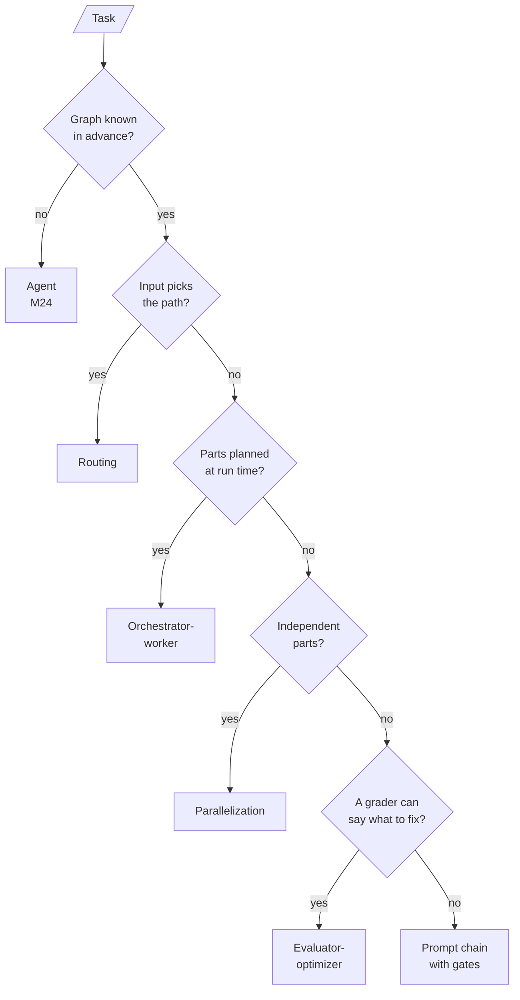

# M25 Theory: Agentic workflow patterns

*Part VIII · Agent Foundations for RAG · [Module README](../../../course/p08_agent_foundations/m25_agentic_workflow_patterns/README.md) · [All theory pages](../../README.md)*

A workflow is a graph you draw before the first token: the LLM fills in the nodes and, at most, picks one of the edges you wrote. Five such graphs cover most of what agentic RAG systems do: prompt chaining, routing, parallelization, orchestrator-worker and evaluator-optimizer. The M25 notebooks build on four ideas: the line between a workflow and an agent, checks between steps, running branches at once and merging them, and loops that always stop. Each idea has a page in the folder of the lesson that teaches it, listed under [Lessons](#lessons). This page has the overview, the interview questions and the takeaways.

The running example is the Larkspur Cloud support assistant from M11 to M13, answering from the same handbook. Its golden question *Can I export my data after I cancel my plan?* needs two evidence chunks, `export` and `retention`, which makes it the natural case for orchestrator-worker decomposition. The notebooks run their own small demos (an email, a story, a joke, a code review), and every number on these pages is one they printed or one the lab computes.

## TL;DR

- In a workflow, code fixes the path through the LLM calls; in an agent (M24), the model picks its next step. Each M25 pattern hands the model one decision at most: a gate's verdict, a route, a vote, a plan's length or a grade.
- A **quality gate** checks an intermediate result before the next step spends tokens on it. In lesson 25.1 a concrete topic passed on attempt 1 (four LLM calls); an abstract one was rejected three times and stopped before drafting (six calls, no email).
- Routing by model tier sent 1 of 7 requests to `o4-mini` and scored 86%, against 71% for all-cheap and 100% for all-reasoning. The router's costly mistake is sending a hard request to the cheap tier.
- A **fan-out** lasts as long as its slowest branch: the 25.3 sections took 7.0 s in parallel against a 13.4 s sum. In the lab a cap of two concurrent branches costs nothing on that workload, until the slowest branch is submitted last.
- Every loop gets a cap in code. LCEL cannot loop at all, so a generate, critique, refine cycle lives in LangGraph, a Python loop or agent middleware, and at `MAX_ITERATIONS = 5` it makes at most ten LLM calls.

## Mental model

Real systems nest these. CRAG (M29) is an evaluator-optimizer around retrieval, adaptive RAG (M30) is a router, and query decomposition (M18) is orchestrator-worker. Read an architecture by asking which of the five each node belongs to, and where the model, rather than your code, makes the call.

## Lessons

| Lesson | Topic | Theory |
|---|---|---|
| 25.1 | Prompt chaining with quality gates | [Workflow vs agent](01_prompt_chaining_with_quality_gates/README.md#workflow-vs-agent) [Quality gates](01_prompt_chaining_with_quality_gates/README.md#quality-gates) |
| 25.2 | Routing by handler and by model tier | [Routing by handler](02_routing_by_handler_and_by_model_tier/README.md#routing-by-handler) [Routing by model tier](02_routing_by_handler_and_by_model_tier/README.md#routing-by-model-tier) |
| 25.3 | Parallelization: sectioning and voting | [Fan-out / fan-in](03_parallelization_sectioning_and_voting/README.md#fan-out--fan-in) [Sectioning and voting](03_parallelization_sectioning_and_voting/README.md#sectioning-and-voting) |
| 25.4 | Orchestrator-worker with the Send API | [Dynamic fan-out with Send](04_orchestrator_worker_with_the_send_api/README.md#dynamic-fan-out-with-send) |
| 25.5 | Evaluator-optimizer loops, always bounded: LangGraph vs LCEL | [Bounded loops](05_evaluator_optimizer_loops_always_bounded_langgraph_vs_lcel/README.md#bounded-loops) [Where LCEL stops](05_evaluator_optimizer_loops_always_bounded_langgraph_vs_lcel/README.md#where-lcel-stops) |

## Interactive lab

[**Fan-out and the concurrency cap**](03_parallelization_sectioning_and_voting/interactive/fan-out-lab.html): open the file in a browser. Keep *Story sections* and drag the cap from 3 to 1 to watch the wall time grow from 10.6 s to 16.9 s. Set it to 2: the wall time goes back to 10.6 s, because the two short branches share one slot. Then pick *Fastest first* at a cap of 2 and see it rise to 12.2 s, because the slowest branch now waits for a slot.

## How it connects

- **Before:** M08 (LCEL) and M09 to M10 (LangGraph state, conditional edges, reducers) supply every primitive these graphs use. M24 builds the agent these workflows are contrasted with. M18 introduces the query decomposition that lesson 25.4 rebuilds as orchestrator-worker.
- **Next:** M26 turns evaluator-optimizer into reflection, where the model also decides what to check. M28 to M30 assemble the patterns into agentic RAG: grading and rewriting, CRAG and Self-RAG, adaptive routing.

## Interview Spotlight: 5 Questions You Might Get Asked

*Production questions of the kind asked in applied AI engineering interviews.*

### 1. Larkspur's reply drafter is an evaluator-optimizer loop. After an evaluator model upgrade, p95 latency triples and cost per ticket doubles, but no request fails. What happened, and what do you change?

**What a strong answer covers:**
- Suspects the loop first: the new evaluator approves less often, so more tickets run to the iteration cap, and the cap returns a draft instead of an error
- Confirms it from logs: drafts per ticket, the share of runs ending at `iteration_cap_reached`, and which criterion fails most
- Fixes the criteria, not the cap: one boolean per criterion, counts and lengths checked in code, and a re-check of the new evaluator on drafts already graded by hand
- Alerts on the cap-hit rate as its own metric, and marks capped answers so they are not sent as approved

### 2. Larkspur routes support questions by model tier. "Can I get a refund after 45 days?" needs proration arithmetic, and the triage step sends it to the cheap tier, which answers it wrong with confidence. Which way should the router err, and how do you prove the router pays for itself?

**What a strong answer covers:**
- Names the asymmetry: over-escalation costs money and shows on a bill; under-escalation returns a wrong answer nobody sees until a customer acts on it
- Biases triage toward `hard` on borderline cases and escalates before answering, since detecting a confident wrong answer afterwards is the hard problem
- Measures routed accuracy and reasoning-call share against all-cheap and all-reasoning baselines on a labelled, honestly mixed set
- Reads the router's own confusion matrix, counting hard-sent-cheap separately, and remembers that triage is one more call on every request

### 3. The assistant fans out to the handbook index, the status page and the account API, then merges. p95 latency is 9 s and nobody knows which branch is slow. How do you find out, and what can you change?

**What a strong answer covers:**
- Times each node as it finishes (`stream_mode="updates"` in LangGraph, or per-run traces), since the fan-in waits for the slowest branch and the mean hides it
- Gives each branch a timeout and a fallback value, so one slow source degrades the answer instead of stalling it
- Checks the concurrency cap against the API rate limits and submits the slowest branch first when a cap applies
- Checks whether the merge step itself dominates: it needs every branch, so no fan-out can shorten it

### 4. You rebuild query decomposition as orchestrator-worker. For "How long does a refund take?" the planner returns five sub-questions, including "Introduction" and "Conclusion". What went wrong, and what guards do you add?

**What a strong answer covers:**
- Spots padding: a prompt with numeric anchors ("simple topics need 2, broad topics 5+") produced five sections for every topic in lesson 25.4
- Rewrites the planner prompt to ask for one item per distinct question and forbids padding sections
- Bounds the plan in code: a maximum number of `Send`s, a direct path for single-part questions, and a defined result for an empty plan
- Checks that workers consume their item, by confirming the set of workers that ran changes with the plan

### 5. A product manager wants to replace the fixed refund workflow with a ReAct agent "so it can handle anything". When do you agree, and what do you keep?

**What a strong answer covers:**
- Keeps a workflow where the steps are known: its calls are countable, each node and router can be unit-tested, and it stops at a known node with a reason
- Uses an agent where the steps depend on what the model finds, such as a multi-step account investigation, and accepts trajectory-level evaluation and a step limit as the bound
- Proposes a hybrid: a router that sends known intents to workflows and only the rest to the agent
- Compares both on the same golden questions for accuracy, LLM calls, p95 latency and the share of runs that hit a limit

## Key Takeaways

- Draw the graph first. If you can, it is a workflow; give the model one decision per node at most, and keep that decision in a closed set your edges cover.
- Put a gate where a bad intermediate result would waste the steps after it, and give every gate a retry count and a terminal "stop with a reason" node.
- Measure a router against both of its baselines, and bias it toward the error that costs money rather than the one that costs correctness.
- Every loop has a cap in code, and hitting the cap is a metric. A fan-out costs its slowest branch, so time branches one by one before tuning any of them.

---
*Previous: [M24 ReAct agents and LangChain create_agent](../m24_react_agents/README.md). Next: [M26 Planning, reflection and reasoning patterns](../m26_planning_reflection_reasoning/README.md).*
