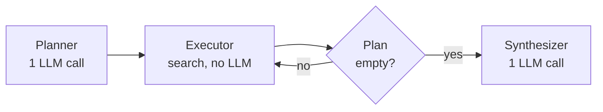
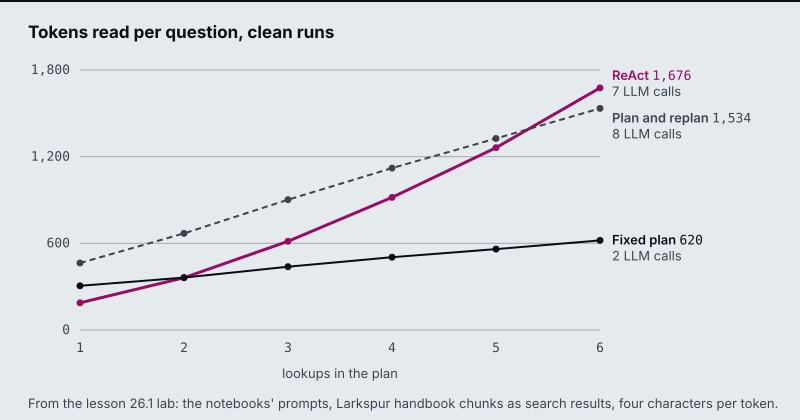
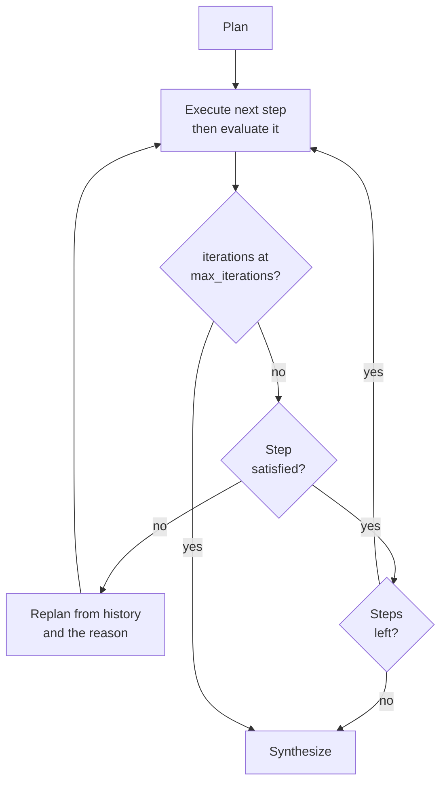

# M26.1 Theory: Plan-and-execute vs ReAct; decompose, execute, replan

*[M26 theory](../README.md) · Lesson 26.1 · Notebooks: [`01a_planning_react_vs_plan.ipynb`](../../../../course/p08_agent_foundations/m26_planning_reflection_reasoning/notebooks/01a_planning_react_vs_plan.ipynb), [`01b_planning_decompose_execute_replan.ipynb`](../../../../course/p08_agent_foundations/m26_planning_reflection_reasoning/notebooks/01b_planning_decompose_execute_replan.ipynb) · [All theory pages](../../../README.md)*

## Plan-and-execute

A ReAct agent loops `agent → tools → agent` and decides each next step after reading the last result. A plan-and-execute agent decides all the steps first. Notebook 01a builds it as three nodes:

| Node | What it does | LLM calls |
|---|---|---|
| Planner | One structured-output call returns `Plan.steps`, a list of search queries, one fact each | 1 |
| Executor | Pops the next query and runs the search tool | 0 |
| Synthesizer | Reads every collected result and writes the answer, including any arithmetic | 1 |

One pure router drives the loop: after planning and after every execution it asks whether the plan is empty. Because each step is a plain query, the executor needs no LLM, so the agent makes 2 LLM calls whatever the plan's length. ReAct makes one call per search plus one to answer, and each call re-reads the whole conversation, every earlier result included.

The notebook also shows what ReAct's adaptivity costs in reliability. On its three-capitals task, the ReAct agent stopped after the capitals in 4 of 4 runs, writing *"Next, I will find the current population of the United States"* as text instead of a tool call. `tools_condition` ends the loop on any turn without a tool call, so the promised search never ran. ReAct keeps its to-do list in the model's head; the planner wrote the missing lookup into its plan before the first search.

The [interactive lab](interactive/plan-or-react-lab.html) runs the same comparison on the Larkspur cancellation question, with the notebooks' own prompts and handbook chunks as search results. On clean runs, with no wrong results:

| Lookups | ReAct calls | ReAct tokens | Fixed plan calls | Fixed plan tokens |
|---|---|---|---|---|
| 2 | 3 | ~362 | 2 | ~363 |
| 4 | 5 | ~918 | 2 | ~504 |
| 6 | 7 | ~1,676 | 2 | ~620 |

At two lookups the two agents read about the same; at six, ReAct reads 2.7 times as much, because its prompt grows with every result and it pays for that prompt on every call. Wall time is a different matter: in notebook 01a the searches dominate it and the executor runs them one after another, so it can go either way from run to run.

Use a plan when the steps are knowable from the question, as in "find these four facts and compare them". Use ReAct when the next step depends on what the last one found, as in troubleshooting. The plan's weakness is the reverse of its strength: it was fixed before the first search, and nothing in the graph checks a result.

## Replanning

Notebook 01b treats the plan as a living document. After every step an evaluator asks one structured question, `StepEvaluation.satisfied`: *does this result state the fact the step asks for, about the right entity?* The verdict and a one-sentence `reason` go into state, and pure routers read them:

Three rules make the loop safe:

- **Replanning is not retrying.** The replanner sees the goal, the history of OK and INSUFFICIENT steps and the reason the last one failed, and writes a new list of remaining steps. It is told never to resubmit a failed step unchanged.
- **Only accepted results reach the answer.** The synthesizer gets the satisfied results as data and is told to say a fact could not be found rather than fill it in from memory.
- **A cap ends the loop.** `max_iterations` counts executed steps. The router checks it before the verdict, so a run at the cap goes straight to the synthesizer.

In the notebook, a stub search returns the U.S. state of Georgia for a question about the country. The evaluator marks the step INSUFFICIENT, the replanner rewrites the query, and the next result is accepted. A fixed plan would have popped the step and written the state's 11 million into the country's row. A dead search tool, which never finds anything, runs until the cap and returns an honest "not found".

The lab adds a wrong first result to the Larkspur question: the search for the refund rule returns the `refund-timing` chunk. With four lookups:

| Agent | LLM calls | Searches | Tokens read | Answer |
|---|---|---|---|---|
| ReAct, at its best | 6 | 5 | ~1,211 | Complete |
| Fixed plan | 2 | 4 | ~500 | One wrong fact |
| Plan and replan | 8 | 5 | ~1,582 | Complete |

The replanner's bill follows from its graph: 1 planner call, 1 evaluator call per executed step, 1 replanner call per rejected step and 1 synthesizer call, so N + 2 + 2f calls for N lookups and f wrong results under the cap. On a clean run that is N + 2, one more than ReAct, and the extra machinery changes nothing. The evaluator is the bottleneck: too lenient and wrong data slips through, too strict and the agent replans good results.

The cap needs the same arithmetic. Six lookups with one wrong result need 7 executed steps. At the notebook's `max_iterations = 6`, the lab's run stops with one lookup unanswered after 9 LLM calls; at 7 it completes in 10. ReAct has its own ceiling: notebook 01a runs it with `recursion_limit = 20` graph steps, and each search costs two (an agent turn and the tool). Six lookups with four wrong results need 10 searches and 21 steps, so LangGraph raises `GraphRecursionError` and the user gets no answer.

<!-- lab: interactive/plan-or-react-lab.html -->

The lab's models are scripted, so its numbers are exact for these prompts and chunks but not for a live model: a real ReAct agent may stop early, as in notebook 01a, and a real replanner may need more than one rewrite. Its numbers match the notebooks' own node and router code run under LangGraph with the same scripted models on all 1,764 settings.

## Key Takeaways

- Use a plan when the steps are knowable from the question and ReAct when each step depends on the last result. ReAct can promise a search in text and stop; a plan writes every lookup down.
- A fixed plan never checks a result, so a wrong search lands in the answer. Replanning evaluates each step and rewrites the remaining steps from the failure reason instead of retrying unchanged.
- Size caps from the call arithmetic: N + 2 + 2f calls for N lookups and f wrong results. The evaluator decides quality, since too lenient lets wrong data through and too strict replans good results.

## Check yourself

1. Why does the plan-and-execute agent make two LLM calls whatever the length of its plan?

The planner writes every step as a plain search query in one structured-output call, the executor runs each query with no LLM, and the synthesizer makes the one call that writes the answer. ReAct makes one call per search plus one to answer, and each call re-reads the whole conversation.

2. On clean runs with six lookups, how many tokens does ReAct read compared with the fixed plan, and why the gap?

About 1,676 against about 620, 2.7 times as much. ReAct's prompt grows with every result and it pays for that prompt on every call. At two lookups the two read about the same (about 362 and 363).

3. A replanning run with six lookups and one wrong result stops with one lookup unanswered. What caused it, and what fixes it?

The cap: `max_iterations = 6` counts executed steps, and six lookups with one wrong result need 7. The run stops after 9 LLM calls; at 7 it completes in 10. Size the cap from N + 2 + 2f calls for N lookups and f wrong results.

---
*Previous: [M26 overview](../README.md). Next: [26.4 Chain-of-verification and constitutional critique](../04_chain_of_verification_and_constitutional_critique/README.md).*
