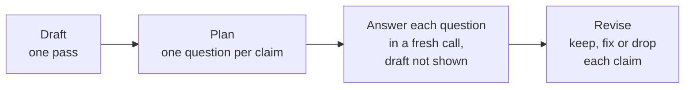

# M26.4 Theory: Chain-of-verification and constitutional critique

*[M26 theory](../README.md) · Lesson 26.4 · Notebooks: [`04a_chain_of_verification.ipynb`](../../../../course/p08_agent_foundations/m26_planning_reflection_reasoning/notebooks/04a_chain_of_verification.ipynb), [`04b_constitutional_ai_critique_loop.ipynb`](../../../../course/p08_agent_foundations/m26_planning_reflection_reasoning/optional/04b_constitutional_ai_critique_loop.ipynb) (optional) · [All theory pages](../../../README.md)*

## Chain-of-verification

Reflection (lesson 26.3) asks the model to re-read its own answer. If the model did not know a fact was wrong the first time, re-reading rarely shows it: the draft sits in the prompt and the model agrees with itself. Chain-of-verification (CoVe; Dhuliawala et al., 2023) checks claims in calls that cannot see the draft.

<!-- animated: diagrams/cove.anim.html -->

Notebook 04a runs the four steps with structured output at each one:

1. **Draft.** Answer in one pass. The notebook asks for 8 U.S. presidents born in Ohio when only 7 exist, so the model has to pad the list.
2. **Plan.** `VerificationPlan.questions` holds one atomic, self-contained question per claim. Say what to verify: a prompt that only asked for "one question per factual claim" produced *"Who was the 18th President?"*, which checks a claim nobody doubted. Tying each question to the property the user asked about ("born in Ohio" becomes "Where was X born?") fixed it.
3. **Verify.** Each question goes to its own call with no draft, no other questions and no earlier answers. The calls are independent, so the notebook runs them as one `batch`.
4. **Revise.** Only now does the model see the draft next to every (question, independent answer) pair. It returns `final_items` and `corrections_made`, and code scores both lists against the ground truth.

The notebook's findings set the limits:

- **It raises precision, not recall.** CoVe checks the claims that were made. A president the draft left out is still missing after revision.
- **The reviser can add errors.** In one run it removed Rutherford B. Hayes, whose verified birthplace is "Delaware, Ohio", apparently reading Delaware as the state. Its own `corrections_made` called that a fix; only the scoring in code exposed it.
- **It is bounded by what the verifier knows.** If the model answers the narrow question wrongly too, CoVe agrees with the draft.
- **It costs 1 + 1 + N + 1 calls** for N claims, against 1 for the draft alone.
- **It must leave a correct answer alone.** The notebook's second run asks for 5 presidents born in Virginia, where 8 exist and the draft is usually right.

In a RAG system the third limit is the one to remove: answer each verification question from retrieved chunks, not from the model's memory. That is the M26 lab brief, applied here to a hand-written Larkspur example. A customer cancels an annual plan 20 days after buying it, and the draft answer makes three claims:

| Draft claim | Verification question | What the retrieved chunk says | Verdict |
|---|---|---|---|
| You get a full refund, because you are within 30 days | What are the conditions for a full refund on a Larkspur annual plan? | `refund-window`: within 30 days, if the account used less than 100 GB of outbound traffic | Fix |
| The refund appears in 5 to 10 business days | How long does a Larkspur refund take to appear? | `refund-timing`: 5 to 10 business days | Keep |
| Your data is kept for 90 days after cancelling | How long is data kept after a Larkspur plan is cancelled? | `retention`: 30 days, then permanently deleted | Fix |

The revised answer adds the traffic condition to the first claim and changes 90 days to 30 in the third. Each verification question is self-contained ("a Larkspur annual plan", not "the plan"), so retrieval for it works without the draft, and each correction traces to one question and one chunk. To measure it on a golden set, count claims per answer that no retrieved chunk supports, before and after, and count the correct claims the reviser removed as a separate number. A drop in the first with a rise in the second is the Hayes failure at scale.

The optional notebook 04b runs the same draft, critique and revise loop against a written constitution: each named rule gets its own structured verdict (`rule`, `passes`, `critique`), only the failing rules go back to the reviser, and `MAX_ITERATIONS` bounds the loop. The notebook labels it a teaching pattern, not a safety system.

## Check yourself

1. Why does chain-of-verification answer each verification question in a call that cannot see the draft?

If the model did not know a fact was wrong the first time, re-reading rarely shows it: with the draft in the prompt, the model agrees with itself. A fresh call with no draft, no other questions and no earlier answers checks each claim on its own.

2. A customer cancels an annual plan 20 days after buying it, and the draft promises a full refund and 90 days of data retention. What does the revised answer change?

It adds the condition from the `refund-window` chunk: a full refund within 30 days only if the account used less than 100 GB of outbound traffic. It changes 90 days to 30, then permanent deletion, from the `retention` chunk. The claim that the refund appears in 5 to 10 business days is kept.

3. After adding verification, unsupported claims per answer fall, but the count of correct claims removed rises. What is happening?

The reviser is adding errors, as when it removed Rutherford B. Hayes, whose verified birthplace was "Delaware, Ohio", and its own `corrections_made` called that a fix. Only scoring in code against the ground truth exposes it, which is why the removed correct claims are counted as a separate number.

---
*Previous: [26.1 Plan-and-execute vs ReAct; decompose, execute, replan](../01_plan_and_execute_vs_react_decompose_execute_replan/README.md). Next: [26.6 Self-consistency, tree of thoughts and LATS](../06_self_consistency_tree_of_thoughts_and_lats/README.md).*
